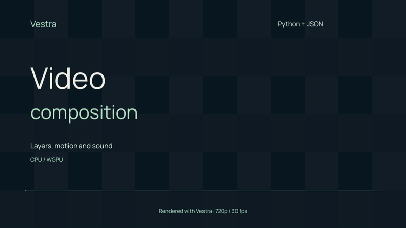

# Vestra

Vestra is a video composition and rendering engine. You describe a video as a
project — layers, sources, keyframes, effects, audio — and Vestra renders it to
MP4 through a native Rust engine, on the CPU or GPU (WGPU). It ships as a
Python library, with a canonical JSON format and a `ve` CLI built from source.



[Full demo](https://github.com/evgen2571/vestra/blob/main/examples/showcase/readme-demo/render.mp4)
· [Python source](https://github.com/evgen2571/vestra/blob/main/examples/showcase/readme-demo/main.py)
· [Asset credits](https://github.com/evgen2571/vestra/blob/main/examples/showcase/ASSETS.md)

## Quick start

Requires Python 3.11–3.14. Rendering needs `ffmpeg` and `ffprobe` on `PATH`
(see [installation](https://github.com/evgen2571/vestra/blob/main/docs/getting-started/installation.md)).

```bash
pip install vestra   # or: uv add vestra
```

```python
from vestra import Project
from vestra.sources import Color, Rectangle

project = Project(size=(640, 360), fps=30, duration=2)
project.root.add(Color("#171d20"))

bar = project.root.add(Rectangle(width=240, height=8, fill="#a9c4aa"))
bar.transform.scale.keyframe(0, (0.05, 1))
bar.transform.scale.keyframe(2, (1, 1))

project.render("output.mp4", overwrite=True)
```

## What you can build

- **Video edits** — images, video, shapes and text on a timeline, with nested
  compositions, masks, track mattes, blend modes and transitions.
- **Motion graphics** — keyframed transforms and properties, flashes,
  timeline presets, particles and animated effects.
- **Audio-reactive visuals** — master-audio spectrum displays and signals that
  drive any scalar property, plus a real audio mix (fades, gain automation,
  EQ and playback-rate effects) in the same render.
- **Stylized looks** — ASCII, palette mapping, ordered and blue-noise dither,
  halftone, pixel sorting and CRT effects, on clips or the whole frame.

See [the rendered showcases](https://github.com/evgen2571/vestra/blob/main/examples/showcase/README.md)
and [reference examples](https://github.com/evgen2571/vestra/blob/main/examples/README.md).

## Design and limits

Projects compile to a versioned canonical model validated before rendering,
so timing and layering errors are reported up front, with locations —
`ve validate` and `project.validate()` check semantics; `ve inspect` and
`prepare()` check media and backends. CPU and GPU share one evaluated plan.

- Output is MP4 (H.264 + AAC) up to 8192×8192; even dimensions are required.
- Rendering shells out to `ffmpeg`/`ffprobe` at runtime; wheels only bundle
  the FFmpeg libraries used internally for decoding.
- `auto` uses WGPU when a usable adapter is found and falls back to CPU;
  `cpu` and `wgpu` force a renderer. WGPU coverage per feature is in the
  [feature matrix](https://github.com/evgen2571/vestra/blob/main/docs/reference/feature-support.md).
- The Python wheel does not install the `ve` CLI — build it with
  `cargo build -p vestra-cli` ([JSON authoring](https://github.com/evgen2571/vestra/blob/main/docs/guides/json-authoring.md)).
- Python text uses a bundled default, an installed font family, or an explicit font file.

Vestra is a rendering engine, not a live editor: it renders a finished project
to a file rather than streaming interactive previews. If you need a timeline
UI, a Node/browser stack, or a wide codec/container range, look at Remotion,
Motion Canvas or MoviePy instead.

## Documentation

[Installation](https://github.com/evgen2571/vestra/blob/main/docs/getting-started/installation.md)
· [Python quickstart](https://github.com/evgen2571/vestra/blob/main/docs/getting-started/python-quickstart.md)
· [CLI quickstart](https://github.com/evgen2571/vestra/blob/main/docs/getting-started/cli-quickstart.md)
· [Docs index](https://github.com/evgen2571/vestra/blob/main/docs/index.md)
· [Python API](https://github.com/evgen2571/vestra/blob/main/docs/reference/python-api.md)
· [Contributing](https://github.com/evgen2571/vestra/blob/main/CONTRIBUTING.md)

Vestra 0.1.x: the Python API may still change between minor versions; the JSON
schema and diagnostic codes are stable contracts.

## Building and contributing

Vestra uses Cargo to build the Rust engine and CLI, and Maturin to build
the Python bindings. uv manages the Python environment; the Justfile
provides common build and test commands.

### With Nix (Linux and macOS)

The Nix development shell supplies Rust, Python, uv, Just, and the native
build dependencies, including NASM, libclang, and FFmpeg.

With [Nix installed](https://nix.dev/install-nix) and
[flakes enabled](https://nix.dev/manual/nix/stable/command-ref/conf-file.html#conf-experimental-features), clone
the development branch and enter the shell:

```bash
git clone --branch develop https://github.com/evgen2571/vestra.git
cd vestra
nix develop
```

Inside the development shell, build the editable Python package:

```bash
just python-sync
uv run python -c "import vestra; print(vestra.__version__)"
```

To build and run the separate CLI:

```bash
cargo build -p vestra-cli
cargo run -q -p vestra-cli -- version
```

### Without Nix

Install these dependencies before running `uv sync`:

- Rust toolchain, including rustfmt and Clippy.
- Python 3.11–3.14.
- uv for the Python environment and package build.
- Just for the repository's build and test commands.
- A C compiler and `make` to build bundled FFmpeg.
- libclang for native bindings, and `pkg-config` for library discovery.
- Git to fetch the source code.
- **NASM** for FFmpeg's x86 assembly.
- FFmpeg runtime: `ffmpeg` and `ffprobe` on `PATH` for rendering.

See [native setup instructions](docs/getting-started/installation.md#without-nix)
for the prerequisites and build commands, including an Ubuntu/Debian example.

### Checking your changes

Run `just check` for the Rust, schema, generation, and documentation checks,
and `just python-test` for Python tests. Run `just` to list available commands.

See [CONTRIBUTING.md](CONTRIBUTING.md) for the contribution workflow and
[testing](docs/development/testing.md) for focused checks.
Agents start with [AGENTS.md](AGENTS.md); benchmarks live in
[benchmarks](benchmarks/README.md) with a
[MoviePy comparison](https://github.com/evgen2571/vestra/blob/main/docs/benchmarks/vestra-vs-moviepy.md).

## License

[MIT](LICENSE). Third-party software and example assets keep their own
licenses — see [THIRD_PARTY_NOTICES.md](THIRD_PARTY_NOTICES.md) and
[asset credits](https://github.com/evgen2571/vestra/blob/main/examples/showcase/ASSETS.md).
