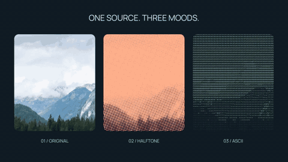
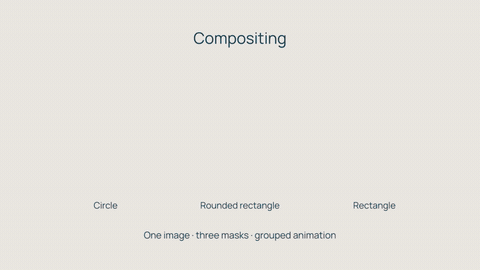
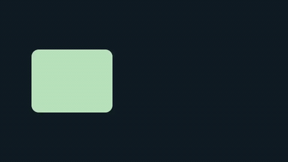

<p align="center">
  <picture>
    <source media="(prefers-color-scheme: dark)" srcset="docs/assets/brand/vestra-dark.svg">
    
  </picture>
</p>

<h1 align="center">Video, composed in code.</h1>

<p align="center">
  Motion graphics. Layered edits. Visuals that move with music.<br>
  <strong>A Python API. A native Rust engine. Your next video.</strong>
</p>

<p align="center">
  <a href="https://pypi.org/project/vestra/"></a>
  <a href="docs/getting-started/installation.md"></a>
  <a href="LICENSE"></a>
</p>

<p align="center">
  <a href="#try-it"><strong>Get started</strong></a> &nbsp; · &nbsp;
  <a href="docs/index.md"><strong>Read the docs</strong></a> &nbsp; · &nbsp;
  <a href="examples/showcase/README.md"><strong>Explore the gallery</strong></a>
</p>

<p align="center">
  <a href="examples/showcase/readme-demo/render.mp4">
    
  </a>
</p>

<p align="center">
  <sub>Made with Vestra, right down to the typography.</sub><br>
  <a href="examples/showcase/readme-demo/render.mp4">Watch the film</a> ·
  <a href="examples/showcase/readme-demo/main.py">View the Python</a> ·
  <a href="examples/showcase/ASSETS.md">Credits</a>
</p>

Vestra turns a timeline of layers, keyframes, effects and audio into an MP4.
Render with the native **CPU** or **WGPU** backend, and keep your composition
in Python or export it to canonical **JSON**. Build a reusable video template,
a music visualizer or a whole series of edits from the same code.

<h2 align="center">A few things you can make</h2>

<table>
  <tr>
    <td width="50%" align="center" valign="top">
      <h3>City after dark</h3>
      <a href="examples/showcase/real-media-edit/render.mp4"></a>
      <p>Real footage. Animated framing. Seamless dissolves.</p>
      <p><a href="examples/showcase/real-media-edit/render.mp4">Watch</a> · <a href="examples/showcase/real-media-edit/main.py">Python source</a></p>
    </td>
    <td width="50%" align="center" valign="top">
      <h3>One source. Three moods.</h3>
      <a href="examples/showcase/lookbook/render.mp4"></a>
      <p>One photograph, reimagined with halftone and ASCII.</p>
      <p><a href="examples/showcase/lookbook/render.mp4">Watch</a> · <a href="examples/showcase/lookbook/main.py">Python source</a></p>
    </td>
  </tr>
  <tr>
    <td width="50%" align="center" valign="top">
      <h3>Sound into shape</h3>
      <a href="examples/showcase/audio-visualizer/render.mp4"></a>
      <p>Audio signals drive spectra, geometry and particles.</p>
      <p><a href="examples/showcase/audio-visualizer/render.mp4">Watch with sound</a> · <a href="examples/showcase/audio-visualizer/main.py">Python source</a></p>
    </td>
    <td width="50%" align="center" valign="top">
      <h3>Cut. Layer. Compose.</h3>
      <a href="examples/showcase/compositing/render.mp4"></a>
      <p>Masks, nested compositions and coordinated motion.</p>
      <p><a href="examples/showcase/compositing/render.mp4">Watch</a> · <a href="examples/showcase/compositing/main.py">Python source</a></p>
    </td>
  </tr>
</table>

<p align="center">
  <sub>Actual Vestra CPU renders. Silent GIF previews; full MP4s and reproducible source linked above.</sub><br>
  <a href="examples/README.md">More examples</a> · <a href="docs/reference/feature-support.md">Feature support</a> · <a href="examples/showcase/ASSETS.md">Asset credits &amp; licenses</a>
</p>

## Try it


Python **3.11–3.14**, plus **`ffmpeg` and `ffprobe`** on your `PATH`.
[Installation and platform details →](docs/getting-started/installation.md)

```bash
python -m pip install vestra
```

Save as `quickstart.py`, then run `python quickstart.py`. No assets or fonts needed.

```python
from vestra import Interpolation, Project
from vestra.sources import Color, Rectangle

project = Project(size=(640, 360), fps=30, duration=3)
project.root.add(Color("#101c24"))
ease = Interpolation.EASE_IN_OUT

for index, colour in enumerate(("#527e79", "#b8e3bc", "#f1efe5")):
    card = project.root.add(
        Rectangle(width=140, height=180, corner_radius=16, fill=colour)
    )
    card.transform.position = (0.35 + index * 0.15, 0.5)
    angle = (index - 1) * 25
    card.transform.rotation_degrees.keyframe(0, angle)
    card.transform.rotation_degrees.keyframe(1.5, -angle, interpolation=ease)
    card.transform.rotation_degrees.keyframe(3, angle, interpolation=ease)

project.render("quickstart.mp4", backend="cpu", overwrite=True)
```

<p align="center">
  <a href="examples/showcase/quickstart/render.mp4"></a><br>
  <sub>Your first render. No external assets. Just Python.</sub>
</p>

**That's the complete scene.** The result is a three-second, 640×360 MP4.
Positions use normalized canvas coordinates; keyframe times are in seconds.
[Continue the tutorial →](docs/getting-started/python-quickstart.md)

## Vestra and MoviePy

Choose Vestra when you want keyframed layers, reusable compositions and built-in
visual effects in a declarative project. [MoviePy](https://zulko.github.io/moviepy/)
is a mature choice for general video editing and custom Python/NumPy frame processing.
Vestra is younger (0.1.x), with an evolving Python API and a narrower export scope.

| | Vestra | MoviePy v2 |
| :--- | :--- | :--- |
| Compose | Layers, property keyframes, nested timelines; export a canonical JSON project | Python clip objects, composition and time-dependent functions |
| Customize | Built-in effects, masks, particles and audio-signal bindings | Clip effects and custom Python/NumPy frame functions |
| Render | Native Rust CPU renderer or WGPU backend | Python/NumPy frame processing with FFmpeg I/O |
| Export | MP4 with H.264 video and AAC audio | Broader FFmpeg codec/container options, plus GIF and image sequences |

Speed depends on the scene, resolution and hardware. Our
[MoviePy benchmark report](docs/benchmarks/vestra-vs-moviepy.md) includes matched
workloads, hardware details and memory use, including cases where Vestra's GPU
backend is slower than its CPU backend. There is no universal speedup claim.

<details>
<summary><strong>Current limits &amp; practical details</strong></summary>

Vestra is **0.1.x**; the Python API may change between minor versions. Rendering
produces a file; there is no timeline UI. Output is MP4 (H.264 + AAC), with even
canvas dimensions up to 8192×8192. Text needs an explicit font file.

`auto` selects WGPU when a usable adapter is available and otherwise falls back
to CPU. GPU rendering does not imply hardware video encoding. FFmpeg and ffprobe
must be on `PATH`, including for wheel installs. The `ve` CLI is built separately
from source.

See the [feature matrix](docs/reference/feature-support.md),
[backend guide](docs/reference/backends.md) and [installation guide](docs/getting-started/installation.md).

</details>

<p align="center">
  <br>
  <strong>Make the next frame yours.</strong><br>
  <a href="docs/getting-started/python-quickstart.md">Python tutorial</a> ·
  <a href="docs/getting-started/cli-quickstart.md">JSON / CLI</a> ·
  <a href="docs/reference/python-api.md">API reference</a> ·
  <a href="CONTRIBUTING.md">Contribute</a> ·
  <a href="https://github.com/evgen2571/vestra/issues">Report an issue</a>
</p>

<p align="center">
  <sub><a href="LICENSE">MIT licensed</a> · Third-party software and demo assets retain their own licenses.<br>
  <a href="THIRD_PARTY_NOTICES.md">Software notices</a> · <a href="examples/showcase/ASSETS.md">Asset credits</a></sub>
</p>
