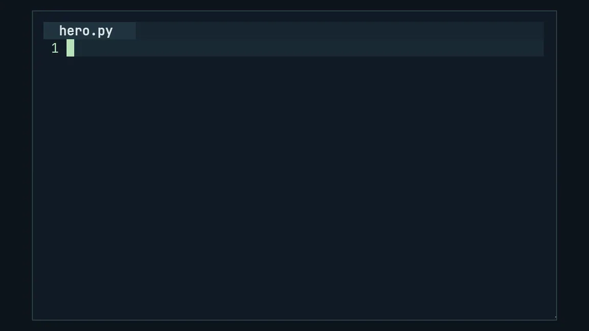

<h1 align="center">Vestra</h1>

<p align="center">A Rust engine for layer-based video composition and rendering, with a Python API.</p>

<p align="center">
  <a href="https://pypi.org/project/vestra/"></a>
  <a href="LICENSE"></a>
  <a href="https://github.com/evgen2571/vestra/actions/workflows/ci.yml"></a>
</p>

<p align="center">
  
</p>

<p align="center">
  <a href="docs/assets/hero/reel.mp4">Full video</a> ·
  <a href="examples/showcase/readme-hero/main.py">Demo source</a> ·
  <a href="https://github.com/evgen2571/vestra/blob/develop/docs/index.md">Documentation</a>
</p>

## Quick start

In a Python project with CPython 3.11–3.14, install Vestra with uv.
See the [installation guide](https://github.com/evgen2571/vestra/blob/main/docs/getting-started/installation.md)
for pip and supported platforms.

```bash
uv add vestra
```

Save the moving-tile example from the hero as `example.py`.

```python
from vestra import Interpolation, Project, Rectangle

project = Project(
    size=(960, 540),
    fps=30,
    duration=2,
    background="#101c24",
)
track = Rectangle(width=640, height=6, fill="#36545b")
project.root.add(track)

tile = project.root.add(
    Rectangle(
        width=200,
        height=120,
        corner_radius=20,
        fill="#b8e3bc",
    )
)

move = tile.transform.position
ease = Interpolation.EASE_IN_OUT
move.keyframe(0, (0.25, 0.5))
move.keyframe(1, (0.75, 0.5), interpolation=ease)

project.render("out.mp4", backend="cpu")
```

```bash
uv run python example.py
```

This writes a two-second animation to `out.mp4` in the current directory.

## Why

While planning another project, I needed a way to create videos programmatically.
I first looked at MoviePy, but I would have had to implement quite a lot myself,
particularly for more complex compositions.

I also tried MLT and OpenShot, but found them difficult to work with. Remotion
looked interesting, but I didn't really want to work with Node.js. After almost
two months of looking for alternatives alongside other work, I decided to write
my own video engine.

At that point, my only experience with video editing was a few months of using
After Effects and Premiere Pro, so I based much of Vestra's design on what I was
familiar with.

I can now use Vestra for the project I originally wanted to build.

## Features

- [Groups and nested compositions](docs/guides/python/nested-compositions.md)
- [Keyframes and easing](docs/guides/python/animation.md)
- [Masks and track mattes](docs/guides/python/masks.md)
- [Blend modes](docs/benchmarks/workloads.md#blend_modes) and [transitions](docs/guides/python/transitions-flashes-and-presets.md)
- [Visual effects](docs/guides/python/effects.md)
- [Audio-reactive animation](docs/guides/python/signals-and-audio-reactivity.md)
- [Export MP4, GIF, animated WebP, and still images](docs/reference/render-outputs.md#formats)
- [Convert rendered frames to NumPy arrays](docs/guides/python/rendering-and-preparation.md#use-frames-with-numpy)
- [Render videos from JSON with the CLI](docs/getting-started/cli-quickstart.md)

## Comparison with MoviePy

| Tool | When to use it |
| --- | --- |
| Vestra | Build a layered composition with keyframes and masks, or reuse an animated layout with different footage and text. |
| MoviePy | Trim and join clips in a Python script, or process each frame with a custom Python function. |

See the [render benchmarks](docs/benchmarks/vestra-vs-moviepy.md) for measured
render times, workloads, and hardware.

## AI use disclaimer

I use LLMs extensively while building Vestra. I decide what goes into the
project, spend time reviewing and improving the code, and take responsibility
for what ships.

I'm still learning the conventions of rendering engines and compiler tooling.
If you find something hard to follow or maintain, I'd appreciate a concrete
example. That helps me understand the problem and improve the code.

## Contributing

See the [contribution guide](CONTRIBUTING.md) for reporting issues and submitting
changes. The development docs cover [building from source](docs/development/source-builds.md)
and [running checks](docs/development/testing.md).

## License

Vestra is released under the [MIT License](LICENSE). See the
[third-party notices](THIRD_PARTY_NOTICES.md) and
[hero video credits](examples/showcase/readme-hero/README.md#credits) for
third-party software and assets.
