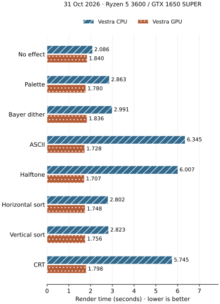

# Vestra and MoviePy benchmarks

Measured on 10 November 2026 using a Ryzen 5 3600 and GTX 1650 SUPER with Vulkan. All short outputs use 1920 × 1080 at 60 fps.

<!-- Chart context: 10 Nov 2026 · 1920 × 1080 · 60 fps -->

[Benchmark overview](index.md) · [Workload previews](workloads.md) · [Run benchmarks](collecting.md)

## Matched editing workloads

All three timelines use 1920 × 1080 at 60 fps, silent H.264/yuv420p, libx264 CRF 23 / veryfast. Basic and layered last 10 seconds (600 frames); editing lasts 12 seconds (720 frames). Each engine has one warmup and three measured samples. Times include the complete worker process: startup, project construction, decoding, rendering, encoding and publication. Lower is better.

<figure class="comparison" markdown="span">

</figure>

| Timeline | MoviePy CPU | Vestra CPU | Vestra hardware GPU |
| --- | ---: | ---: | ---: |
| Basic export | 14.018 s | 14.156 s | 8.649 s |
| Three-shot edit | 122.797 s | 29.672 s | 11.680 s |
| Layered composition | 68.349 s | 32.616 s | 13.038 s |

<details markdown="1">
<summary>Effective FPS, ratios and sampled process memory</summary>

Ratios divide each Vestra median by the MoviePy median; below 1 means less wall time.

| Scenario | MoviePy CPU wall s | Vestra CPU wall s | CPU ratio | Vestra WGPU wall s | WGPU ratio | MoviePy FPS | Vestra CPU FPS | Vestra WGPU FPS | MoviePy RSS MiB | Vestra CPU RSS MiB | WGPU RSS MiB |
| --- | ---: | ---: | ---: | ---: | ---: | ---: | ---: | ---: | ---: | ---: | ---: |
| basic | 14.018 | 14.156 | 1.01x | 8.649 | 0.62x | 42.80 | 42.38 | 69.38 | 991.0 | 1453.6 | 1227.4 |
| editing | 122.797 | 29.672 | 0.24x | 11.680 | 0.10x | 5.86 | 24.26 | 61.65 | 1965.5 | 2128.2 | 1336.2 |
| layered | 68.349 | 32.616 | 0.48x | 13.038 | 0.19x | 8.78 | 18.40 | 46.02 | 1745.4 | 2370.1 | 1316.1 |

Effective FPS is recalculated from the validated output frame count and each measured worker wall time. The captured runner still used a fixed 30 fps in its derived FPS field; its calculation has since been corrected. Render timings and output frame counts are unchanged.

</details>

### Sample ranges

| Timeline | MoviePy CPU range | Vestra CPU range | Hardware GPU range |
| --- | ---: | ---: | ---: |
| Basic export | 13.826–14.055 s | 13.785–14.868 s | 8.492–8.835 s |
| Three-shot edit | 122.670–123.568 s | 29.401–29.957 s | 11.482–11.763 s |
| Layered composition | 67.097–69.523 s | 32.343–32.897 s | 13.021–13.221 s |

All published streams passed structural checks and full decode. Independent source-reference and cross-engine checks passed 135 sampled frame/region comparisons, including the frames surrounding fades, placement starts and placement ends. Reduced RGB error is bounded by the maintained verifier tolerance; encoded outputs need not be pixel-identical.

## Native rendering and effect controls

Every output uses 1920 × 1080 at 60 fps and the high quality tier (libx264 CRF 18 / medium). Canonical workloads use one warmup and five samples; the complete effects/control suite uses one warmup and three. The wall interval includes loading, preparation, rendering, encoding and publication. This scope differs from the process-based MoviePy table above.

Native video timelines and effect controls use prepared lossless FFV1 inputs; the two row-copy controls use H.264. The matched editing comparisons above use H.264 inputs and a different output preset. Compare the CPU/GPU pair within each row.

The effect chart shows three-second outputs (180 frames). Other scenario durations remain defined by their scenes; the production edit is twelve seconds (720 frames). These are Vestra CPU versus Vestra hardware-GPU measurements.

<figure class="comparison" markdown="span">

</figure>

<details markdown="1">
<summary>All 30 native workload medians and ranges</summary>

| Suite | Scenario | Resolution | CPU wall s | CPU FPS | WGPU wall s | WGPU FPS | WGPU/CPU |
| --- | --- | ---: | ---: | ---: | ---: | ---: | ---: |
| canonical | single_video | 1920×1080 | 12.263 | 14.68 | 9.214 | 19.54 | 0.75x |
| canonical | mixed_dynamic | 1920×1080 | 22.065 | 8.16 | 13.033 | 13.81 | 0.59x |
| canonical | video_heavy | 1920×1080 | 41.835 | 4.30 | 375.164 | 0.48 | 8.97x |
| canonical | combined | 1920×1080 | 24.863 | 14.48 | 4.327 | 83.20 | 0.17x |
| canonical | masks | 1920×1080 | 0.751 | 79.89 | 0.884 | 67.87 | 1.18x |
| canonical | mattes | 1920×1080 | 0.682 | 87.98 | 0.990 | 60.61 | 1.45x |
| canonical | nested_groups | 1920×1080 | 7.810 | 23.05 | 2.385 | 75.47 | 0.31x |
| canonical | particles | 1920×1080 | 1.013 | 59.23 | 1.077 | 55.71 | 1.06x |
| canonical | blend_modes | 1920×1080 | 2.386 | 125.73 | 2.239 | 133.99 | 0.94x |
| canonical | production_edit | 1920×1080 | 70.010 | 10.28 | 45.893 | 15.69 | 0.66x |
| effects | opaque_video | 1920×1080 | 12.748 | 47.07 | 11.186 | 53.64 | 0.88x |
| effects | ineligible_video | 1920×1080 | 25.185 | 23.82 | 10.812 | 55.49 | 0.43x |
| effects | stylization_baseline | 1920×1080 | 13.682 | 13.16 | 10.838 | 16.61 | 0.79x |
| effects | palette_video | 1920×1080 | 16.612 | 10.84 | 11.306 | 15.92 | 0.68x |
| effects | oklab_palette_video | 1920×1080 | 21.258 | 8.47 | 11.972 | 15.04 | 0.56x |
| effects | dither_video | 1920×1080 | 17.576 | 10.24 | 11.922 | 15.10 | 0.68x |
| effects | blue_noise_video | 1920×1080 | 17.133 | 10.51 | 11.625 | 15.48 | 0.68x |
| effects | rgb_dither_video | 1920×1080 | 20.849 | 8.63 | 12.510 | 14.39 | 0.60x |
| effects | hue_dither_video | 1920×1080 | 20.414 | 8.82 | 12.179 | 14.78 | 0.60x |
| effects | channel_dither_video | 1920×1080 | 18.427 | 9.77 | 11.264 | 15.98 | 0.61x |
| effects | oklab_dither_video | 1920×1080 | 22.638 | 7.95 | 12.481 | 14.42 | 0.55x |
| effects | nonuniform_dither_video | 1920×1080 | 16.286 | 11.05 | 11.383 | 15.81 | 0.70x |
| effects | tone_dither_video | 1920×1080 | 16.237 | 11.09 | 11.487 | 15.67 | 0.71x |
| effects | detail_dither_video | 1920×1080 | 19.716 | 9.13 | 11.543 | 15.59 | 0.59x |
| effects | contrast_dither_video | 1920×1080 | 28.321 | 6.36 | 11.668 | 15.43 | 0.41x |
| effects | ascii_video | 1920×1080 | 21.821 | 8.25 | 10.651 | 16.90 | 0.49x |
| effects | halftone_video | 1920×1080 | 21.346 | 8.43 | 10.715 | 16.80 | 0.50x |
| effects | sort_horizontal_video | 1920×1080 | 16.628 | 10.83 | 10.740 | 16.76 | 0.65x |
| effects | sort_vertical_video | 1920×1080 | 17.171 | 10.48 | 10.753 | 16.74 | 0.63x |
| effects | crt_video | 1920×1080 | 20.892 | 8.62 | 10.949 | 16.44 | 0.52x |

| Scenario | CPU sample range | Hardware GPU sample range |
| --- | ---: | ---: |
| single_video | 12.165–12.445 s | 9.197–9.392 s |
| mixed_dynamic | 21.951–22.411 s | 12.994–13.207 s |
| video_heavy | 41.437–42.093 s | 371.336–379.166 s |
| combined | 24.576–25.158 s | 4.181–4.434 s |
| masks | 0.736–0.772 s | 0.882–0.908 s |
| mattes | 0.673–0.701 s | 0.967–1.003 s |
| nested_groups | 7.667–7.955 s | 2.116–2.486 s |
| particles | 0.993–1.073 s | 1.064–1.099 s |
| blend_modes | 2.288–2.447 s | 2.133–2.341 s |
| production_edit | 69.899–70.396 s | 45.820–46.150 s |
| opaque_video | 12.593–13.168 s | 10.722–11.337 s |
| ineligible_video | 24.977–25.317 s | 10.617–11.266 s |
| stylization_baseline | 13.638–13.794 s | 10.730–10.873 s |
| palette_video | 16.436–16.615 s | 11.260–11.343 s |
| oklab_palette_video | 20.871–21.281 s | 11.645–12.181 s |
| dither_video | 17.535–17.980 s | 11.601–12.320 s |
| blue_noise_video | 17.047–17.491 s | 11.563–11.723 s |
| rgb_dither_video | 20.111–21.837 s | 12.492–12.707 s |
| hue_dither_video | 20.331–20.427 s | 12.126–12.240 s |
| channel_dither_video | 18.262–18.505 s | 11.062–11.298 s |
| oklab_dither_video | 22.292–22.718 s | 12.427–12.514 s |
| nonuniform_dither_video | 16.039–16.549 s | 11.362–11.432 s |
| tone_dither_video | 16.124–16.280 s | 11.461–11.548 s |
| detail_dither_video | 19.650–20.091 s | 11.477–11.561 s |
| contrast_dither_video | 26.630–28.324 s | 11.427–11.724 s |
| ascii_video | 21.478–23.982 s | 10.530–10.731 s |
| halftone_video | 21.135–23.021 s | 10.547–11.004 s |
| sort_horizontal_video | 16.280–17.026 s | 10.739–10.803 s |
| sort_vertical_video | 16.865–17.203 s | 10.672–10.756 s |
| crt_video | 20.645–22.034 s | 10.884–10.975 s |

</details>

The concurrent-video scene is a decode bottleneck: its median is 375.164 s on WGPU versus 41.835 s on CPU. In the first measured WGPU sample, 2 shared asset decoders made 119 seeks and decoded 8,432 frames for a 180-frame output. CPU used 24 worker-local decoder sessions, 16 seeks and 4,275 decodes. WGPU shares a decoder when placements read the same asset at different timestamps; CPU gives those simultaneous reads separate cursors. These counters support a decoder bottleneck, rather than measuring GPU shader cost in isolation. No renderer optimization was applied during this capture.

## Environment and interpretation

- Host: AMD Ryzen 5 3600, 12 logical CPUs, 16 GiB RAM, Linux x86_64.
- Hardware GPU: NVIDIA GeForce GTX 1650 SUPER, driver 595.71.05, Vulkan, classified by Vestra as `discrete_gpu`. Software adapters and CPU fallback are excluded.
- Toolchain: rustc 1.95.0 (59807616e 2026-04-14) (built from a source tarball); Python 3.13.14; ffmpeg version 8.1.2; MoviePy 2.2.1; release builds.
- Inputs are the three shared bundled clips, prepared as 1080p60 CFR. Original footage is approximately 24–25 fps, so frame-rate conversion repeats source frames. Generating input files, building the engine and validating outputs are outside measured intervals.
- GPU means WGPU rendering. Decoding and H.264 encoding still run on CPU. Startup, readback and encoding costs remain part of the reported wall time.
- Short process comparisons sample simultaneous process-tree RSS every 20 ms. Sampled RSS can miss peaks and double-count shared pages; PSS and GPU VRAM were not measured. Native engine counters are separate partial accounting.
- One capture describes this host and workload. Sample ranges show run variability; they do not establish statistical significance or predict other hardware.
- Endurance rendering and decoder/cache profiles were excluded from this capture.

<details markdown="1">
<summary>Capture provenance and reporting corrections</summary>

Engine baseline: `develop` at `d570c38d7aacafafb183bf8657f063e00f704344`, with the benchmark settings and shared-footage changes described here.

Source fingerprint: `3449b023fea2223f1c3a7493eee1106bfa13fac365e42831360416e6937ac263`. Sources stayed unchanged throughout collection. After capture, the collector default timeout was raised to 7200 seconds and the derived FPS calculation was corrected; this capture already explicitly used that timeout, and neither correction changes rendering or measured wall times. Timing records, input hashes, process measurements and validation evidence remain locally under `target/benchmark-results/`.

</details>

## Reproduce the capture

Use the same source and input fingerprint, native environment, graphics API and settings. Run serially:

```bash
uv run --no-project --python 3.13 scripts/collect-benchmarks.py --suite canonical --graphics-api vulkan --timeout 7200
VESTRA_BENCH_VALIDATE=1 python scripts/benchmark.py run --suite effects --backend cpu --output target/benchmark-results/effects-cpu
VESTRA_BENCH_VALIDATE=1 VESTRA_WGPU_BACKEND=vulkan python scripts/benchmark.py run --suite effects --backend hardware-wgpu --output target/benchmark-results/effects-gpu
```

The default collector includes smoke checks and structural/decoded-frame validation. For direct suite runs, set `VESTRA_BENCH_VALIDATE=1` for both CPU and hardware WGPU. Raw logs preserve the actual adapter and every measured sample.
