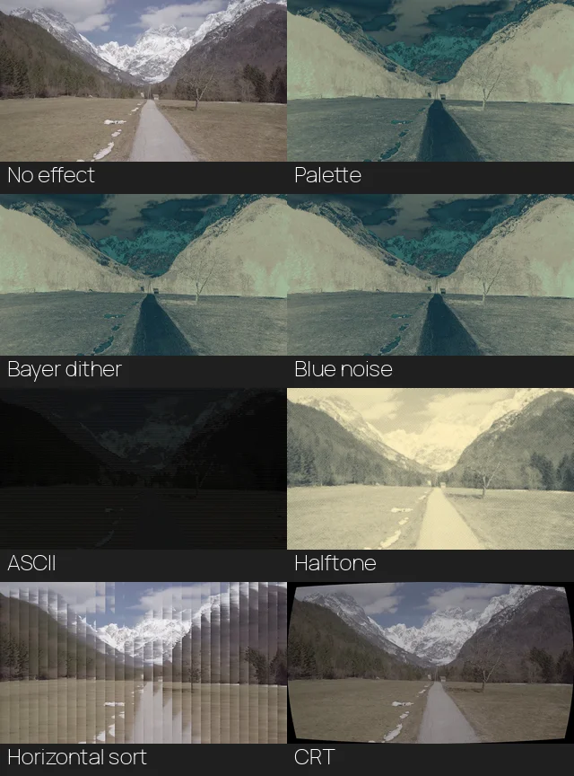

<!-- Generated by benchmarks/render-previews.py; edit descriptions there. -->
# What the benchmarks render

Three representative CPU renders show editing, compositing and a production timeline. The remaining workloads are listed below. Video benchmarks use the same bundled footage as the showcases.

[Benchmark overview](index.md){ .md-button } [Run benchmarks](collecting.md){ .md-button }

## Shared footage

These three inputs are included in the checkout and also used by the showcases. Each is a silent 12-second, 1920 × 1080, 60 fps clip; the collector resizes them before measurement.

| Clip | Used by | Repository file |
| --- | --- | --- |
| Forest | Basic export, editing, layered and sustained workloads; native video timelines | [forest.mp4](https://github.com/evgen2571/vestra/blob/develop/assets/footage/forest.mp4) |
| Valley | Editing, layered and effect controls; masked showcase footage | [valley.mp4](https://github.com/evgen2571/vestra/blob/develop/assets/footage/valley.mp4) |
| Tear | Editing and masked overlay | [tear.mp4](https://github.com/evgen2571/vestra/blob/develop/assets/footage/tear.mp4) |

Short rendering suites use 1920 × 1080 at 60 fps. The optional endurance workload is separate.

The three previews are silent 1920 × 1080 videos at 60 fps. Timing measurements are collected separately from these previews.

Captured on CPU from revision `d570c38d7aacafafb183bf8657f063e00f704344`; worktree modified: true. The [provenance manifest](../assets/benchmarks/previews.json) identifies workload sources by content hash and records original dimensions/checksums, poster times and delivery hashes. Reproduce them with the [media instructions](../development/documentation-media.md#reproduce-benchmark-previews).

## Representative edits

### Three-shot edit {#editing}

<video controls preload="metadata" playsinline width="1920" height="1080" poster="../../assets/benchmarks/editing.webp" aria-label="Three-shot edit: actual benchmark output">
  <source src="../assets/benchmarks/editing.mp4" type="video/mp4">
  <a href="../assets/benchmarks/editing.mp4">Download the preview</a>.
</video>

Forest, valley and tear clips overlap with 0.6-second fades, animated positioning and brightness.

`editing` · 12 s · 1920 × 1080 original · 60 fps

[Download preview](../assets/benchmarks/editing.mp4) · [Definition](https://github.com/evgen2571/vestra/blob/develop/benchmarks/comparisons/moviepy/workloads.py)

### Layered video and mask {#layered}

<video controls preload="metadata" playsinline width="1920" height="1080" poster="../../assets/benchmarks/layered.webp" aria-label="Layered video and mask: actual benchmark output">
  <source src="../assets/benchmarks/layered.mp4" type="video/mp4">
  <a href="../assets/benchmarks/layered.mp4">Download the preview</a>.
</video>

Two translucent moving overlays sit over a background; one uses a hard ellipse mask.

`layered` · 10 s · 1920 × 1080 original · 60 fps

[Download preview](../assets/benchmarks/layered.mp4) · [Definition](https://github.com/evgen2571/vestra/blob/develop/benchmarks/comparisons/moviepy/workloads.py)

### Production edit {#production_edit}

<video controls preload="metadata" playsinline width="1920" height="1080" poster="../../assets/benchmarks/production_edit.webp" aria-label="Production edit: actual benchmark output">
  <source src="../assets/benchmarks/production_edit.mp4" type="video/mp4">
  <a href="../assets/benchmarks/production_edit.mp4">Download the preview</a>.
</video>

A twelve-second forest and valley edit combines dissolves, colour correction, grouped titles and audio. This web preview is silent.

`production_edit` · 12 s · 1920 × 1080 original · 60 fps

[Download preview](../assets/benchmarks/production_edit.mp4) · [Definition](https://github.com/evgen2571/vestra/blob/develop/benchmarks/rust/animation_effects.rs)

## Effects at a glance

Left to right, top to bottom: no effect, palette mapping, Bayer dither, blue noise, ASCII, halftone, horizontal pixel sort and CRT. All eight frames are sampled at frame 108 (1.8 seconds) from the actual 1080p CPU workloads. Downscaling can hide fine dither and glyph detail.

[View the contact sheet at full size](../assets/benchmarks/effects.webp).

## Workload catalog

Every scenario remains runnable through the benchmark tools. Exact suite membership, dimensions, warmups and samples are defined in [suites.json](https://github.com/evgen2571/vestra/blob/develop/benchmarks/suites.json). Unfeatured outputs remain local; they are not separate documentation media.

### Rendering suites

| Workload | Measures |
| --- | --- |
| **One video** (`single_video`) | The forest clip measures the decode-to-encode pipeline. |
| **Videos, shapes and a dissolve** (`mixed_dynamic`) | Forest and valley clips with different playback rates dissolve beneath shape, text and grouped layers. |
| **Concurrent video layers** (`video_heavy`) | Three moving video placements overlap at different source offsets. |
| **Combined effects** (`combined`) | Several layers and ordered effects share the same composition. |
| **Geometric masks** (`masks`) | Shape coverage clips the contents of the layers. |
| **Track mattes** (`mattes`) | One layer supplies coverage for another layer. |
| **Nested compositions** (`nested_groups`) | Groups exercise local canvases, transforms and nested effects. |
| **Particles and bloom** (`particles`) | Seeded particles exercise generation, compositing and bloom. |
| **Blend modes** (`blend_modes`) | Overlapping coloured layers demonstrate the benchmark's blend operations. |

### Focused effects and controls

| Workload | Measures |
| --- | --- |
| **Opaque video copy** (`opaque_video`) | Two source-sized video placements include an integer-clipped overlay at full opacity. |
| **Translucent video copy** (`ineligible_video`) | The same two placements use 0.9 opacity, exercising the sampling fallback. |
| **Unmodified effect control** (`stylization_baseline`) | The valley clip prepared as FFV1 without an effect supplies the shared control. |
| **Palette mapping** (`palette_video`) | An animated palette remaps the valley footage. |
| **Oklab palette mapping** (`oklab_palette_video`) | The palette uses perceptual Oklab interpolation. |
| **Bayer dithering** (`dither_video`) | Fine Bayer8 dithering maps the footage to a limited palette. |
| **Blue-noise dithering** (`blue_noise_video`) | Stationary seeded blue noise replaces the ordered Bayer pattern. |
| **RGB dithering** (`rgb_dither_video`) | Blue-noise dithering operates in RGB mode. |
| **Hue-aware dithering** (`hue_dither_video`) | Hue-aware mapping preserves colour relationships in the limited palette. |
| **Independent channel dithering** (`channel_dither_video`) | Independent channel noise changes the colour distribution. |
| **Oklab dithering** (`oklab_dither_video`) | Perceptual colour distances drive the dithered palette mapping. |
| **Uneven tonal stops** (`nonuniform_dither_video`) | Nonuniform palette stops redistribute the available tones. |
| **Input tone adjustment** (`tone_dither_video`) | Exposure and gamma adjust the footage before dithering. |
| **Input detail enhancement** (`detail_dither_video`) | Local detail enhancement precedes the same tone and dither settings. |
| **Local contrast adjustment** (`contrast_dither_video`) | A wider local-detail filter changes contrast before dithering. |
| **ASCII characters** (`ascii_video`) | A cached glyph atlas converts moving footage into characters. |
| **Halftone dots** (`halftone_video`) | A halftone treatment represents the moving footage with dots. |
| **Horizontal pixel sorting** (`sort_horizontal_video`) | Bounded horizontal sorting rearranges selected pixel spans. |
| **Vertical pixel sorting** (`sort_vertical_video`) | Bounded vertical sorting rearranges selected pixel spans. |
| **CRT treatment** (`crt_video`) | A seeded periodic CRT treatment processes the moving footage. |

### Export and endurance

| Workload | Measures |
| --- | --- |
| **Basic video export** (`basic`) | The forest clip is resized and encoded through each library's public API. |
| **Sustained render** (`sustained`) | Two moving placements read the same two-hour repeated forest source during an optional one- or two-hour render. |

## Decoder and preparation probes

Cache/access probes issue frame-request sequences, and preparation probes measure setup. They do not each produce a separate showcase video. The cache collector uses the same bundled footage as the comparison; [specialist procedures](../development/performance-probes.md) explain their scope.

## Credits

Video inputs are bundled under `assets/footage/` and shared with the showcases. Rendered lettering uses the repository's test font and bundled ASCII atlas; existing font notices remain with their source assets. Preview encoding and input preparation commands are maintained in the linked script and benchmark builders.
