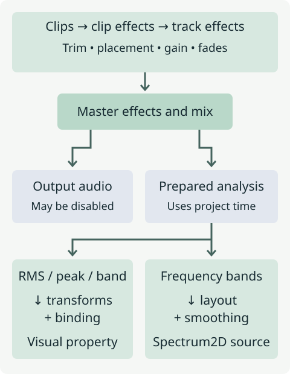

# Audio and signals

An audio clip supplies sound. A signal supplies a number that can control a
visual property. A spectrum source draws many frequency bands. The last two
read analysis of the project's mixed master audio; neither creates sound by
itself.

The branches matter when editing. Removing a visual binding leaves playback
intact. Disabling audio in the render output can make a silent visualizer while
retaining the clips needed for analysis. In the learning previews,
`project.output_audio = False` removes the published audio track while the
bindings and spectra still follow the prepared input. Removing those clips
removes the analysis input too. A valid input that contains silence is different from
having no usable audio input.

## Clips describe what plays and when

The project owns an audio timeline. Its tracks hold path-based audio clips.
A clip's `start` places it in **project seconds**; `trim_start` and `trim_end`
select positions in the source file. Clip fades are durations within that
excerpt, and gain-automation keys use clip-local time. Clip, track and master
effect stacks run at their respective scopes before master analysis.

For example, placing an excerpt from source seconds 4–7 at project second 1
plays it over project seconds 1–4, before any duration-changing playback-speed
effect. A visual layer's start does not move that audio clip.

See [add audio](../guides/python/audio.md) for authoring and
[the audio reference](../reference/audio.md) for exact time domains and effects.

## Signals control properties

`project.audio.signal.rms()`, `.peak()` and `.band(min_hz, max_hz)` each describe
one measurement of the master audio. They are immutable: `remap`, `clamp`,
`envelope` and the other transforms return a new signal in the order called.
A property binding samples that transformed signal at project time and
combines it with the property's current value.

| Binding operation | Result |
| --- | --- |
| `replace` | Use the signal value. |
| `add` | Add the signal to the base or animated property value. |
| `multiply` | Multiply the base or animated property value by the signal. |

Use a signal when you want a circle to pulse, an effect to strengthen, or a
position component to move with the recording. Choose a range appropriate to
that property. A useful scale multiplier might be `0.75`–`1.30`; an opacity
requires `0`–`1`. Remapping does **not** clamp values outside its input range.
The [audio-reactivity guide](../guides/python/signals-and-audio-reactivity.md)
shows bounded values and measured smoothing curves with visible input timing.

## Spectra draw a distribution

`Spectrum2D` is visual content added as a source. It draws a range of frequency
bands using its own sensitivity, attack/release and layout settings. It does
not take a `ScalarSignal` binding as its input: it requests prepared master
frequency analysis directly. Use it to show which frequencies are present,
rather than only how loud the recording is overall.

The [spectrum guide](../guides/python/spectra.md) compares linear and radial
layouts using the same recording and band settings. Scalar `envelope(...)`
does not change the spectrum's smoothing; use the source's
`attack_seconds` and `release_seconds`.

## Preparation is part of the result

Vestra resolves audio files, mixes the authored timeline, and prepares the
requested analysis before frames use it. Keep source files available even for
a silent visualizer. Audio measurements use project time, including when a
bound layer is inside a child composition; they are not restarted by that
layer's local clock.

The examples here were rendered on CPU. Spectrum2D has CPU support and WGPU
dispatch, but full WGPU visual parity is not verified. See
[feature support](../reference/feature-support.md),
[signals](../reference/signals.md) and
[the rendering lifecycle](rendering-lifecycle.md) for the detailed contracts.
