# The authoring model

A source answers **what is drawn**. A layer answers **where, when and how it is
shown**. A composition owns those layers, and a project owns the output settings
and root composition. Understanding these relationships makes reuse and later
edits predictable.

<figure markdown="span">

<figcaption>Schematic ownership diagram. Adding a source twice creates two placements; it does not establish a live link between them.</figcaption>
</figure>

## Project

`Project` owns the output size, frame rate, optional duration, background and
root composition. It also owns the audio timeline, project-level visual effects,
root flash overlays and output audio policy.

The Python project is mutable while you author it. `snapshot()` copies and lowers
it to the canonical project model. Validation, preparation and rendering operate
on a snapshot; later authoring edits do not alter an existing snapshot or
prepared runtime.

## Composition and layer

A `Composition` is an ordered collection of layers in one local time space.
Higher `z` values draw over lower values. A `Layer` supplies a start, duration,
source offset, playback rate, visibility, opacity, transform, blend mode and
attached processing. Its `source` supplies the content.

For example, place one rectangle source twice:

```python
from vestra import Project, Rectangle

project = Project(size=(640, 360), fps=30, duration=3)
panel = Rectangle(width=160, height=80, fill="#2563eb")

left = project.root.add(panel, position=(0.25, 0.5), id="left")
right = project.root.add(panel, position=(0.75, 0.5), id="right")
right.opacity = 0.5
```

Both rectangles have the same initial geometry. Changing `right.opacity` affects
only the right placement. Changing `panel.fill` afterward affects future
placements, because the existing layers already hold copies.

## Sources

Sources describe images, video, colors, shapes, text, groups, particles and
spectra. Sources do not own a timeline position. Python sources may carry
**default transforms**, including animation and bindings, which each placement
copies. An `add(position=...)` override replaces that property's copied state;
other properties keep their defaults.

Copying a file-backed source copies its descriptor and path. It does not create
another image, video or font file on disk. Reusing a source therefore creates
independent authoring state while still referring to the same media asset.

Use the returned layer for placement edits. For the exact override behavior and
practical source examples, see [sources and layers](../guides/python/sources-and-layers.md).

## Nested compositions

A reusable `Group` source is copied on placement, including its current children.
`composition.group()` instead creates a `CompositionLayer` with an editable
`child` composition. Both become canonical group content, with local coordinates
and local time. They serve different authoring needs: reusable content versus
ongoing edits to one child composition.

Continue with [coordinates and anchors](coordinates-and-anchors.md), then
[groups and nesting](groups-and-nesting.md) to see how placement applies inside
a group.

## When lower-level objects matter

Most Python editing uses `Project`, `Composition`, `Layer` and source classes.
`ProjectBuilder` provides exact canonical authoring and asset IDs.
`ProjectSnapshot`, `Editor`, `PrepareOptions` and `PreparedProject` expose
explicit validation, preparation and repeated rendering. These interfaces share
the same project semantics. The [rendering lifecycle](rendering-lifecycle.md)
explains when to use each step.
