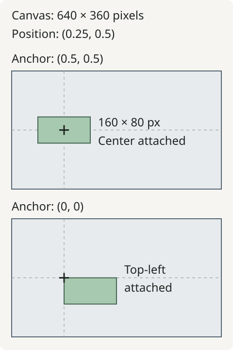

# Coordinates and anchors

A 160-pixel rectangle does not become 160% of the canvas. Vestra separates
**source geometry in pixels** from **placement in normalized parent coordinates**.
The anchor connects those spaces.

<figure markdown="span">

<figcaption>Schematic canvases with identical position and geometry. Changing the anchor changes which point of the rectangle lands on the crosshair.</figcaption>
</figure>

## Three different measurements

| Value | Space and units | Example |
| --- | --- | --- |
| `Project(size=(640, 360))` | Output canvas, pixels | Width 640, height 360 |
| `Rectangle(width=160, height=80)` | Source-local geometry, pixels | Size before placement transforms |
| `position=(0.25, 0.5)` | Fraction of the parent canvas | `(160, 180)` in that project |
| `anchor=(0.5, 0.5)` | Fraction of the source's own extent | The rectangle's center, `(80, 40)` |
| `scale=(2, 1)` | Unitless multiplier | Twice the width, same height |
| `rotation=30` | Clockwise degrees | Rotation around the anchor |

Coordinates start at the top-left: x increases rightward and y downward.
Positions can extend outside `[0, 1]`, which is useful for entrances and exits.
Anchors must stay within `[0, 1]` on both axes. Scale components must be positive.

## Place an edge instead of a center

These snippets build a new project, then change its rectangle placement:

```python
from vestra import Project, Rectangle

project = Project(size=(640, 360), fps=30, duration=3)
panel = project.root.add(
    Rectangle(width=160, height=80, fill="#2563eb"),
    position=(0.25, 0.5),
)
```

The default anchor is the center, so the rectangle extends from `(80, 140)` to
`(240, 220)` before antialiasing. Set its top-left corner on the same position:

```python
panel.transform.anchor = (0, 0)
```

Its extent becomes `(160, 180)` to `(320, 260)`. The position did not change;
the point of the source attached to it did. Scaling and rotation keep that anchor
at the placement position. Choosing a left-edge anchor is useful for a bar that
grows to the right; choosing the center makes it grow in both directions.

## Geometry belongs to the source

Rectangle widths, circle radii, line endpoints and polygon points describe
source-local pixel geometry. A shape's geometry is static; animate its layer's
transform to move, scale or rotate it. Stroke-only shapes use the same placement
rules. See [shape reference](../reference/sources/shape.md) for each primitive's
bounds and defaults, and [animation](../learn/animation.md) for property tracks.

Images normally retain their intrinsic geometry; `fit`, `cover` and crop change
how media uses the containing canvas. Text derives its bounds from layout.
A `Color` source fills the containing canvas. These sources still use the layer
transform to present that content.

## Each group has a parent and a local canvas

Inside `Group(size=(600, 300))`, child position `(0.25, 0.5)` means `(150, 150)`.
The group's own position uses its parent's dimensions. Giving a group dimensions
does not resize its children's geometry. Its transform scales and rotates the
composited result afterward.

Continue with [groups and nesting](groups-and-nesting.md) for local bounds and
clipping, or use the [source guide](../guides/python/sources-and-layers.md) to
place media and text.
