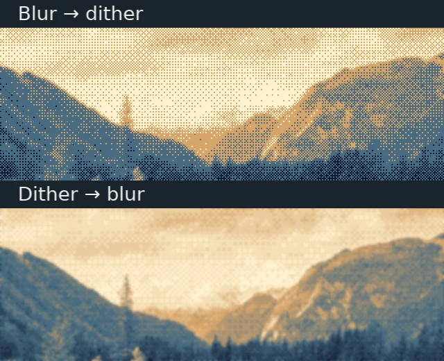
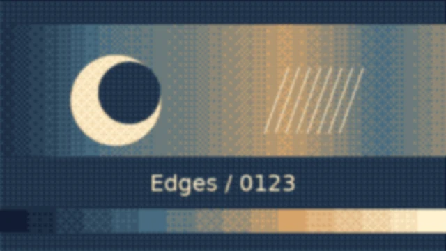

# Effects, transitions, animation, flashes, and presets

A property value, a processing operation and a timeline relationship solve
different problems. Choose the one that owns the change you want to make.

| Feature | What it changes | Continue with |
| --- | --- | --- |
| Animation | A property over layer-local time | [Keyframes](../learn/animation.md) |
| Effect | The appearance of a layer or composed output | [Attach an effect](../guides/python/effects.md) |
| Transition | Presentation of two sibling layers over an interval | [Transition comparisons](../guides/python/transitions-flashes-and-presets.md) |
| Flash | A short root-owned color overlay | [Flashes](../reference/presets-and-flashes.md) |
| Preset | Reusable cinematic intent on one eligible image layer | [Preset contracts](../reference/presets-and-flashes.md) |

Animation can drive an effect parameter: a blur still runs in the same processing
stage as its radius changes. A transition owns presentation channels on its
outgoing and incoming endpoints, driven by normalized progress. Manually
keyframing a layer does not create that two-layer relationship.

## Processing stages


This is a schematic of ownership and order, not a rendered image. Read downward:
a layer's masks see its effected presentation, then a track matte supplies
coverage, then opacity and blend place it into its parent. A group first
composes its children; its placed result then passes through the same layer
pipeline. Project post-effects process the complete root result.

Effects retain attachment order **within their stage**. Motion Tile is the only
pre-transform effect, so it fills a virtual source region before moving or
rotating that source. Other effects process the transformed image. A larger
Motion Tile region does not make the canvas larger.

A useful consequence: layer blur does not blur the background behind a title.
To blur the final title and background together, use a project post-effect. To
blur only a composed card, apply the effect to that card's group layer.

## Order changes the result

The two actual CPU renders below use the same procedural source, palette and
settings. Only attachment order changes.

<div class="gallery-grid" markdown>

<figure markdown>

<figcaption>GaussianBlur(radius=5) → OrderedDither(scale=2). Look at the crisp pattern across the softened circle edge.</figcaption>
</figure>

<figure markdown>

<figcaption>OrderedDither(scale=2) → GaussianBlur(radius=5). The pattern itself is blurred, so output no longer contains only palette colors.</figcaption>
</figure>

</div>

Download [the controlled source](../assets/examples/effects_catalog.py), then run
these alternatives in an empty output directory:

```bash
python effects_catalog.py --effect order --still
python effects_catalog.py --effect order --reverse --still
```

Both write WebP images and replace their named output on a rerun. The
[effect catalog](../guides/python/effect-catalog.md) compares individual effects
before combining them.

## Ownership and clocks

Effects attach by copy. Keep `layer.effects.add(...)`'s returned handle to edit
that placement. An untimed child effect uses its child layer's local time; an effect on
the parent group uses that group's layer-local time. Global effect tracks use
the project span. A CameraShake with a delayed `active_interval` uses time since
that effect interval began for its parameter tracks. Periodic CRT/palette colors loop their procedural component;
they do not loop source video or audio.

Transitions belong to the immediate composition shared by their two endpoints.
A nested composition can own transitions between its children; the parent can
also transition that entire composition layer. The placement's start and duration
use the owning composition's clock, while definition channels use progress 0..1.
See [timeline and time](timeline-and-time.md) and the
[transition guide](../guides/python/transitions-flashes-and-presets.md) for the
relationship between placement, overlap and progress.

## Interpolation

The authoritative [animation explanation](../learn/animation.md) covers base
values, destination-keyframe easing, holds, cubic Bézier curves and overshoot.
Layer tracks use layer-local seconds; timed effects use effect-local seconds;
transition channels use normalized progress. The first keyframe takes effect
at its time without interpolating from the base value. Before it the base value
applies; after the last keyframe its value holds. Keep resulting values within
the parameter's supported range.

Find exact scope, stage, alpha and timing rules in [effect contracts](../reference/effects.md),
precise controls in [effect parameters](../reference/effect-parameters.md), and
canonical JSON curves in [animation reference](../reference/animation.md), and
implementation mathematics in [effect algorithms](../development/effect-algorithms.md).
