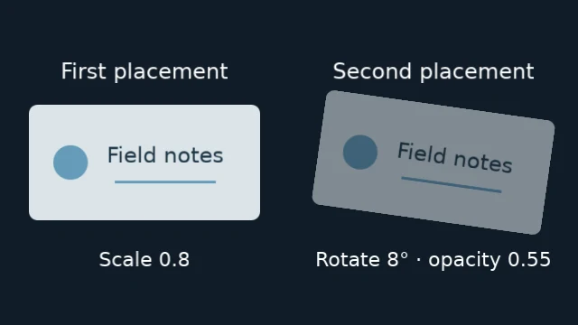

# Groups and nesting

A group combines children into one visual result. Build a standalone `Group`,
then place it with `project.root.add(group)`. Moving, scaling, rotating or fading
that placement affects all its children together.

<figure class="comparison" markdown="span">

<figcaption>One completed source, two independent placements. The right card's rotation and opacity leave the left card unchanged.</figcaption>
</figure>

The [complete card example](../assets/examples/group_placements.py) needs no assets.
Run `python group_placements.py` to write `group-placements.mp4`; rerunning replaces
it. Its graphics are original and use the bundled font.

## Compose locally, then transform the result

A group has its own canvas. Its children use positions relative to that canvas;
the group's placement uses positions relative to its parent. The root canvas
matches the project's output size; root pixels are the final output's coordinates.

<figure class="diagram" markdown="span">

<figcaption>The inner origin is root pixel (160, 90). Child positions start from that local origin, rather than the root's top-left.</figcaption>
</figure>

This new example matches the diagram. The small rectangle fades in after its
panel appears:

```python
from vestra import Group, Project, Rectangle

project = Project(
    size=(640, 360), fps=30, duration=5, background="#101c27"
)
panel = Group(size=(320, 180))
panel.add(Rectangle(width=320, height=180, fill="#263e4b"))
marker = panel.add(
    Rectangle(width=100, height=60, fill="#e9bd72"),
    position=(0.25, 0.5),
    start=0.5,
    duration=2,
)
marker.opacity.keyframe(0, 0)
marker.opacity.keyframe(0.5, 1)

placed_panel = project.root.add(
    panel, position=(0.5, 0.5), start=1, duration=3
)
```

The default anchor is the center. The 320 × 180 panel is centered at root pixel
`(320, 180)`, so its top-left is `(160, 90)`. The marker's anchor is at local pixel
`(0.25 × 320, 0.5 × 180) = (80, 90)`. Adding the panel's top-left puts that anchor
at root pixel **(240, 180)**, or normalized root position **(0.375, 0.5)**.

That addition works here because the panel has no rotation and scale is one.
Scaling or rotating the panel transforms the completed local result, including
child positions and sizes. It does not rewrite the children's local coordinates.
See [coordinates and anchors](coordinates-and-anchors.md) for placement rules.

`size` sets the local canvas; it does not stretch child geometry. The marker is
100 × 60 local pixels. An unsized `Group()` inherits its immediately enclosing
canvas. A sized group nested inside another group starts a new coordinate space.

## Child time starts with the group

The same nesting applies to time. `start` is measured on the containing timeline;
each placement's keyframes start from its own local zero. For the example above:

| Project time | Panel time | Marker time | Visible result |
| --- | --- | --- | --- |
| 1 s | 0 s | Not started | Panel appears |
| 1.5 s | 0.5 s | 0 s | Marker begins its fade at opacity 0 |
| 2 s | 1 s | 0.5 s | Marker reaches opacity 1 |
| 3.5 s | 2.5 s | End excluded | Marker disappears |
| 4 s | End excluded | Inactive | Panel and all its children disappear |

Subtract a placement's start to enter its clock:

```text
panel_time = project_time - 1
marker_time = panel_time - 0.5
```

The marker's `0.5`-second opacity keyframe therefore lands at project second `2`.
Moving `placed_panel.start` moves this whole sequence without rewriting any
child starts or keyframes. The panel's lifetime clips its children even if their
authored durations extend beyond it. [Timeline and time](timeline-and-time.md)
covers media clocks, duration resolution and frame boundaries.

<span id="choose-how-to-author-the-children"></span>

## Standalone Group and root.group()

These are two ways to author nested content, with the same local coordinate,
time and clipping rules. A standalone `Group` is usually the straightforward
starting point, even for content you place only once.

| Choice | `Group(...)`, then `root.add(group)` | `root.group(...)` |
| --- | --- | --- |
| What you create | A source first, then a separate placement | One placement with an owned child composition immediately |
| Add children | Build the source before placing it | Keep editing the placed scene through `scene.add()` or `scene.child` |
| Reuse | Each `add(group)` copies the current children and their state | Author children directly for this one placement |
| Local canvas | Set `size`, or inherit the parent if omitted | Inherits the parent; `group()` has no `size` argument |
| Child ordering | `Group.add(..., layer=...)` | `scene.add(..., z=...)` |

A standalone group is **a snapshot source, not a live template**. Adding a child
to `panel` or changing `marker` after `root.add(panel)` does not update an earlier
placement. Edit the returned placement to move or fade that copy as a whole.
Use `root.group()` when you need an editable child composition, for example to
connect its children with `scene.child.transitions`.

The [nested composition guide](../guides/python/nested-compositions.md) shows both
construction styles. Transitions using the group itself as an endpoint belong
to its parent composition.

## Clipping happens before the parent transform

Children are clipped to their group's local canvas. Content outside it is lost
before the group is transformed in its parent. Moving or shrinking the group
cannot bring that clipped content back. Move the child inside the local canvas
or enlarge the group when you need to preserve it. There is no overflow-visible
option.

Child effects run in the local canvas. Effects on the group run on its completed,
transformed placement in the parent, so an outer blur can spread beyond its
bounds. A group mask applies to the already-composited group and follows its
placement. [Masks and mattes](masks-and-mattes.md) explain this distinction.

For fractional sizes, resource limits and exact transform rules, see
[nested composition reference](../reference/nested-compositions.md#sized-group-coordinates-and-bounds).
