# Masks and mattes

A mask supplies **coverage**: how much of a layer survives at each pixel. The
layer still supplies the visible color. A white circle used as a mask reveals a
circular part of a photograph; it does not draw a white circle over it.

<figure class="diagram" markdown="span">

<figcaption>The mask changes visibility. The blue stripes still come from the content layer, including after a second mask removes the center.</figcaption>
</figure>

## Alpha and brightness answer different questions

**Alpha** uses the mask source's transparency. An opaque black image reveals as
much as an opaque white one. This works well for silhouettes, shape edges and
transparent image cutouts.

**Luma** uses brightness multiplied by alpha. Opaque white reveals, opaque black
hides and opaque gray reveals partially. Transparent white still hides. Vestra
uses encoded RGB values with Rec.709 weights, rather than thresholding the image.
See [the exact coverage formula](../reference/masks.md#canonical-inputs).

Shapes supply rendered alpha, including stroke and antialiased edges. Images,
text, video, groups, spectra and particles can also be owned mask sources.
A group first composes its children to RGBA, then extracts coverage from that
result.

## Combine coverage in order

The accumulated coverage starts at `1`, so the default `INTERSECT` mask reveals
its own silhouette. Each later mask operates on the current coverage:

| Operation | What it does |
| --- | --- |
| `REPLACE` | Discards earlier coverage and uses this mask |
| `INTERSECT` | Keeps the overlapping coverage |
| `UNION` | Adds coverage from either mask |
| `SUBTRACT` | Removes this mask's coverage |

Order matters: starting with `UNION` adds to already-full coverage and therefore
reveals the whole layer. Start with `REPLACE` or `INTERSECT` when building a
silhouette, then add a second shape with `UNION`.

`invert` turns each mask's coverage into `1 - coverage` before combination.
`strength` mixes between the previous coverage and the operation's result:
zero has no effect; one applies it completely. The [mask reference](../reference/masks.md)
gives the equations for fractional coverage.

## Move and soften the reveal

An owned mask has a separate transform in the owner's local coordinates. Moving
that transform slides the reveal across the content. Moving the owning layer
moves the content and its owned masks together. Mask images keep their intrinsic
pixel size; use the mask transform to align them. Direct image/video mask sizing
and crop options are currently rejected.

`feather` softens **coverage**, leaving the underlying photograph sharp. It is
measured in output pixels, supports fractional values from `0` to `256`, and
filters coverage before inversion and combination. Samples outside the canvas
have zero coverage. The practical [mask guide](../guides/python/masks.md) builds
a circular crop, animated soft reveal and subtractive hole separately.

## A matte refers to another layer

An owned mask copies a source into the consuming layer. A **track matte** instead
references an existing sibling layer in the same immediate composition. The matte
keeps its own transform and timing in composition space. Moving the consumer
does not move its matte.

The matte's isolated presentation supplies coverage: its source, effects, masks,
transform, opacity and any valid matte of its own. Set it invisible when you want
coverage without also drawing it normally. Hidden matte layers still supply
coverage during their active interval. Outside that interval, their raw coverage
is zero; an inverted matte therefore reveals rather than hides then.

A layer can have multiple owned masks and one matte. It applies owned masks,
then intersects matte coverage, then applies final opacity and blend/compositing.
Effects run before masks. Validation rejects missing layers, self references,
cycles and mattes from another composition. See [track matte reference](../reference/masks.md#track-mattes).

## The owner supplies mask time

Owned mask animation uses the owning layer's local time. A direct video mask
starts at source second zero at normal speed, independent of the owner's video
source offset and playback rate. Video children inside a mask group retain their
own child-local timing and retiming settings. A referenced matte instead follows
its own layer interval.

Continue with the [mask recipes and rendered comparison](../guides/python/masks.md)
or [rendering lifecycle](rendering-lifecycle.md) to produce the final output.
