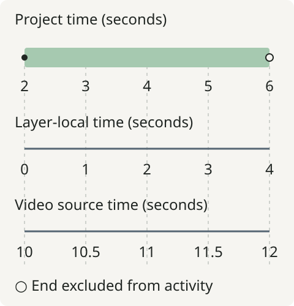

# Timeline and time

A layer has both a position on its composition's timeline and a clock that starts
at zero when it becomes active. A video source has another clock: the position
sampled in the original media. Keep those clocks separate when trimming,
retiming or nesting content.

## Project and layer time

Consider a four-second video placement that starts at project second two:

```python
from vestra import Project, Video

project = Project(size=(1280, 720), fps=30, duration=6)
excerpt = project.root.add(
    Video("clip.mp4"),
    start=2,
    duration=4,
    source_start=10,
    playback_rate=0.5,
)
```

<figure markdown="span">

<figcaption>Schematic aligned clocks for this placement. Half-speed playback advances the source by two seconds during four seconds of output.</figcaption>
</figure>

At project second `4`, the layer-local time is `4 - 2 = 2` seconds and the video
samples source second `10 + 2 × 0.5 = 11`. The relationship is:

```text
layer_local = composition_time - layer.start
video_source = layer.source_start + layer_local × layer.playback_rate
```

`source_start` and `playback_rate` retime video sampling. They do not shift the
layer's position on the timeline or retime its presentation keyframes. A position
keyframe at local second `1` is reached at project second `3` in this example.
For interpolation and values before/after keyframes, use the authoritative
[animation guide](../learn/animation.md#layer-local-time).

## Nested time

A group at parent second `1` has child time zero there. A child with `start=0.5`
begins at parent second `1.5`; its own animation time is zero at that point.
Apply the same subtraction at each level of nesting. The group's active interval
clips the children, even if a child has a longer authored duration.

Transitions between child siblings use the child's composition clock. They do
not use project timestamps. See [groups and nesting](groups-and-nesting.md) and
[the transition guide](../guides/python/transitions-flashes-and-presets.md).

## Duration is not an end timestamp

An explicit project duration fixes the output span. Content after that span is
clipped; shorter content can leave a background or silent tail. With automatic
project duration, resolved root visual, flash and audio ends determine the span,
including authored muted audio. Group duration is authored rather than inferred
from its children.

In high-level Python, an omitted non-video layer duration inherits the **whole**
containing explicit duration. In a five-second project, `start=2` with no duration
means an authored five-second layer ending at second `7`, then clipped by the
output. Use `duration=3` to end it at second `5`. This inheritance is resolved
when added; it is not a continuing “fill to end” relationship. Video duration
omission instead uses the remaining media length divided by playback rate.

Use non-negative starts and source offsets, positive durations and positive
playback rates. Media preflight checks that a finite video's selected source
span is available. Authored layer ends, output end and source EOF are different
boundaries; [diagnostics](../reference/diagnostics.md) identify which failed.

<span id="frames-and-frame-rate"></span>
<span id="boundaries"></span>

## Frames and boundaries

Layers are active over `[start, start + duration)`: the start is included, the end
is excluded. At 30 fps, a one-second output has frames at `0`, `1/30`, …, `29/30`.
There is no frame at the excluded end `1.0`. A final keyframe at that end therefore
need not be sampled exactly. Put it earlier to show a held final state.

`fps` can be an integer or rational pair such as `(30000, 1001)`. Times in Python
properties are seconds, not frame indices. Use prepared frame-number APIs when
selecting exact frames; avoid accumulating rounded frame steps. Non-frame-aligned
output durations round the frame count up. The [runtime reference](../reference/python-api.md)
provides frame APIs; [project-to-plan development notes](../development/architecture/project-to-plan.md#time-domains-and-frame-boundaries)
record the precise integer rounding rules.

## Audio time

Audio clip `start` is project time; `trim_start` and `trim_end` select source
positions. Fades are durations on the selected clip and gain keyframes are
clip-local. Analysis supplies control values sampled during timeline evaluation;
it is not a separate playback clock. Continue with [audio and signals](audio-and-signals.md)
or [rendering lifecycle](rendering-lifecycle.md).
