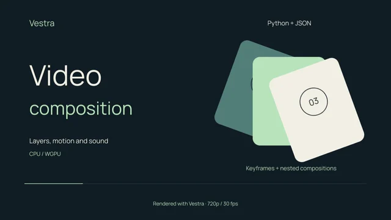
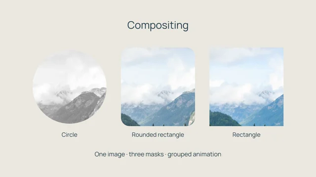
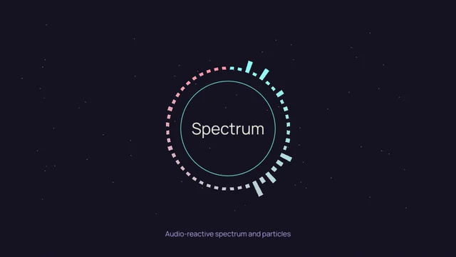
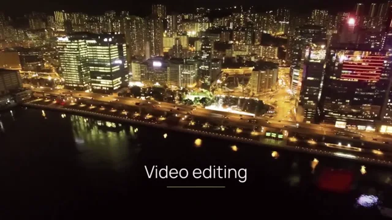
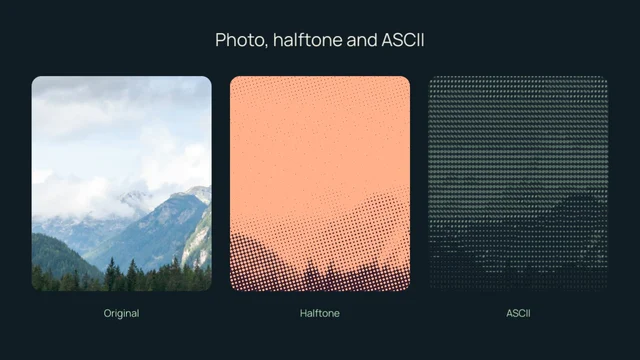

# Examples

Browse complete Python projects by their output. Each page includes a preview
rendered with Vestra, the source code, and instructions for rendering it from
a checkout.

For a smaller introduction, start with the
[first render tutorial](../getting-started/first-render.md).

<div class="gallery-grid" markdown>

<div class="gallery-card" markdown>

[](motion-design.md)

## [Layers, masks and audio signals](motion-design.md)

Three scenes show grouped card animation, masked valley footage with ordered
dithering, and an audio-reactive radial spectrum.

</div>

<div class="gallery-card" markdown>

[](compositing.md)

## [Photo cutouts](compositing.md)

A landscape zooms inside three geometric cutouts. Each frame and its contents
move as a group, with a different saturation treatment.

</div>

<div class="gallery-card" markdown>

[](audio-reactive.md)

## [Audio-reactive graphics](audio-reactive.md)

Frequency analysis controls 48 radial spectrum bars; loudness controls a ring
and particle opacity. The preview includes the synthesized soundtrack.

</div>

<div class="gallery-card" markdown>

[](video-editing.md)

## [A three-shot video edit](video-editing.md)

Forest, valley and water-drop shots use slow zooms, half-second dissolves, colour adjustments
and a grouped title overlay.

</div>

<div class="gallery-card" markdown>

[](visual-effects.md)

## [Halftone and ASCII effects](visual-effects.md)

Compare two effects with the original photograph. The three masked panels
share the same zoom animation.

</div>

</div>

## Run the examples

These projects load shared media and fonts from `assets/`. The
sources and inputs are included in the documentation checkout. If you already
have that checkout, enter `nix develop` and run `just python-sync` from its root.

To obtain the exact example versions used for these previews independently:

```bash
git clone https://github.com/evgen2571/vestra.git
cd vestra

# Keep the example sources and input assets at the captured revision.
git switch --detach f4679ecdc4d7a45b6b56e5d106f873d3374492dd

# Enter the native development environment and build the Python package once.
nix develop
just python-sync
```

Source links, bundled inputs and full-resolution renders all use revision
`bf527c93952b258f518ea6915551437ba629b545`. The video-editing and masked-footage previews have been regenerated
with the shared benchmark inputs. Public commit links become
available when the reviewed commits are pushed.

Each example describes its inputs and preview. To make website delivery
copies from the bundled renders, follow [preview reproduction](../development/documentation.md#reproduce-gallery-previews);
it uses this checkout and does not fetch a separate documentation branch.

If you don't use Nix, follow the
[source-build installation instructions](../getting-started/installation.md#build-from-source--development)
for your platform. Building from the checkout needs Rust and native build tools;
developer media tools also need `ffmpeg` on `PATH`. Current Python installs its
FFmpeg executable automatically. The captured revision
above also uses `ffprobe` for audio probing. Current Vestra probes media through
bundled libraries and does not require that executable.

Each project page gives its render command. Add `--smoke` for a 320 × 180,
6 fps version of the full timeline. Full renders use the CPU at 1280 × 720
and 30 fps with Vestra's high quality tier; the website previews are downscaled
copies.

The required media and fonts are committed with the examples, so rendering
needs no asset download after setup. Source, license and modification details
are beside each example under **Credits**, with reproduction details in its
linked README.
