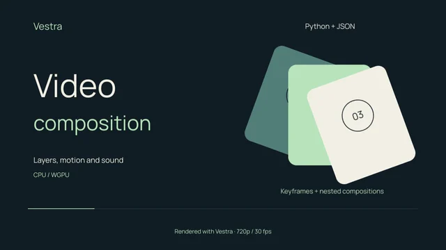
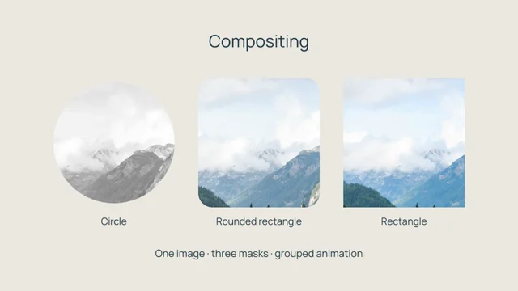
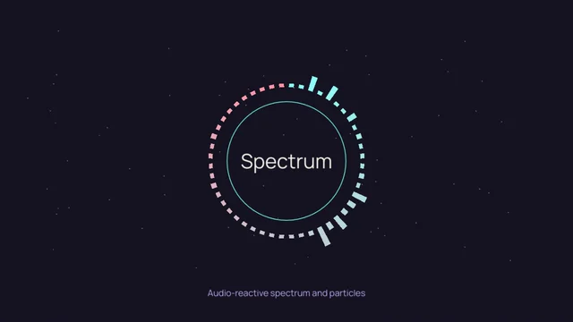
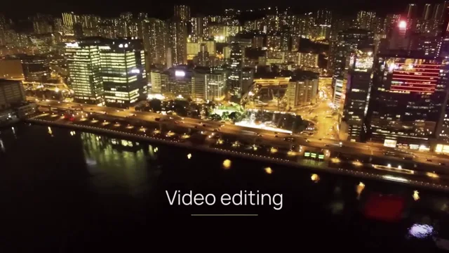
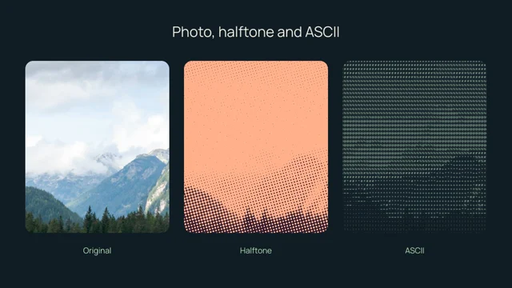

# Examples

Pick a project to watch its render, read the Python source, or make it yourself.
For a smaller example you can run in a new project, try
[your first render](../getting-started/first-render.md).

<div class="gallery-grid" markdown>

<div class="gallery-card" markdown>

[](motion-design.md)

## [Layers, masks and audio signals](motion-design.md)

Three scenes show grouped card animation, masked valley footage with ordered
dithering, and an audio-reactive radial spectrum.

</div>

<div class="gallery-card" markdown>

[](compositing.md)

## [Photo cutouts](compositing.md)

A landscape zooms inside three geometric cutouts. Each frame and its contents
move as a group, with a different saturation treatment.

</div>

<div class="gallery-card" markdown>

[](audio-reactive.md)

## [Audio-reactive graphics](audio-reactive.md)

Frequency analysis controls 48 radial spectrum bars; loudness controls a ring
and particle opacity. The preview includes the synthesized soundtrack.

</div>

<div class="gallery-card" markdown>

[](video-editing.md)

## [A three-shot video edit](video-editing.md)

Forest, valley and water-drop shots use slow zooms, half-second dissolves, colour adjustments
and a grouped title overlay.

</div>

<div class="gallery-card" markdown>

[](visual-effects.md)

## [Halftone and ASCII effects](visual-effects.md)

Compare two effects with the original photograph. The three masked panels
share the same zoom animation.

</div>

</div>

## Run the examples

Clone Vestra and check out the revision used to make these previews. The
checkout includes the source, footage, and fonts.

```bash
git clone https://github.com/evgen2571/vestra.git
cd vestra

# Keep the example sources and input assets at the captured revision.
git switch --detach e6191c1e567d8e66e73f1fe299ccc15fe64711df

# Enter the native development environment and build the Python package once.
nix develop
just python-sync
```

Then run the command on the project page. Add `--smoke` to render the full
timeline at a smaller size and lower frame rate.

For setup without Nix, follow the [source-build instructions](../development/source-builds.md)
for your platform. See **Credits** on each example page for sources and licenses,
or [preview reproduction](../development/documentation.md#reproduce-gallery-previews)
to rebuild the site's previews.
