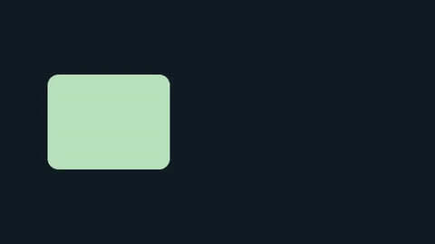

# Python quickstart

This example renders a rounded rectangle with eased movement to a three-second
MP4. It is the same scene shown in the [README](../../README.md#usage).
It needs no images, fonts or audio files.

## Prerequisites

Install Vestra with `uv add vestra` in your Python project or
`python -m pip install vestra` in your chosen environment. Complete the
[installation guide](installation.md), including the `ffmpeg` and `ffprobe`
runtime checks.

## Create the project

Save this complete example as `quickstart.py`:

```python
from vestra import Interpolation, Project
from vestra.sources import Color, Rectangle

project = Project(size=(640, 360), fps=30, duration=3)
project.root.add(Color("#101c24"))
card = project.root.add(
    Rectangle(width=180, height=140, corner_radius=16, fill="#b8e3bc")
)
card.transform.position.keyframe(0, (0.25, 0.5))
card.transform.position.keyframe(1.5, (0.75, 0.5), interpolation=Interpolation.EASE_IN_OUT)
card.transform.position.keyframe(3, (0.25, 0.5), interpolation=Interpolation.EASE_IN_OUT)

project.render("quickstart.mp4", backend="cpu", overwrite=True)
```

`Project` sets the canvas, frame rate and duration. Each source added to
`project.root` becomes a layer. Later layers appear on top by default.

Rectangle dimensions and corner radii are in pixels. Positions are normalized:
`(0.5, 0.5)` is the centre of the canvas. Keyframe times are seconds on the layer's local timeline. `EASE_IN_OUT` gives the movement
a gentle start and finish. See [animation](../guides/python/animation.md).

## Render it

```bash
python quickstart.py
# Or, if you installed with uv:
uv run python quickstart.py
```

The explicit `cpu` backend makes the first render independent of GPU adapter
availability. `overwrite=True` replaces an existing `quickstart.mp4`.

## Expected result

[](../../examples/showcase/quickstart/render.mp4)

The result is `quickstart.mp4`: 640×360, 30 fps, three seconds, no audio.
The two halves of the animation return the rectangle to its starting position;
the preview loops. The [source and regeneration instructions](../../examples/showcase/quickstart/README.md)
are also included in the checkout.

If rendering fails, check that `ffmpeg` and `ffprobe` are available as described
in the [installation guide](installation.md), then see
[Python troubleshooting](../troubleshooting/python.md).

## Check a project before rendering

```python
report = project.validate()
print(f"Project settings valid: {report.is_valid}")
print(report)  # diagnostics with JSON locations when invalid
```

Validation checks timing, ranges and references. It does not check media files,
FFmpeg or graphics adapters; preparation and rendering check those. See
[rendering and preparation](../guides/python/rendering-and-preparation.md).

## Next steps

Add [images, video or text](../guides/python/sources-and-layers.md), apply
[effects](../guides/python/effects.md), or arrange a larger timeline with
[projects and compositions](../guides/python/projects-and-compositions.md).
