# Visual effect catalog

Compare the **source above** with the **treatment below**. Moving views share
one clock, so you can pause them at the same point.

- [Color and tone](#color-and-tone)
- [Blur and light](#blur-and-light)
- [Palettes and print](#palettes-and-print)
- [Characters and motion](#characters-and-motion)

These selected settings cover all 23 canonical effects, PseudoAscii and a second
dither pattern. Use [Add an effect](effects.md) to attach a treatment, or the
[complete example](#complete-example) to run these comparisons.

## Color and tone

<div class="gallery-grid" markdown>

<div class="gallery-card" markdown>

### Brightness

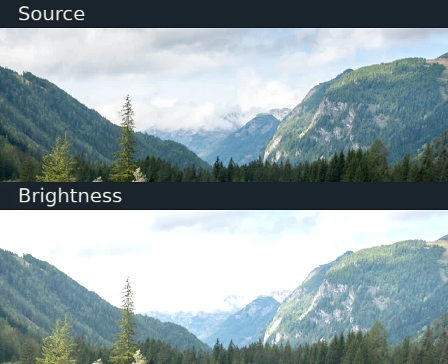{ loading=lazy width=640 height=520 }

Lift forest shadows; the brightest clouds begin to clip.

```python
Brightness(amount=0.15)
```

[Parameters](../../reference/effect-parameters.md#brightness-brightness)

</div>

<div class="gallery-card" markdown>

### Contrast

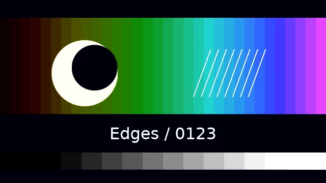{ loading=lazy width=640 height=520 }

Separate light cliffs from the darker trees.

```python
Contrast(amount=1.5)
```

[Parameters](../../reference/effect-parameters.md#contrast-contrast)

</div>

<div class="gallery-card" markdown>

### Saturation

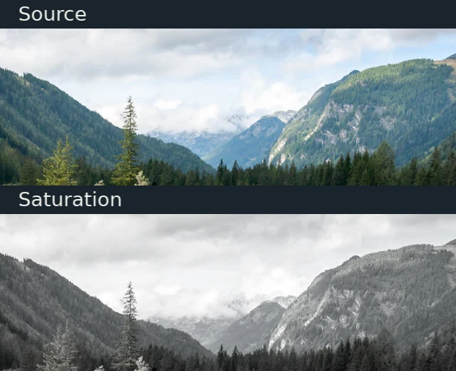{ loading=lazy width=640 height=520 }

Reduce the green and blue color while keeping the same tonal structure.

```python
Saturation(amount=0.1)
```

[Parameters](../../reference/effect-parameters.md#saturation-saturation)

</div>

<div class="gallery-card" markdown>

### Tint

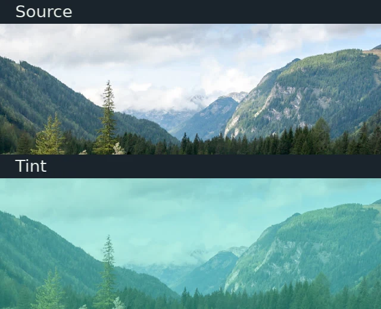{ loading=lazy width=640 height=520 }

Mix a selected mint color into the photograph.

```python
Tint(colour='#4ed5bf', amount=0.45)
```

[Parameters](../../reference/effect-parameters.md#tint-tint)

</div>

<div class="gallery-card" markdown>

### ColorAdjust

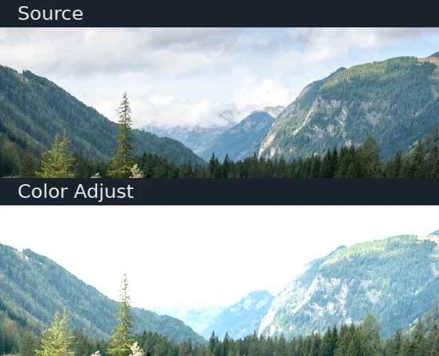{ loading=lazy width=640 height=520 }

Exposure lifts the image, while gamma opens its midtones.

```python
ColorAdjust(
    exposure=0.5,
    gamma=1.3,
    black_point=0,
    white_point=1,
)
```

[Parameters](../../reference/effect-parameters.md#coloradjust-color_adjust)

</div>

</div>

## Blur and light

<div class="gallery-grid" markdown>

<div class="gallery-card" markdown>

### GaussianBlur

{ loading=lazy width=640 height=520 }

Soften the same tree silhouettes equally in every direction.

```python
GaussianBlur(radius=5)
```

[Parameters](../../reference/effect-parameters.md#gaussianblur-gaussian_blur)

</div>

<div class="gallery-card" markdown>

### DirectionalBlur

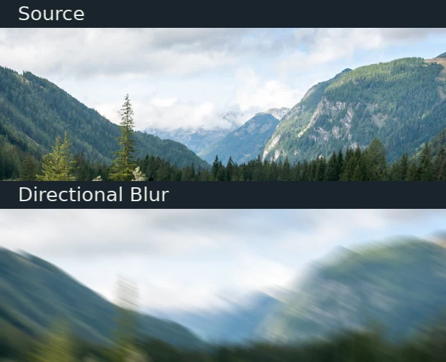{ loading=lazy width=640 height=520 }

Stretch those edges along the selected 25° direction.

```python
DirectionalBlur(radius=16, angle_degrees=25)
```

[Parameters](../../reference/effect-parameters.md#directionalblur-directional_blur)

</div>

<div class="gallery-card" markdown>

### ZoomBlur

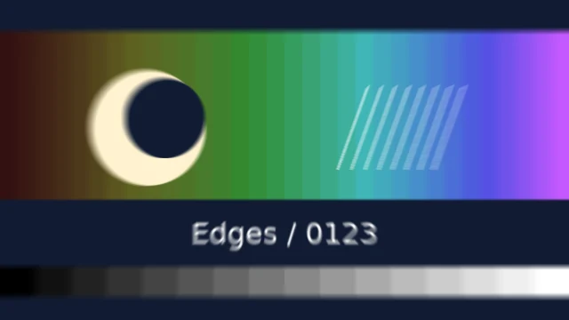{ loading=lazy width=640 height=520 }

Spread detail along rays from the middle of the valley.

```python
ZoomBlur(radius=18, samples=24, anchor=(0.5, 0.5))
```

[Parameters](../../reference/effect-parameters.md#zoomblur-zoom_blur)

</div>

<div class="gallery-card" markdown>

### RadialBlur

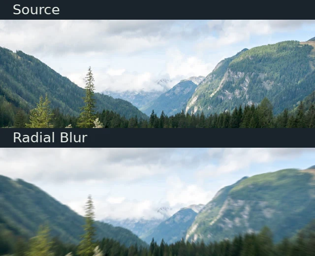{ loading=lazy width=640 height=520 }

Current RadialBlur also uses centered zoom samples, with a bindable center and 16 taps. It is not rotational blur.

```python
RadialBlur(amount=12, center=(0.5, 0.5))
```

[Parameters](../../reference/effect-parameters.md#radialblur-radial_blur)

</div>

<div class="gallery-card" markdown>

### Glow

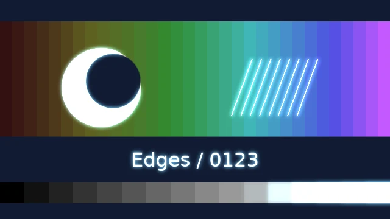{ loading=lazy width=640 height=520 }

Bright edges spread into a blue halo; the dark background stays controlled.

```python
Glow(
    threshold=0.55,
    radius=14,
    intensity=1.8,
    colour='#8adfff',
)
```

[Parameters](../../reference/effect-parameters.md#glow-glow)

</div>

<div class="gallery-card" markdown>

### Bloom

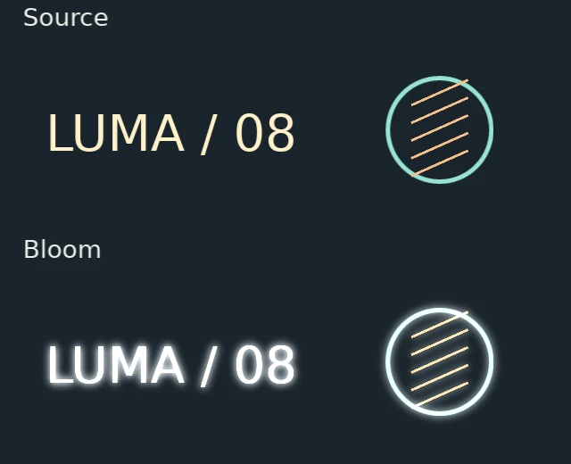{ loading=lazy width=640 height=520 }

Spread the original warm and mint highlights, rather than adding a chosen glow color.

```python
Bloom(threshold=0.55, radius=14, intensity=1.8)
```

[Parameters](../../reference/effect-parameters.md#bloom-bloom)

</div>

<div class="gallery-card" markdown>

### ChromaticAberration

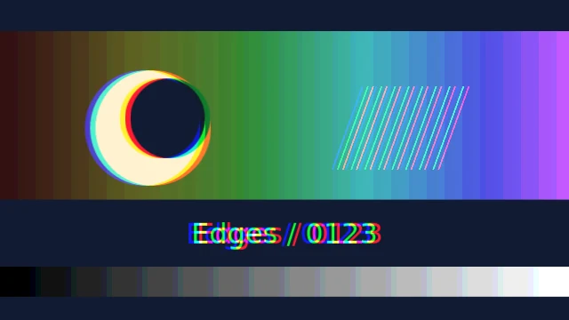{ loading=lazy width=640 height=520 }

Offset color channels at the bright letter and ring edges.

```python
ChromaticAberration(amount=6, angle_degrees=0)
```

[Parameters](../../reference/effect-parameters.md#chromaticaberration-chromatic_aberration)

</div>

<div class="gallery-card" markdown>

### Vignette

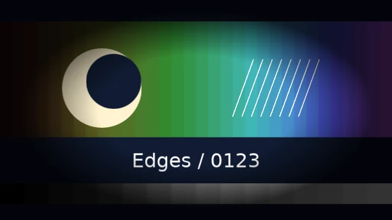{ loading=lazy width=640 height=520 }

Keep attention on the valley by darkening the photograph toward its edges.

```python
Vignette(
    amount=0.8,
    radius=0.5,
    softness=0.4,
    colour='#000000',
)
```

[Parameters](../../reference/effect-parameters.md#vignette-vignette)

</div>

<div class="gallery-card" markdown>

### Sharpen

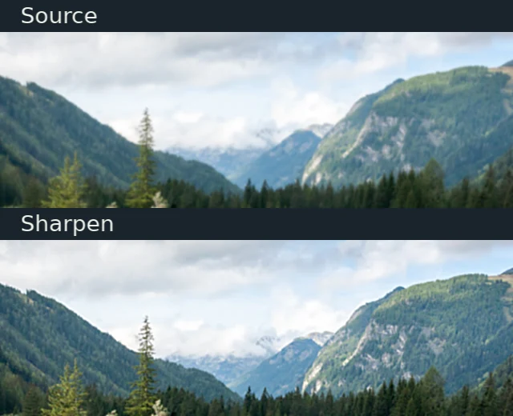{ loading=lazy width=640 height=520 }

Both inputs start with a 3-pixel Gaussian blur. Sharpen restores local edge contrast in the lower image; it cannot recover missing detail.

```python
Sharpen(amount=2.5, radius=3)
```

[Parameters](../../reference/effect-parameters.md#sharpen-sharpen)

</div>

</div>

## Palettes and print

[Palettes and dithering](palettes-and-dithering.md) explains mode, pattern and input-detail choices.

<div class="gallery-grid" markdown>

<div class="gallery-card" markdown>

### PaletteMap

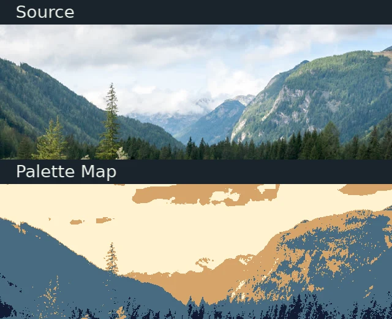{ loading=lazy width=640 height=520 }

Turn the forest and cliffs into discrete tonal color bands.

```python
PaletteMap(palette=PALETTE, mode='nearest')
```

[Parameters](../../reference/effect-parameters.md#palettemap-palette_map)

</div>

<div class="gallery-card" markdown>

### OrderedDither

{ loading=lazy width=640 height=520 }

Mix the same palette colors in a repeating Bayer pattern to preserve intermediate tones.

```python
OrderedDither(
    palette=PALETTE,
    matrix='bayer8',
    scale=1,
)
```

[Parameters](../../reference/effect-parameters.md#ordereddither-ordered_dither)

</div>

<div class="gallery-card" markdown>

### OrderedDither · blue noise

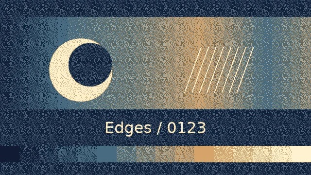{ loading=lazy width=640 height=520 }

Replace the regular Bayer pattern with a fixed, less regular threshold pattern.

```python
OrderedDither(
    palette=PALETTE,
    matrix='blue_noise',
    seed=37,
)
```

[Parameters](../../reference/effect-parameters.md#ordereddither-ordered_dither)

</div>

<div class="gallery-card" markdown>

### Halftone

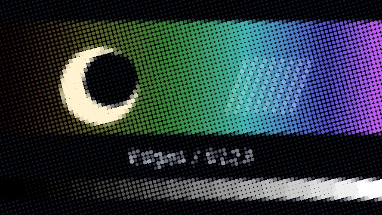{ loading=lazy width=640 height=520 }

Replace continuous photograph detail with dots whose area follows cell tone.

```python
Halftone(mode='source', cell_size=5, softness=0.5)
```

[Parameters](../../reference/effect-parameters.md#halftone-halftone)

</div>

<div class="gallery-card" markdown>

### PixelSort

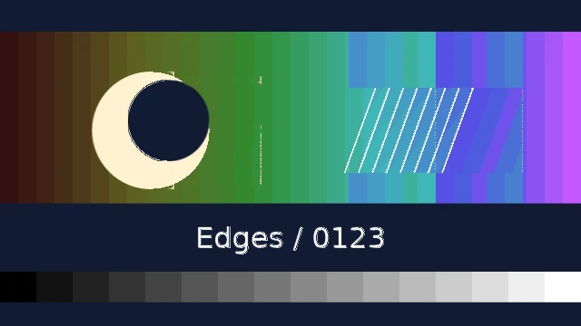{ loading=lazy width=640 height=520 }

Reorder eligible horizontal runs in 96-pixel blocks. Tree and mountain edges become bounded horizontal streaks.

```python
PixelSort(
    direction='horizontal',
    segment_length=96,
    amount=1,
)
```

[Parameters](../../reference/effect-parameters.md#pixelsort-pixel_sort)

</div>

</div>

## Characters and motion

[ASCII](ascii.md) explains glyph coverage and readability. Play the motion comparisons deliberately with the native controls.

<div class="gallery-grid" markdown>

<div class="gallery-card" markdown>

### Ascii

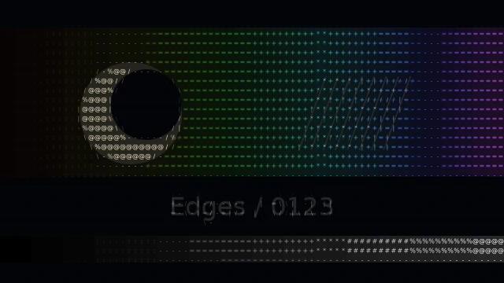{ loading=lazy width=640 height=520 }

Express the photograph with light characters over a dark background; larger 10×14 cells expose the glyph structure.

```python
Ascii(
    cell_width=10,
    cell_height=14,
    foreground='#efe1b8',
    background='#172126',
)
```

[Parameters](../../reference/effect-parameters.md#ascii-ascii)

</div>

<div class="gallery-card" markdown>

### PseudoAscii

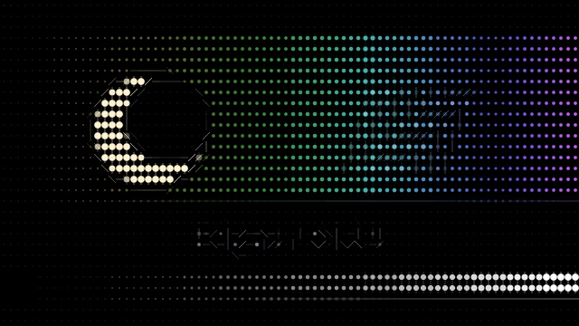{ loading=lazy width=640 height=520 }

Use geometric marks instead of font glyphs on the same photograph and cell grid.

```python
PseudoAscii(
    cell_width=10,
    cell_height=14,
    foreground='#efe1b8',
    background='#172126',
)
```

[Parameters](../../reference/effect-parameters.md#ascii-ascii)

</div>

<div class="gallery-card gallery-card--comparison" markdown>

### Crt

<video controls playsinline preload="metadata" width="640" height="640" poster="../../../assets/renders/effect-crt.webp" aria-label="Synchronized source above and Crt treatment below.">
  <source src="../../assets/renders/effect-crt.mp4" type="video/mp4">
  <a href="../../assets/renders/effect-crt.mp4">Download the Crt comparison</a>.
</video>

The stationary photograph acquires scanlines, seeded grain, rolling brightness and jitter. Only the lower view changes over time.

```python
Crt(period=2, seed=7, jitter=1.5, grain=0.05)
```

[Parameters](../../reference/effect-parameters.md#crt-crt)

</div>

<div class="gallery-card gallery-card--comparison" markdown>

### CameraShake

<video controls playsinline preload="metadata" width="640" height="640" poster="../../../assets/renders/effect-camera-shake.webp" aria-label="Synchronized source above and CameraShake treatment below.">
  <source src="../../assets/renders/effect-camera-shake.mp4" type="video/mp4">
  <a href="../../assets/renders/effect-camera-shake.mp4">Download the CameraShake comparison</a>.
</video>

The upper photograph is still. The lower one adds seeded translation and rotation; a three-second decay keeps the movement visible. Both start with the same 1.5× overscan.

```python
CameraShake(
    position_amount=0.08,
    rotation_degrees=4,
    scale_amount=0.02,
    frequency=7,
    seed=7,
    attack=0.1,
    decay=3,
)
```

[Parameters](../../reference/effect-parameters.md#camerashake-camera_shake)

</div>

<div class="gallery-card gallery-card--comparison" markdown>

### MotionBlur

<video controls playsinline preload="metadata" width="640" height="640" poster="../../../assets/renders/effect-motion-blur.webp" aria-label="Synchronized source above and MotionBlur treatment below.">
  <source src="../../assets/renders/effect-motion-blur.mp4" type="video/mp4">
  <a href="../../assets/renders/effect-motion-blur.mp4">Download the MotionBlur comparison</a>.
</video>

Both striped objects follow the same rapid left–right path. Only the lower object smears along its velocity; pause mid-travel to compare the dark bars.

```python
MotionBlur(
    intensity=2,
    shutter_angle=270,
    max_radius=32,
    samples=16,
)
```

[Parameters](../../reference/effect-parameters.md#motionblur-motion_blur)

</div>

<div class="gallery-card gallery-card--comparison" markdown>

### MotionTile

<video controls playsinline preload="metadata" width="640" height="640" poster="../../../assets/renders/effect-motion-tile.webp" aria-label="Synchronized source above and MotionTile treatment below.">
  <source src="../../assets/renders/effect-motion-tile.mp4" type="video/mp4">
  <a href="../../assets/renders/effect-motion-tile.mp4">Download the MotionTile comparison</a>.
</video>

Both images shrink and rotate identically. The light outline marks the original image bounds; only the lower view samples mirrored copies outside that outline.

```python
MotionTile(
    output_width_percent=300,
    output_height_percent=300,
    mirror_edges=True,
)
```

[Parameters](../../reference/effect-parameters.md#motiontile-motion_tile)

This comparison uses `anchor=(0, 0)` on both images. The current renderer shifts
center-anchored virtual bounds; simply increasing the extent can leave the
right and bottom uncovered. The [isolated reproduction](../../development/documentation.md#motion-tile-anchor-limitation)
records that engine issue. No engine behavior was changed for this example.

</div>

</div>

<span id="the-controlled-input"></span>

## Complete example

Save [effects_catalog.py](../../assets/examples/effects_catalog.py) and
[landscape.jpg](../../assets/examples/landscape.jpg) in the same directory:

```bash
python effects_catalog.py --effect gaussian-blur --still
python effects_catalog.py --effect motion-blur
```

These write `effect-gaussian-blur.webp` and a three-second `effect-motion-blur.mp4`;
rerunning replaces those files. Every treatment above is selected by its
hyphenated effect name. `PALETTE` in the settings is
`("#101b32", "#476b80", "#d6a46b", "#fff2cf")`; other unlisted controls use defaults.

Photograph: “Landscape in Salzburger Land” by Dimitry Anikin, CC0; cropped from
[the existing licensed input](https://commons.wikimedia.org/wiki/File:Landscape_in_Salzburger_Land.jpg).
The light and motion graphics are original. [Input source record](../../assets/examples/learning-inputs.txt).


<span id="compare-and-reproduce"></span>

Continue with [order-dependent processing](../../concepts/effects-transitions-and-animation.md#order-changes-the-result)
or [composed treatments](effect-treatments.md) when combining effects.
