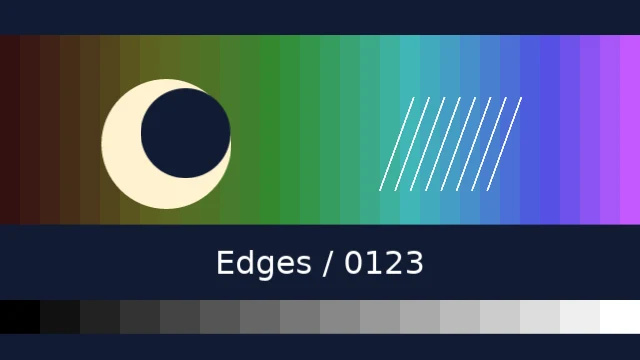

# Visual effect catalog

Choose a look by its visible result, then follow its parameter link for the
exact contract. These are representative **CPU renders**, not a test of every
parameter combination or a WGPU parity claim. All 23 public canonical effects
are represented, plus the PseudoAscii convenience and a second dither pattern.

- [Color and tone](#color-and-tone): change tonal relationships and color.
- [Blur and light](#blur-and-light): spread, separate or emphasize edges.
- [Palettes and print](#palettes-and-print): reduce colors and image detail.
- [Characters and motion](#characters-and-motion): analyze cells or change over time.

## The controlled input



The same 640×360 study reveals tone, small edges and broad features. Each static
preview adds exactly one effect. The final motion cases use the same study with
specified transform animation; their baseline controls are shown alongside them.
Settings below come from `effect_cases()` in the downloadable
[complete source](../../assets/examples/effects_catalog.py). `PALETTE` means
`("#101b32", "#476b80", "#d6a46b", "#fff2cf")`. Unlisted controls use Python defaults.

Download the file and run a selected study:

```bash
python effects_catalog.py --effect gaussian-blur --still
python effects_catalog.py --effect crt
```

The first writes `effect-gaussian-blur.webp`; the second writes a 2-second
`effect-crt.mp4`. Rerunning replaces named outputs. All inputs are original
procedural Vestra content and bundled-font text; no downloads are required.
The [processing model](../../concepts/effects-transitions-and-animation.md)
explains attachment order, scope and coordinates. The [basic guide](effects.md)
explains keeping and animating returned handles.

## Color and tone

<div class="gallery-grid" markdown>

<div class="gallery-card" markdown>

### Brightness

{ loading=lazy width=640 height=360 }

Lift every channel. Watch the dark ramp lose its deepest steps.

```python
Brightness(amount=0.15)
```

[Parameters](../../reference/effect-parameters.md#brightness-brightness) · [Runnable source](../../assets/examples/effects_catalog.py)

</div>

<div class="gallery-card" markdown>

### Contrast

{ loading=lazy width=640 height=360 }

Separate dark and light tones around the midpoint.

```python
Contrast(amount=1.5)
```

[Parameters](../../reference/effect-parameters.md#contrast-contrast) · [Runnable source](../../assets/examples/effects_catalog.py)

</div>

<div class="gallery-card" markdown>

### Saturation

{ loading=lazy width=640 height=360 }

Reduce chroma while retaining the tonal structure.

```python
Saturation(amount=0)
```

[Parameters](../../reference/effect-parameters.md#saturation-saturation) · [Runnable source](../../assets/examples/effects_catalog.py)

</div>

<div class="gallery-card" markdown>

### Tint

{ loading=lazy width=640 height=360 }

Mix a selected color into the study.

```python
Tint(colour='#4ed5bf', amount=0.65)
```

[Parameters](../../reference/effect-parameters.md#tint-tint) · [Runnable source](../../assets/examples/effects_catalog.py)

</div>

<div class="gallery-card" markdown>

### ColorAdjust

{ loading=lazy width=640 height=360 }

Lift midtones with gamma and exposure; watch highlights for clipping.

```python
ColorAdjust(exposure=0.5, gamma=1.3, black_point=0, white_point=1)
```

[Parameters](../../reference/effect-parameters.md#coloradjust-color_adjust) · [Runnable source](../../assets/examples/effects_catalog.py)

</div>

</div>

## Blur and light

<div class="gallery-grid" markdown>

<div class="gallery-card" markdown>

### GaussianBlur

{ loading=lazy width=640 height=360 }

Soften equally in all directions; compare the small lines with the original.

```python
GaussianBlur(radius=5)
```

[Parameters](../../reference/effect-parameters.md#gaussianblur-gaussian_blur) · [Runnable source](../../assets/examples/effects_catalog.py)

</div>

<div class="gallery-card" markdown>

### DirectionalBlur

{ loading=lazy width=640 height=360 }

Spread detail along a selected direction.

```python
DirectionalBlur(radius=16, angle_degrees=25)
```

[Parameters](../../reference/effect-parameters.md#directionalblur-directional_blur) · [Runnable source](../../assets/examples/effects_catalog.py)

</div>

<div class="gallery-card" markdown>

### ZoomBlur

{ loading=lazy width=640 height=360 }

Spread detail along rays from the anchor; the center moves least.

```python
ZoomBlur(radius=18, samples=24, anchor=(0.5, 0.5))
```

[Parameters](../../reference/effect-parameters.md#zoomblur-zoom_blur) · [Runnable source](../../assets/examples/effects_catalog.py)

</div>

<div class="gallery-card" markdown>

### RadialBlur

{ loading=lazy width=640 height=360 }

Current RadialBlur uses centered zoom samples with 16 taps; unlike ZoomBlur, its center is a dynamic property. It does not produce rotational trails.

```python
RadialBlur(amount=12, center=(0.5, 0.5))
```

[Parameters](../../reference/effect-parameters.md#radialblur-radial_blur) · [Runnable source](../../assets/examples/effects_catalog.py)

</div>

<div class="gallery-card" markdown>

### Glow

{ loading=lazy width=640 height=360 }

Tint light spread from pixels above the threshold.

```python
Glow(threshold=0.65, radius=10, intensity=1.5, colour='#8adfff')
```

[Parameters](../../reference/effect-parameters.md#glow-glow) · [Runnable source](../../assets/examples/effects_catalog.py)

</div>

<div class="gallery-card" markdown>

### Bloom

{ loading=lazy width=640 height=360 }

Spread bright source colors beyond their original edges.

```python
Bloom(threshold=0.65, radius=10, intensity=1.5)
```

[Parameters](../../reference/effect-parameters.md#bloom-bloom) · [Runnable source](../../assets/examples/effects_catalog.py)

</div>

<div class="gallery-card" markdown>

### ChromaticAberration

{ loading=lazy width=640 height=360 }

Separate channels across high-contrast edges.

```python
ChromaticAberration(amount=6, angle_degrees=0)
```

[Parameters](../../reference/effect-parameters.md#chromaticaberration-chromatic_aberration) · [Runnable source](../../assets/examples/effects_catalog.py)

</div>

<div class="gallery-card" markdown>

### Vignette

{ loading=lazy width=640 height=360 }

Darken the periphery while retaining the center.

```python
Vignette(amount=0.8, radius=0.5, softness=0.4, colour='#000000')
```

[Parameters](../../reference/effect-parameters.md#vignette-vignette) · [Runnable source](../../assets/examples/effects_catalog.py)

</div>

<div class="gallery-card" markdown>

### Sharpen

{ loading=lazy width=640 height=360 }

Increase local edge contrast; inspect small lines and circle contours.

```python
Sharpen(amount=2, radius=2)
```

[Parameters](../../reference/effect-parameters.md#sharpen-sharpen) · [Runnable source](../../assets/examples/effects_catalog.py)

</div>

</div>

## Palettes and print

Read [palettes and dithering](palettes-and-dithering.md) for mode, pattern and input-detail decisions.

<div class="gallery-grid" markdown>

<div class="gallery-card" markdown>

### PaletteMap

{ loading=lazy width=640 height=360 }

Nearest tonal stops create discrete bands in the smooth ramp.

```python
PaletteMap(palette=PALETTE, mode='nearest')
```

[Parameters](../../reference/effect-parameters.md#palettemap-palette_map) · [Runnable source](../../assets/examples/effects_catalog.py)

</div>

<div class="gallery-card" markdown>

### OrderedDither

{ loading=lazy width=640 height=360 }

A fine repeating Bayer pattern preserves intermediate tone as color mixtures.

```python
OrderedDither(palette=PALETTE, matrix='bayer8', scale=1)
```

[Parameters](../../reference/effect-parameters.md#ordereddither-ordered_dither) · [Runnable source](../../assets/examples/effects_catalog.py)

</div>

<div class="gallery-card" markdown>

### OrderedDither · blue noise

{ loading=lazy width=640 height=360 }

The same palette with a less regular fixed threshold pattern.

```python
OrderedDither(palette=PALETTE, matrix='blue_noise', seed=37)
```

[Parameters](../../reference/effect-parameters.md#ordereddither-ordered_dither) · [Runnable source](../../assets/examples/effects_catalog.py)

</div>

<div class="gallery-card" markdown>

### Halftone

{ loading=lazy width=640 height=360 }

Cell averages become dots; the text and fine lines lose source detail.

```python
Halftone(mode='source', cell_size=7, softness=0.5)
```

[Parameters](../../reference/effect-parameters.md#halftone-halftone) · [Runnable source](../../assets/examples/effects_catalog.py)

</div>

<div class="gallery-card" markdown>

### PixelSort

{ loading=lazy width=640 height=360 }

Eligible horizontal runs reorder within fixed blocks; inspect the circle and colored ramp.

```python
PixelSort(direction='horizontal', segment_length=96, amount=1)
```

[Parameters](../../reference/effect-parameters.md#pixelsort-pixel_sort) · [Runnable source](../../assets/examples/effects_catalog.py)

</div>

</div>

## Characters and motion

Read [ASCII](ascii.md) for readable cell sizes and glyph coverage. The motion previews below are silent; use native controls to play and seek.

<figure>
<video controls playsinline preload="metadata" width="640" height="360" poster="../../../assets/renders/effect-motion-original.webp" aria-label="Moving baseline: scale 1.1, rotation −12° to 12°, x position 0.35 to 0.65">
  <source src="../../assets/renders/effect-motion-original.mp4" type="video/mp4">
  <a href="../../assets/renders/effect-motion-original.mp4">Download the baseline video</a>.
</video>
<figcaption>Moving baseline: scale 1.1, rotation −12° to 12°, x position 0.35 to 0.65; 2 seconds. These controls have no effect attached.</figcaption>
</figure>

<figure>
<video controls playsinline preload="metadata" width="640" height="360" poster="../../../assets/renders/effect-tile-original.webp" aria-label="Shrunken baseline: scale 0.7 with the same rotation and position tracks">
  <source src="../../assets/renders/effect-tile-original.mp4" type="video/mp4">
  <a href="../../assets/renders/effect-tile-original.mp4">Download the baseline video</a>.
</video>
<figcaption>Shrunken baseline: scale 0.7 with the same rotation and position tracks; 2 seconds. These controls have no effect attached.</figcaption>
</figure>

<div class="gallery-grid" markdown>

<div class="gallery-card" markdown>

### Ascii

{ loading=lazy width=640 height=360 }

Character cells use source colors with a small amount of original detail mixed back.

```python
Ascii(cell_width=8, cell_height=12, color_mode='source', source_mix=0.15)
```

[Parameters](../../reference/effect-parameters.md#ascii-ascii) · [Runnable source](../../assets/examples/effects_catalog.py)

</div>

<div class="gallery-card" markdown>

### PseudoAscii

{ loading=lazy width=640 height=360 }

Geometric marks express the same cell measurements without a glyph font.

```python
PseudoAscii(cell_width=8, cell_height=12, color_mode='source')
```

[Parameters](../../reference/effect-parameters.md#ascii-ascii) · [Runnable source](../../assets/examples/effects_catalog.py)

</div>

<div class="gallery-card" markdown>

### Crt

<video controls playsinline preload="metadata" width="640" height="360" poster="../../../assets/renders/effect-crt.webp" aria-label="Crt study: Play to see continuous seeded grain, rolling brightness and jitter on a stationary input.">
  <source src="../../assets/renders/effect-crt.mp4" type="video/mp4">
  <a href="../../assets/renders/effect-crt.mp4">Download Crt video</a>.
</video>

Play to see continuous seeded grain, rolling brightness and jitter on a stationary input.

```python
Crt(period=2, seed=7, jitter=1.5, grain=0.05)
```

[Parameters](../../reference/effect-parameters.md#crt-crt) · [Runnable source](../../assets/examples/effects_catalog.py)

</div>

<div class="gallery-card" markdown>

### CameraShake

<video controls playsinline preload="metadata" width="640" height="360" poster="../../../assets/renders/effect-camera-shake.webp" aria-label="CameraShake study: Compare with the moving baseline: seeded shake adds motion to the same authored transform.">
  <source src="../../assets/renders/effect-camera-shake.mp4" type="video/mp4">
  <a href="../../assets/renders/effect-camera-shake.mp4">Download CameraShake video</a>.
</video>

Compare with the moving baseline: seeded shake adds motion to the same authored transform.

```python
CameraShake(position_amount=0.025, rotation_degrees=2, scale_amount=0.02, frequency=5, seed=7, attack=0.1, decay=0.2)
```

[Parameters](../../reference/effect-parameters.md#camerashake-camera_shake) · [Runnable source](../../assets/examples/effects_catalog.py)

</div>

<div class="gallery-card" markdown>

### MotionBlur

<video controls playsinline preload="metadata" width="640" height="360" poster="../../../assets/renders/effect-motion-blur.webp" aria-label="MotionBlur study: Compare with the moving baseline: transform velocity determines smearing, not the static image alone.">
  <source src="../../assets/renders/effect-motion-blur.mp4" type="video/mp4">
  <a href="../../assets/renders/effect-motion-blur.mp4">Download MotionBlur video</a>.
</video>

Compare with the moving baseline: transform velocity determines smearing, not the static image alone.

```python
MotionBlur(intensity=1, shutter_angle=270, max_radius=32, samples=16)
```

[Parameters](../../reference/effect-parameters.md#motionblur-motion_blur) · [Runnable source](../../assets/examples/effects_catalog.py)

</div>

<div class="gallery-card" markdown>

### MotionTile

<video controls playsinline preload="metadata" width="640" height="360" poster="../../../assets/renders/effect-motion-tile.webp" aria-label="MotionTile study: Compare with the shrunken baseline: mirrored virtual repeats fill the area around the moving source.">
  <source src="../../assets/renders/effect-motion-tile.mp4" type="video/mp4">
  <a href="../../assets/renders/effect-motion-tile.mp4">Download MotionTile video</a>.
</video>

Compare with the shrunken baseline: mirrored virtual repeats fill the area around the moving source.

```python
MotionTile(output_width_percent=200, output_height_percent=200, mirror_edges=True)
```

[Parameters](../../reference/effect-parameters.md#motiontile-motion_tile) · [Runnable source](../../assets/examples/effects_catalog.py)

</div>

</div>

## Compare and reproduce

The catalog shows one selected setting per effect. For controlled stack order,
see [blur before and after dithering](../../concepts/effects-transitions-and-animation.md#order-changes-the-result).
For combining effects, continue with [composed treatments](effect-treatments.md).
All previews use CPU; [feature support](../../reference/feature-support.md)
distinguishes specific WGPU evidence and limits.

From a native source checkout, regenerate all learning assets with:

```bash
just python-sync
just docs-media --learning
```

The renderer keeps originals and QA output under `target/docs-media/`, commits
only web previews, and records original-video hashes, poster times and selected
backend in [the media manifest](../../assets/renders/learning-media.json).
Static previews sample 0.7 seconds; motion posters also sample 0.7 seconds.
Inspect the output after regeneration; FFmpeg versions may change encoding bytes.
See [documentation authoring](../../development/documentation.md) for the complete
workflow and [effect contracts](../../reference/effects.md) for alpha, ownership
and implementation-reference links.
