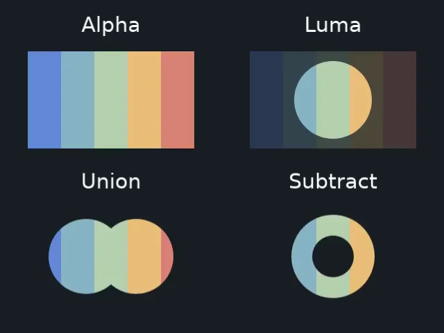

# Layer masks

A mask reveals part of a layer without changing its source image. Start with a
circular portrait crop, then add a soft reveal and a cutout one step at a time.
Use your own `character.png` in the directory where you run the script.
For the coverage model, read [masks and mattes](../../concepts/masks-and-mattes.md).

<figure markdown="span">

<figcaption>Actual Vestra output. Alpha and luma use identical mask artwork: a white circle over an opaque dark gray background. Only luma uses that background's brightness as partial coverage.</figcaption>
</figure>

The lower examples show two circles combined with union and subtract. The
[complete procedural comparison](../../assets/examples/concepts_masks.py)
needs no image files; its source and reproduction command are below. You can
also [download its three-second MP4](../../assets/renders/concepts-masks.mp4).

## Start with a circular crop

```python
from vestra import Circle, Image, Project

project = Project(
    size=(1920, 1080),
    fps=30,
    duration=5,
)

photo = Image("character.png")
portrait = project.root.add(photo)

circle = Circle(radius=300, fill="#ffffff")
window = portrait.masks.add(circle)
```

The portrait inherits the project's five-second duration. The circle is centered
on the layer and its radius is in pixels. Its white fill supplies opaque
coverage: you see the photo inside the circle, not a white circle over it.
The layer's transform moves the photo and its mask together.

## Animate a soft reveal

Continue with the same `window`; there is no need to add another circle:

```python
window.feather = 20
window.transform.scale.keyframe(0, 0.2)
window.transform.scale.keyframe(2, 1)
```

The window grows from 20% to full size over two seconds, then holds its size.
These times are measured from the portrait layer's start. Feathering softens the
edge over 20 output pixels; it does not blur the photograph itself.

## Cut a hole out of the portrait

Add a smaller circle with a subtract operation:

```python
from vestra import MaskOperation

hole = Circle(radius=120, fill="#ffffff")
portrait.masks.add(hole, operation=MaskOperation.SUBTRACT)
```

Masks combine in declaration order. The first mask reveals a circular window;
the second removes its center. The hole stays fixed while the outer window grows,
so the result is an expanding ring. Leave out this step when you want a solid portrait.

## Render the result

```python
project.render("portrait-reveal.mp4", backend="cpu", overwrite=True)
```

This writes a five-second, silent MP4 to the current directory. Rerunning it
replaces that file. To try the alternatives below, replace the masks before
rendering again.

## Use an image as a mask

A grayscale image can supply coverage through its brightness. Here `gradient.png`
is a separate image: bright areas reveal the portrait and dark areas hide it.

```python
from vestra import MaskCoverageMode

portrait.masks.clear()
gradient = Image("gradient.png")
portrait.masks.add(gradient, mode=MaskCoverageMode.LUMA, feather=12)
```

To use an image's transparency instead, replace that mask with an alpha mask:

```python
portrait.masks.clear()
alpha_image = Image("alpha.png")
image_mask = portrait.masks.add(alpha_image, feather=8)
image_mask.transform.scale = 0.75
```

Alpha coverage is the default for image masks. Images keep their intrinsic pixel
size; use the mask transform to align a differently sized mask with the photo.
The mask image and the portrait do not need to be the same file or dimensions.

## Use text or grouped content

A mask can own a normal visual source. For example, reveal the photo through
letters using the bundled font:

```python
from vestra import Text

portrait.masks.clear()
lettering = Text("Vestra", font_size=96)
portrait.masks.add(lettering)
```

For a composite mask, put its parts in a `Group`. This example combines a masked
rectangle and a text label before turning their rendered alpha into coverage:

```python
from vestra import Group, Rectangle

portrait.masks.clear()
mask_artwork = Group()

backplate = mask_artwork.add(Rectangle(width=900, height=600, fill="#ffffff"))
backplate.masks.add(Circle(radius=240, fill="#ffffff"))
mask_artwork.add(Text("Vestra", font_size=96))

portrait.masks.add(mask_artwork)
```

For an opaque backdrop inside a `Group` mask, use a filled `Rectangle` sized to
its canvas. A `Color` child currently fails validation with
`VESTRA-SOLID-TRANSFORM` in this owned-mask path; the comparison uses a rectangle
and leaves engine behavior unchanged.

Video, spectrum and particle sources can also provide coverage. Video masks play
from source time zero; spectrum masks need audio on the project timeline. See the
[masks reference](../../reference/masks.md) for supported sources and timing rules.

## Use a sibling layer as a matte

An owned mask takes a source and follows the portrait. A track matte takes a
separate layer in the same composition and keeps its own timeline and transform.
Continue with the existing `project` and `portrait`, replacing the owned masks:

```python
from vestra import MatteMode

portrait.masks.clear()
matte_layer = project.root.add(
    Text("Vestra", font_size=180),
    duration=5,
    visible=False,
    id="portrait-matte",
)
portrait.set_matte(matte_layer, mode=MatteMode.ALPHA)
```

The text reveals the portrait without also drawing white letters over it.
`visible=False` suppresses its ordinary display while preserving matte coverage
in its active interval. Moving the portrait does not move the matte. A layer can
have one matte and multiple owned masks; masks apply first, then matte coverage,
then final opacity and compositing. See [track matte rules](../../reference/masks.md#track-mattes)
for timing, inversion and validation restrictions.

## Coverage, timing and ordering

`portrait.masks.items` preserves declaration order. Use `remove()` to remove one
mask or `clear()` to start again. Every addition copies the source and its
constructor transform defaults; edit the returned mask afterward.

### Alpha and brightness

The default is alpha coverage: opaque pixels reveal regardless of color.
`LUMA` uses encoded RGB brightness multiplied by alpha. Shapes use their rendered
alpha, including strokes and antialiased edges. See [coverage examples](../../concepts/masks-and-mattes.md#alpha-and-brightness-answer-different-questions)
and [exact input rules](../../reference/masks.md#canonical-inputs).

### Combine masks

Coverage starts at one. An initial `INTERSECT` or `REPLACE` establishes a
silhouette; `UNION` adds another region and `SUBTRACT` removes one. An initial
`UNION` alone cannot reduce full coverage. `invert` reverses the incoming mask;
`strength=0` leaves accumulated coverage unchanged. See the
[operation table](../../concepts/masks-and-mattes.md#combine-coverage-in-order)
and [reference equations](../../reference/masks.md).

### Animate mask properties

`strength`, `feather` and mask transforms support the ordinary property tracks
and signal bindings. Their animation uses the owning layer's local time. Refer
to [animation and keyframes](../../learn/animation.md) for interpolation rather
than changing source geometry. Moving the layer moves its owned masks together;
moving `mask.transform` changes the reveal within it.

??? note "Runtime property details"

    A uniform `mask.transform.scale.bind(signal)` lowers to the same `scale_x`
    and `scale_y` component modifiers used by layer transforms. Static masks can
    be cached; animated, modifier-driven or signal-driven mask properties make
    their owning layer dynamic.

### Feathering and source defaults

Feather filters coverage before inversion and combination. It supports fractional
values from `0` to `256` output pixels, with zero coverage beyond the canvas.
Effects run before masks; final opacity runs afterward. Groups can own masks,
but a composition has no mask stack. Video masks start at source zero at normal
speed, independently of the owning layer's video offset and rate. For owned group
children and direct image/video sizing restrictions, see
[mask source and timing reference](../../reference/masks.md#canonical-inputs).

## Reproduce the comparison

[Download concepts_masks.py](../../assets/examples/concepts_masks.py), then run
`uv run python concepts_masks.py` using the same installation as the tutorials.
It writes `concepts-masks.mp4`: three seconds of static, silent output at
640 × 480 and 30 fps on CPU. Rerunning replaces that file. The preview above is
its frame at 0.5 seconds. All graphics and code are original project work under
MIT; labels use the bundled font and its packaged notice.

??? example "Complete comparison source"

    ```python title="concepts_masks.py"
    --8<-- "docs/assets/examples/concepts_masks.py"
    ```

Contributors regenerate the site still using the
[documentation media workflow](../../development/documentation.md#reproduce-tutorial-previews).
The comparison supplies the same original artwork to each placement, changing
only masks. Use it to isolate coverage behavior before adding animation or media.
