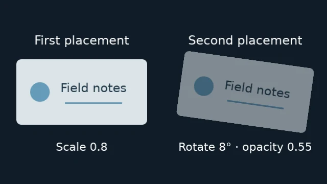

# Use groups and nested compositions

A group combines children into one visual result. Build a standalone `Group`,
then place it with `project.root.add(group)`. Moving, scaling, rotating or fading
that placement affects all its children together.

<figure class="comparison" markdown="span">

<figcaption>One completed source, two independent placements. The right card's rotation and opacity leave the left card unchanged.</figcaption>
</figure>

```python
--8<-- "examples/tutorials/group_placements.py"
```

The [complete card example](https://raw.githubusercontent.com/evgen2571/vestra/develop/examples/tutorials/group_placements.py) needs no assets.
Run `python group_placements.py` to write `group-placements.mp4`; rerunning replaces
it. Its graphics are original and use the bundled font.

## Compose locally, then transform the result

A group has its own canvas. Its children use positions relative to that canvas;
the group's placement uses positions relative to its parent. The root canvas
matches the project's output size. Within either canvas, `(0, 0)` is the
top-left and `(1, 1)` is the bottom-right.

<figure class="diagram" markdown="span">

<figcaption><code>position</code> uses the parent canvas: root for the group, group for the child.</figcaption>
</figure>

This new example matches the diagram. The small rectangle fades in after its
panel appears:

```python
from vestra import Group, Project, Rectangle

project = Project(
    size=(640, 360),
    fps=30,
    duration=5,
    background="#101c27",
)

panel = Group(size=(320, 180))

panel.add(
    Rectangle(
        width=320,
        height=180,
        fill="#263e4b",
    )
)

marker = panel.add(
    Rectangle(
        width=100,
        height=60,
        fill="#e9bd72",
    ),
    position=(0.25, 0.5),
    start=0.5,
    duration=2,
)

# Animate the child before placement.
# Adding the group copies this state.
marker.opacity.keyframe(0, 0)
marker.opacity.keyframe(0.5, 1)

placed_panel = project.root.add(
    panel,
    position=(0.5, 0.5),
    start=1,
    duration=3,
)
```

The default anchor is the center. The panel's `position=(0.5, 0.5)` centers it
in the root. The marker's `position=(0.25, 0.5)` places its center a quarter of
the way across the panel and halfway down. These values use different canvases;
the marker's position is not measured against the root.

Moving, scaling or rotating `placed_panel` transforms the completed group.
The marker keeps its local `position=(0.25, 0.5)` and follows that transform.
See [coordinates and anchors](../../concepts/coordinates-and-anchors.md) for placement rules.

`size` sets the local canvas; it does not stretch child geometry. The marker is
100 × 60 local pixels. An unsized `Group()` inherits its immediately enclosing
canvas. A sized group nested inside another group starts a new coordinate space.

## Child time starts with the group

The same nesting applies to time. `start` is measured on the containing timeline;
each placement's keyframes start from its own local zero. For the example above:

| Project time | Panel time | Marker time | Visible result |
| --- | --- | --- | --- |
| 1 s | 0 s | Not started | Panel appears |
| 1.5 s | 0.5 s | 0 s | Marker begins its fade at opacity 0 |
| 2 s | 1 s | 0.5 s | Marker reaches opacity 1 |
| 3.5 s | 2.5 s | End excluded | Marker disappears |
| 4 s | End excluded | Inactive | Panel and all its children disappear |

Subtract a placement's start to enter its clock:

```text
panel_time = project_time - 1
marker_time = panel_time - 0.5
```

The marker's `0.5`-second opacity keyframe therefore lands at project second `2`.
Moving `placed_panel.start` moves this whole sequence without rewriting any
child starts or keyframes. The panel's lifetime clips its children even if their
authored durations extend beyond it. [Timeline and time](../../concepts/timeline-and-time.md)
covers media clocks, duration resolution and frame boundaries.

<span id="choose-how-to-author-the-children"></span>

## Standalone Group and root.group()

These are two ways to author nested content, with the same local coordinate,
time and clipping rules. A standalone `Group` is usually the straightforward
starting point, even for content you place only once.

| Choice | `Group(...)`, then `root.add(group)` | `root.group(...)` |
| --- | --- | --- |
| What you create | A source first, then a separate placement | One placement with an owned child composition immediately |
| Add children | Build the source before placing it | Keep editing the placed scene through `scene.add()` or `scene.child` |
| Reuse | Each `add(group)` copies the current children and their state | Author children directly for this one placement |
| Local canvas | Set `size`, or inherit the parent if omitted | Inherits the parent; `group()` has no `size` argument |
| Child ordering | `Group.add(..., layer=...)` | `scene.add(..., z=...)` |

A standalone group is **a snapshot source**. Adding a child
to `panel` or changing `marker` after `root.add(panel)` does not update an earlier
placement. Edit the returned placement to move or fade that copy as a whole.
Use `root.group()` when you need an editable child composition, for example to
connect its children with `scene.child.transitions`.

The [owned child recipe](#edit-a-child-composition-directly) below shows the alternative. Transitions using the group itself as an endpoint belong
to its parent composition.

## Clipping happens before the parent transform

Children are clipped to their group's local canvas. Content outside it is lost
before the group is transformed in its parent. Moving or shrinking the group
cannot bring that clipped content back. Move the child inside the local canvas
or enlarge the group when you need to preserve it. There is no overflow-visible
option.

Child effects run in the local canvas. Effects on the group run on its completed,
transformed placement in the parent, so an outer blur can spread beyond its
bounds. A group mask applies to the already-composited group and follows its
placement. [Masks and mattes](../../concepts/masks-and-mattes.md) explain this distinction.

For fractional sizes, resource limits and exact transform rules, see
[nested composition reference](../../reference/nested-compositions.md#sized-group-coordinates-and-bounds).

## Nest a sized group

Continue with the imports from the complete card example above:

```python
card = Group(size=(600, 300))

card.add(
    Rectangle(
        width=100,
        height=80,
        fill="#2563eb",
        position=(0.25, 0.5),
    )
)
```

This new sized-group example is separate from the card above. The rectangle's
anchor is at `(150, 150)` inside the card. The card's own anchor
is placed at the center of its parent. The rectangle remains 100×80 pixels
before placement transforms; `size` does not stretch its geometry.

Sized groups nest with their own dimensions. Add the badge before placing the
card: placement copies the children that exist at that moment.

```python
badge = Group(size=(120, 60))

badge.add(Circle(radius=12, fill="#ffffff", position=(0.5, 0.5)))

card.add(badge, position=(0.75, 0.5))

project.root.add(card, duration=5, position=(0.5, 0.5))
```

The badge uses the card's local canvas. Add all children before placing the card.

## Edit a child composition directly

Use this alternative when you need to edit the actual placed children after
creating the scene, or to add transitions between them. `composition.group()`
creates one `CompositionLayer` that owns an editable child composition. Add children through `group.add()`
or its `child` composition:

```python
from vestra import Color, Project

project = Project(
    size=(1280, 720),
    fps=30,
    duration=5,
)

group = project.root.group(start=1, duration=3, z=2, id="scene")

group.add(Color("#0f172a"), duration=3)

badge = group.child.add(
    Color("#f97316"),
    start=0.5,
    duration=1.5,
    z=1,
)

badge.transform.scale = 0.5
```

Unlike `Group(size=...)`, `group()` has no size argument: here the child canvas
is 1280 × 720, inherited from the root. Adding or editing `badge` updates this
placed scene directly; there is no separate source to add afterward.

The group starts at parent time one. `badge` starts at child time 0.5, so it
appears at parent time 1.5. Transforms, opacity, effects, and transitions on
the `CompositionLayer` affect the child placement in the parent. The child
layers retain their own local properties.

Use `group.child.transitions` for transitions between child siblings. Use
`project.root.transitions` when the child composition itself is one endpoint
of a parent transition.

Use the standalone style for reusable templates; edits to its source after
placement do not change existing layers. Use the direct style to keep editing
one owned child composition, including transitions between its siblings.
Standalone group placements can also be transition endpoints in their parent.
Both styles lower to the same canonical group clips and share media/font assets.
Groups remain supported as owned mask inputs.

Nesting is recursive, subject to the project's validation limits. Keep a
composition's timing explicit and validate after building deep or dynamically
generated graphs.
