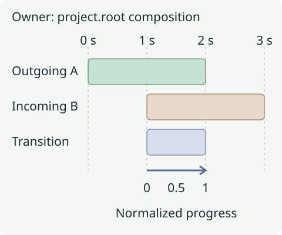

# Transitions, flashes, and presets

A transition presents two overlapping layers as one change of scene. Its
placement belongs to the composition that owns both layers; its reusable
definition describes how their opacity, transforms or effects change.

## Start with an overlap

This is a complete three-second project using two procedural shape layers:

```python
from vestra import Crossfade, Project, Rectangle

project = Project(size=(640, 360), fps=30, duration=3, background="#101c24")
outgoing = project.root.add(
    Rectangle(width=640, height=360, fill="#193b43"),
    start=0,
    duration=2,
)
incoming = project.root.add(
    Rectangle(width=640, height=360, fill="#34324f"),
    start=1,
    duration=2,
    z=1,
)
project.root.transitions.add(outgoing, incoming, Crossfade(), start=1, duration=1)
project.render("crossfade.mp4", backend="cpu", overwrite=True)
```

This replaces `crossfade.mp4`. Both endpoint layers exist throughout the
transition. The transition API does not extend their durations or move the
incoming layer to create an overlap.



The one-second overlap is a period in **the owning composition's local time**.
For a transition starting at `s` with duration `d`, normalized progress is
`p = (local_time - s) / d`. At `1.5` seconds in this example, `p=0.5`.
Easing determines the channel values at that progress. Built-ins default to
`Interpolation.EASE_IN_OUT`; the comparisons below explicitly use linear easing
so geometry is easier to compare.

## Compare four families

Each video uses the same two original scene compositions, the same layers
and z order, and the same overlap from **1–2 s**. The persistent title is outside
both endpoints so it does not move or blur with them.

### Crossfade: change opacity

<figure>
  <video controls playsinline preload="metadata" poster="../../../assets/renders/transition-crossfade.webp" width="640" height="360" aria-label="Scene A and scene B crossfade over one second, with letters and ring patterns superimposed during the overlap.">
    <source src="../../assets/renders/transition-crossfade.mp4" type="video/mp4">
    <a href="../../assets/renders/transition-crossfade.mp4">Download the crossfade</a>.
  </video>
  <figcaption>Letters and line patterns overlap without moving. Both endpoint opacities change, so the root background can contribute during the blend.</figcaption>
</figure>

`Crossfade` fades outgoing opacity from 1 to 0 and incoming opacity from 0 to
1. These values multiply the layers' own opacity. This is ordinary alpha
compositing in layer order; the midpoint is not necessarily a 50/50 RGB average
of two opaque frames.

### Directional push: move both scenes

<figure>
  <video controls playsinline preload="metadata" poster="../../../assets/renders/transition-push.webp" width="640" height="360" aria-label="Scene A moves left out of frame while scene B enters from the right over the same one-second interval.">
    <source src="../../assets/renders/transition-push.mp4" type="video/mp4">
    <a href="../../assets/renders/transition-push.mp4">Download the directional push</a>.
  </video>
  <figcaption>Watch the moving seam. PushLeft(distance=1) moves the outgoing scene left by one composition width while the incoming scene arrives from the right.</figcaption>
</figure>

A push changes position offsets rather than opacity. The normalized distance
uses composition dimensions: a horizontal distance of 1 spans the width, and
a vertical distance of 1 spans the height. Partial distance leaves a different
seam and may reveal the root background when the inputs do not cover the frame.

### Zoom crossfade: combine scale and opacity

<figure>
  <video controls playsinline preload="metadata" poster="../../../assets/renders/transition-zoom.webp" width="640" height="360" aria-label="Scene A scales from one to 1.3 while fading out, and scene B starts at 0.7 scale and grows to one while fading in.">
    <source src="../../assets/renders/transition-zoom.mp4" type="video/mp4">
    <a href="../../assets/renders/transition-zoom.mp4">Download the zoom crossfade</a>.
  </video>
  <figcaption>The ring edges separate as outgoing scale grows to 1.3 and incoming scale grows from 0.7 to 1. Smaller incoming bounds expose more of the scene behind them.</figcaption>
</figure>

`ZoomCrossfade(outgoing_zoom=1.3, incoming_start_zoom=0.7)` multiplies the
endpoints' authored scales. Keep their anchors deliberate: scaling around a
corner has a different path from scaling around the centre.

### Blur crossfade: soften the changing image

<figure>
  <video controls playsinline preload="metadata" poster="../../../assets/renders/transition-blur.webp" width="640" height="360" aria-label="A 16 pixel blur crossfade softens the letters and geometric lines during the change from scene A to scene B.">
    <source src="../../assets/renders/transition-blur.mp4" type="video/mp4">
    <a href="../../assets/renders/transition-blur.mp4">Download the blur crossfade</a>.
  </video>
  <figcaption>The same letters and fine lines lose definition during the blend, then return sharply. The title remains sharp because it is outside the endpoint compositions.</figcaption>
</figure>

This uses `BlurCrossfade(radius=16)`, a pixel-radius Gaussian blur with opacity
channels. `ZoomBlurTransition` uses zoom-directed samples rather than a Gaussian kernel.
Both radius controls use output pixels; equal values need not look equally soft. Use the
[transition reference](../../reference/transitions.md) for the full constructor
catalog rather than transferring radius values between blur families.

## Choose the owner, then the clock

If a nested composition is an endpoint, its parent owns the transition between
that whole scene and its sibling. To transition two children *inside* the scene,
add the placement to `scene.child.transitions` using those two child layers.
A child layer and its parent placement are not sibling endpoints.

When a parent places that scene later in the project, transitions inside it
remain on its child-local clock. Changing a transition's duration stretches its
normalized behavior into the new interval. For more on those clocks, see
[timeline and time](../../concepts/timeline-and-time.md).

## Transitions versus property animation

Use a transition when the intent is to connect two endpoints with reusable
normalized behavior. The transition overlays presentation on both layers during
its interval; it does not rewrite their authored tracks. Position and rotation
contribute offsets, scale contributes a multiplier, and opacity multiplies the
authored opacity. Transition effects join the endpoint's effect processing.

Use [ordinary keyframes](../../learn/animation.md) for one layer's independent
motion on its own clock. You can manually animate two layers to form a cut,
but you then own both sets of seconds, lifetimes and synchronization. A reusable
`CustomTransition` instead expresses endpoint channels with `Animate(...)`
progress from 0 to 1; see the [reference](../../reference/transitions.md).

## Resolve common validation failures

| Failure | What to check |
| --- | --- |
| Wrong owner or removed endpoint | Add both sibling layers to the composition that owns `.transitions`. Use two different live layer handles. |
| Interval does not fit | Both endpoints must be visible and alive for the entire transition; make their overlap at least as long as the transition. |
| Conflicting placements | A layer cannot participate in two transitions whose intervals overlap in the same composition. Touching intervals are allowed. |
| Unsupported canonical source | Image, video, shape, text and group clips are direct endpoints. Python adapts procedural Color, Spectrum2D and particle layers; raw canonical procedural clips are not direct endpoints. |
| Invalid custom progress | Normalized keys must be strictly increasing, start at 0 and end at 1. Positive duration and finite values are required. |

`transitions.add(...)` checks Python ownership and constructor values. Use
`project.validate()` to detect semantic failures such as interval fit or
conflicting placements before rendering. Validation of file-independent
structure is separate from media preflight.

## Run every comparison

[Download transition_comparisons.py](../../assets/examples/transition_comparisons.py)
and run:

```bash
python transition_comparisons.py
```

It replaces `transition-crossfade.mp4`, `transition-push.mp4`,
`transition-zoom.mp4` and `transition-blur.mp4` in the current directory. The
complete source creates the two scenes, places them as parent-owned endpoints,
and changes only the transition definition between renders:

```python
--8<-- "docs/assets/examples/transition_comparisons.py"
```

## Flashes and image presets

A flash is a separate project-wide color overlay. It does not need endpoints
or an overlap. This continues the first shape project:

```python
from vestra import Flash

project.flashes.add(
    Flash(start=1.5, duration=0.12, colour="#ffffff", opacity=0.7, fade_out=0.08, layer=10)
)
```

The explicit `layer=10` places this overlay above the example layers. Use
flashes sparingly: their coverage is frame-wide, and draw order still applies.
Their placement uses project seconds. A preset instead belongs to one image layer
and describes a reusable motion treatment such as a slow drift. The current
high-level API accepts one preset per Image layer. For a separate photo project
using your own `assets/one.png`:

```python
from vestra import Image

project = Project(size=(640, 360), fps=30, duration=6)
photo = project.root.add(Image("assets/one.png"))
photo.presets.apply_slow_drift(start=0.5, duration=4, intensity=0.6)
```

See [presets and flashes](../../reference/presets-and-flashes.md) for their
constraints; neither changes transition ownership.

## Credits and reproduction

These are original procedural graphics using Vestra's bundled default font,
with no third-party media download. The previews came from CPU renders,
640 × 360 at 30 fps for three seconds, silent H.264/yuv420p MP4 with fast-start
metadata. Posters sample **1.5 s**. Full WGPU transition visual parity remains
unverified; see [feature support](../../reference/feature-support.md).
Original-render checksums are recorded below. Encoding bytes may differ across
FFmpeg versions; these originals used FFmpeg **8.1.3**.

| Original render | SHA-256 |
| --- | --- |
| `transition-crossfade.mp4` | `e4b2855bb696b3cbad79755bfc5a5e887f734cf7eaed3b0fcbb18f8c94840fed` |
| `transition-push.mp4` | `a6c6900d01755e90e3a56f036754d0669d59ec1769222824a642d75495fcd168` |
| `transition-zoom.mp4` | `550aedd527dfbd45089b46eef744766828def4119f5c0a1cba68009e9e1c623f` |
| `transition-blur.mp4` | `0f8d5cc7045da7218e4d41a5ffc0486ee04700bc26d74ce9c5bc8b1dc688ae05` |

From the repository root in the native contributor environment, regenerate the
previews and posters with:

```bash
just python-sync
python scripts/render-docs-media.py --learning
```

Original renders and inspection frames stay under `target/docs-media/`.
The website build uses the committed delivery copies and does not run the
engine or download media.
