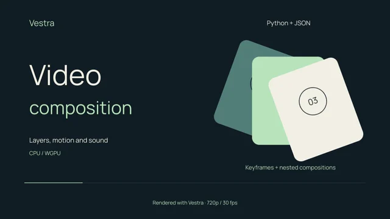
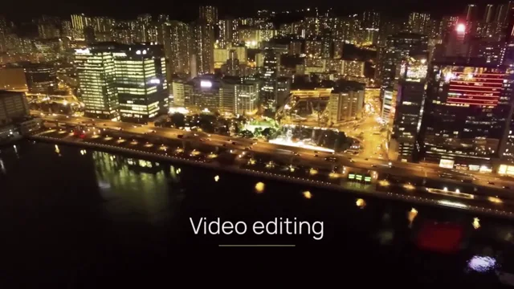
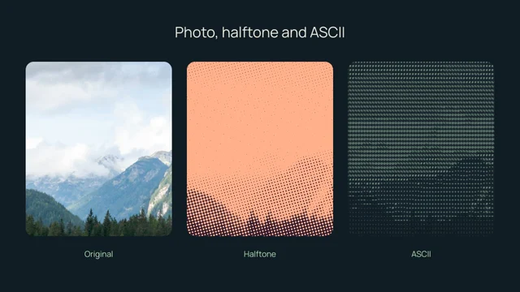

<div class="vestra-home" markdown="1">

<div class="home-hero" markdown="0">
<div class="home-hero__copy">
<span id="video-composition-in-python"></span>
<h1>Compose and render video in Python</h1>
<p class="home-lead">Layer footage, text, and shapes, then add effects and sound. Animate a title, edit a sequence, or generate videos from data.</p>
<div class="home-actions">
<a class="home-button home-button--primary" href="getting-started/installation/">Get started</a>
<a class="home-button" href="gallery/">Browse examples</a>
</div>
<p class="home-formats">Export MP4, GIF, animated WebP, still images, or image sequences. <a href="reference/render-outputs/">See render formats</a>.</p>
</div>
<figure class="home-hero__preview">
<video controls playsinline preload="metadata" width="640" height="360" poster="assets/gallery/audio-reactive.webp" aria-label="Audio-reactive graphics rendered with Vestra" aria-describedby="hero-caption">
<source src="assets/gallery/audio-reactive.mp4" type="video/mp4">
<a href="assets/gallery/audio-reactive.mp4">Download the video</a>.
</video>
<figcaption id="hero-caption">The soundtrack drives the spectrum bars and pulsing ring. <a href="gallery/audio-reactive/">See the example and its source</a>.</figcaption>
</figure>
</div>

<span id="learn-vestra"></span>

## Get started

<ol class="learning-path">
<li>
<span class="learning-path__step" aria-hidden="true">1</span>
<h3><a href="getting-started/installation/">Install Vestra</a></h3>
<p>Add Vestra to a Python project.</p>
</li>
<li>
<span class="learning-path__step" aria-hidden="true">2</span>
<h3><a href="getting-started/first-render/">Render your first video</a></h3>
<p>Draw a shape and save it as a three-second video.</p>
</li>
<li>
<span class="learning-path__step" aria-hidden="true">3</span>
<h3><a href="getting-started/first-animation/">Animate a layer</a></h3>
<p>Move the shape across the canvas with keyframes.</p>
</li>
</ol>

Rendering a JSON project? Follow the [CLI quickstart](getting-started/cli-quickstart.md).

<span id="projects-layers-and-rendering"></span>
<span id="a-complete-rendering-example"></span>

<div class="home-code" markdown="1">
<div markdown="1">

## Render a short animation

This script draws a rounded rectangle and moves it across the canvas using three
keyframes. Save it as `first_animation.py` after [installing Vestra](getting-started/installation.md).

```python title="first_animation.py"
--8<-- "examples/tutorials/first_animation.py"
```

```bash
uv run python first_animation.py
```

The script writes `quickstart.mp4` in the current directory and replaces it on a
rerun. It uses the CPU, so you can run it without a GPU.

</div>
<figure>
<video controls playsinline preload="metadata" width="640" height="360" poster="assets/renders/first-animation.webp" aria-label="A mint rounded rectangle moves right and returns over three seconds">
<source src="assets/renders/first-animation.mp4" type="video/mp4">
<a href="assets/renders/first-animation.mp4">Download the rectangle animation</a>.
</video>
<figcaption>The rectangle moves right, then returns to where it started. <a href="getting-started/first-animation/">Follow the animation tutorial</a>.</figcaption>
</figure>
</div>

## Rendered examples

<div class="home-gallery" markdown="0">
<a href="gallery/motion-design/" class="home-gallery__item"><span><strong>Motion graphics</strong><span>Move cards together and animate a masked video</span></span></a>
<a href="gallery/video-editing/" class="home-gallery__item"><span><strong>Video editing</strong><span>Reframe shots and connect them with dissolves</span></span></a>
<a href="gallery/visual-effects/" class="home-gallery__item"><span><strong>Photo effects</strong><span>Compare halftone and ASCII on the same image</span></span></a>
</div>

[Browse all examples and their source code](gallery/index.md).

<div class="home-reference" markdown="1">

## Guides and API reference

Use the [guides](guides/index.md) to learn tasks such as adding layers, applying
effects, and exporting a project. The [reference](reference/index.md) covers
APIs, settings, and feature support. If something fails, start with
[troubleshooting](troubleshooting/rendering.md).

## Documentation version

This site follows the [`develop` branch](https://github.com/evgen2571/vestra/tree/develop).
Some features here may be newer than the version you installed. Check the
[published release notes](https://github.com/evgen2571/vestra/releases) for your
version. Tutorial downloads follow `develop`, and each gallery page links to
the source used to create its preview.

</div>
</div>
