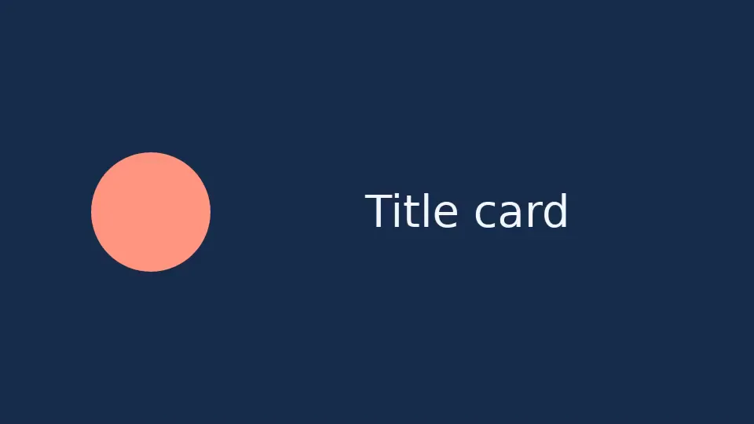
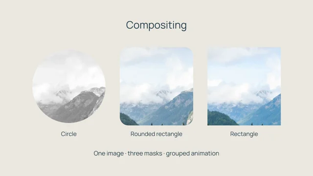
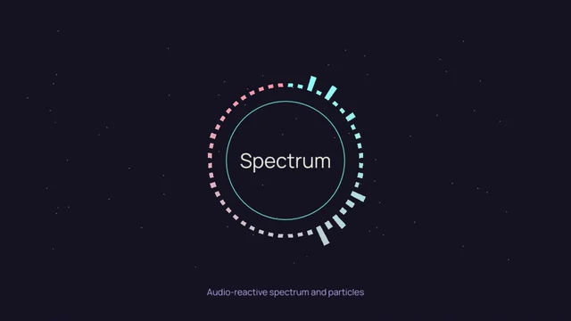
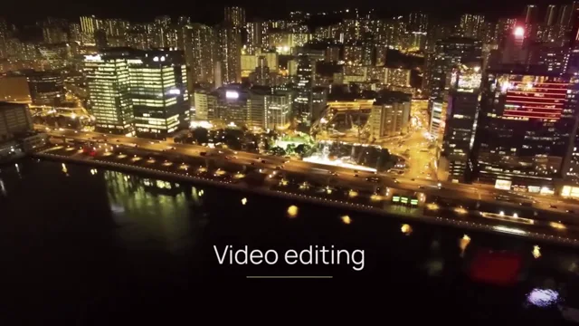

<div class="vestra-home" markdown="1">

<div class="home-hero" markdown="0">
<div class="home-hero__copy">
<h1>Video composition<br> in Python</h1>
<p class="home-lead">Vestra is a Python library for composing and rendering video, backed by Rust. Combine footage, text, shapes, effects, and audio in a script.</p>
<div class="home-actions">
<a class="home-button home-button--primary" href="learn/first-render/">Render a title card</a>
<a class="home-button" href="gallery/">Browse examples</a>
</div>
<p class="home-requirements">Python 3.11–3.14 · CPU or WGPU rendering · MP4 output</p>
</div>
<figure class="home-hero__preview">
<video controls playsinline preload="metadata" width="640" height="360" poster="assets/gallery/motion-design.webp" aria-label="Vestra feature reel: animated layers, moving masks, stylized images and audio-reactive graphics" aria-describedby="reel-caption">
<source src="assets/gallery/motion-design.mp4" type="video/mp4">
<a href="assets/gallery/motion-design.mp4">Download the feature reel</a>.
</video>
<figcaption id="reel-caption">A ten-second Vestra render demonstrating layers, masks, effects, and audio-reactive graphics. <a href="gallery/motion-design/">Source &amp; credits</a></figcaption>
</figure>
</div>

<div class="home-intro" markdown="1">

## Projects, layers, and rendering

A project defines the canvas and timeline. Add sources as layers, set their properties, and use keyframes to change those properties over time. Vestra evaluates the composition and encodes the result as an MP4.

Because the composition is Python code, you can use data, loops, and functions to produce related videos from the same script. The examples below cover motion graphics, masked images, video editing, and audio-reactive graphics.

</div>

<div class="home-code" markdown="1">
<div markdown="1">

### A complete rendering example

This script places a circle and a text layer on a blue background. It uses the bundled font, renders on CPU, and writes `home-card.mp4` to the current directory. Rerunning it replaces that file.

```python
--8<-- "docs/assets/examples/home_card.py"
```

[Install Vestra](learn/installation.md), then follow the [first render tutorial](learn/first-render.md) for a complete, explained project.

</div>
<figure>

<figcaption>The result of the code alongside it. Positions use fractions of the canvas: (0.5, 0.5) is the center.</figcaption>
</figure>
</div>

## Learn Vestra

The introductory tutorials use one title card to explain composition and animation. Each includes complete source and the expected output.

<ol class="learning-path">
<li>
<span class="learning-path__step" aria-hidden="true">1</span>
<h3><a href="learn/installation/">Install Vestra</a></h3>
<p>Install the Python package and FFmpeg, then check your environment.</p>
</li>
<li>
<span class="learning-path__step" aria-hidden="true">2</span>
<h3><a href="learn/first-render/">Render a title card</a></h3>
<p>Define a canvas, place shapes and text, and render a three-second MP4.</p>
</li>
<li>
<span class="learning-path__step" aria-hidden="true">3</span>
<h3><a href="learn/first-animation/">Animate the layers</a></h3>
<p>Add position, scale, rotation, and opacity keyframes to the same card.</p>
</li>
</ol>

[Animation and keyframes](learn/animation.md) explains interpolation, easing, and layer-local time in more detail.

## Rendered examples

<div class="home-gallery" markdown="0">
<a href="gallery/compositing/" class="home-gallery__item"><span><strong>Photo masks</strong><span>Masks, nested groups, and image treatments</span></span></a>
<a href="gallery/audio-reactive/" class="home-gallery__item"><span><strong>Audio-reactive graphics</strong><span>Audio analysis, signals, and particles</span></span></a>
<a href="gallery/video-editing/" class="home-gallery__item"><span><strong>Video editing</strong><span>Video layers, reframing, and transitions</span></span></a>
</div>

[Browse all examples and their source code](gallery/index.md). City footage: [Location Kenya](https://commons.wikimedia.org/wiki/File:City_timelapse_video.webm), [CC BY 3.0](https://creativecommons.org/licenses/by/3.0/); trimmed, resized, reframed, and colour-adjusted. [All asset credits](https://github.com/evgen2571/vestra/blob/develop/examples/showcase/ASSETS.md).

<div class="home-reference" markdown="1">

## Guides and API reference

The [reference hub](reference/index.md) covers the Python API, source types, effects, canonical JSON format, and CLI. It also links to the existing task guides and technical documentation.

Vestra renders finished videos to H.264 MP4. The Python API is evolving in the 0.1 series. Check [feature support](reference/feature-support.md) for backend coverage and [troubleshooting](troubleshooting/rendering.md) if a render fails.

</div>
</div>
