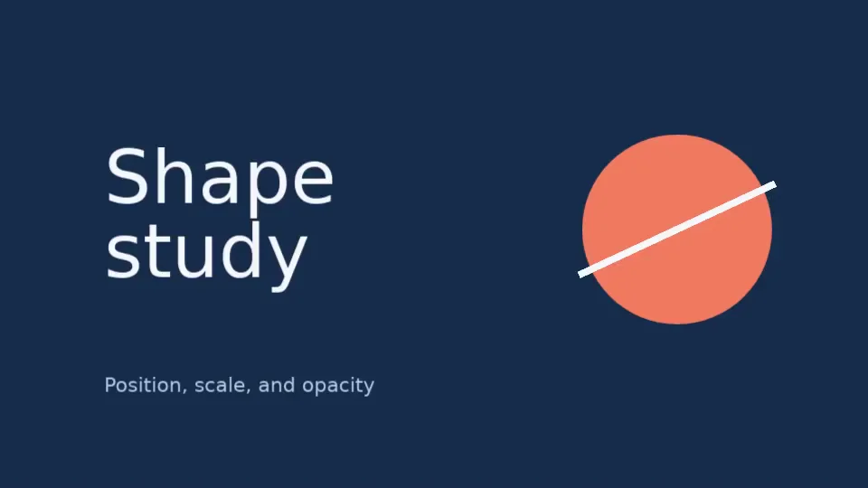

# Your first render

Create a three-second composition with text, a circle and a rectangle.
Vestra draws the shapes and uses its bundled font for the text, so this
example needs no external assets.

<figure>
  
  <figcaption>Expected output: a static composition at 960 × 540 pixels.</figcaption>
</figure>

Complete [installation](installation.md) first, including both FFmpeg checks.
The script uses the CPU backend, so it does not require a GPU.

## 1. Save the script

In your Python project, create `first_render.py` with this complete example.
You can also [download the Python file](../assets/examples/first_render.py).

```python title="first_render.py"
--8<-- "docs/assets/examples/first_render.py"
```

## 2. Render the video

From the directory containing your script:

```bash
uv run python first_render.py
```

The command prints `Rendered first-render.mp4`. Open **`first-render.mp4` in the
current directory** with an MP4-capable video player. It should show the composition
above for three seconds: 960 × 540 pixels at 30 frames per second, with no audio.

!!! note "Running the example again"

    `overwrite=True` replaces an existing `first-render.mp4` when rendering
    succeeds. Use a different output filename to keep an earlier version.
    Omit that option in your own tools if you want an existing file to be
    protected by default.

If the render fails, check [installation](installation.md#3-check-the-environment)
and [rendering troubleshooting](../troubleshooting/rendering.md).

## 3. Understand the layers

The script makes four layers over the project's background:

| Part | What it does |
| --- | --- |
| `Project(...)` | Defines the canvas, frame rate, duration and background colour. |
| `Ellipse`, `Rectangle`, `Text` | Describe the content of a layer. These are **sources**. |
| `project.root.add(...)` | Places a copy of a source in the project's root **composition**. It returns the layer. |
| `project.render(...)` | Prepares the project and writes an encoded MP4. |

Each layer inherits the full three-second duration here. The circle uses the
default `z=0`; the stripe uses `z=1`; the text uses `z=2`. **Higher `z` values
are drawn on top.** Use explicit `z` values when layers should overlap in a
particular order.

### Sizes and positions

`size=(960, 540)` defines the output in pixels. Shape dimensions and `font_size`
also use pixels. A layer's `position` uses the composition's normalized
coordinates:


- `(0, 0)` is the top-left corner; `(1, 1)` is the bottom-right.
- `(0.78, 0.47)` puts the circle's centre 78% across and 47% down the canvas.
- `anchor=(0, 0.5)` places the **left edge, halfway down** the text's own bounds
  at its position. The default anchor is the source's centre, `(0.5, 0.5)`.

The stripe's `rotation_degrees=-25` tilts it around its centre. You can move,
rotate or scale a layer without changing the source's dimensions.

## Change the circle colour

Change the circle's fill from `"#f07860"` to `"#83b6ff"`, then run the script
again. The new MP4 should have the same layout with a blue circle.

The next tutorial animates these layers using position, scale, rotation and
opacity keyframes.

[Continue to your first animation](first-animation.md){ .md-button .md-button--primary }

For a deeper look at placement, see
[sources and layers](../guides/python/sources-and-layers.md).
