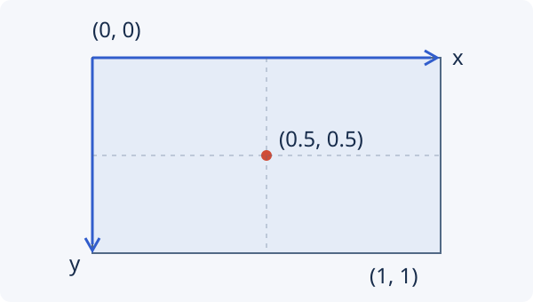

# Your first render

Create a three-second video with a rounded rectangle on a dark background.
The example uses generated shapes, so it needs no images, fonts or audio files.

<figure>
  <video controls playsinline preload="metadata" poster="../../assets/renders/first-render.webp" width="640" height="360" aria-label="A mint rounded rectangle stays on the left side of a dark canvas for three seconds.">
    <source src="../assets/renders/first-render.mp4" type="video/mp4">
    <a href="../assets/renders/first-render.mp4">Download the video</a>.
  </video>
  <figcaption>Expected output: a three-second video of a static rectangle at 640 × 360 pixels, with no audio.</figcaption>
</figure>

Complete [installation](installation.md) first, including both FFmpeg checks.
The script uses the CPU backend, so it does not require a GPU.

## 1. Save the script

In your Python project, create `first_render.py` with this complete example.
You can also [download the Python file](../assets/examples/first_render.py).

```python title="first_render.py"
--8<-- "docs/assets/examples/first_render.py"
```

## 2. Render the video

From the directory containing your script:

```bash
uv run python first_render.py
```

Open **`first-render.mp4` in the current directory** with an MP4-capable video
player. It should show the rectangle above for three seconds at 30 frames per
second, with no audio.

!!! note "Running the example again"

    `overwrite=True` replaces an existing `first-render.mp4` when rendering
    succeeds. Use a different output filename to keep an earlier version.
    Omit that option in your own tools if you want an existing file to be
    protected by default.

If the render fails, check [installation](installation.md#3-check-the-environment)
and [rendering troubleshooting](../troubleshooting/rendering.md).

## 3. Understand the composition

| Part | What it does |
| --- | --- |
| `Project(...)` | Defines a 640 × 360 pixel canvas, 30 fps and a three-second duration. |
| `Color("#101c24")` | Describes a solid-colour source that fills the canvas. |
| `Rectangle(...)` | Describes a 180 × 140 pixel shape with rounded corners and a mint fill. |
| `project.root.add(...)` | Places a copy of a source in the root **composition** and returns its **layer**. |
| `project.render(...)` | Prepares the project and writes an encoded MP4. |

Both layers inherit the project's three-second duration. The background stays
fixed, and `card` is the rectangle layer you can reposition or animate. For
larger compositions, use explicit `z` values when overlapping layers need a
particular drawing order: higher values are drawn on top.

### Sizes and positions

The canvas and rectangle dimensions use pixels. A layer's `position` uses the
composition's normalized coordinates:



- `(0, 0)` is the top-left corner; `(1, 1)` is the bottom-right.
- `(0.25, 0.5)` puts the rectangle 25% across and halfway down the canvas.
  On this canvas, that is 160 pixels from the left and 180 pixels from the top.
- The default **anchor** is the centre of the source, so these coordinates
  place the rectangle's centre rather than its top-left corner.

`card.transform.position = (0.25, 0.5)` sets a static position for the whole
layer. Changing that property does not change the rectangle's dimensions.

## Change the position

Set the position to `(0.75, 0.5)` and render again. The rectangle should now sit
on the right, at x = 480 pixels. In the next tutorial, keyframes move it between
these two positions during one video.

[Continue to your first animation](first-animation.md){ .md-button .md-button--primary }

For more about placement, see [sources and layers](../guides/python/sources-and-layers.md).

<span id="preview-reproduction"></span>
