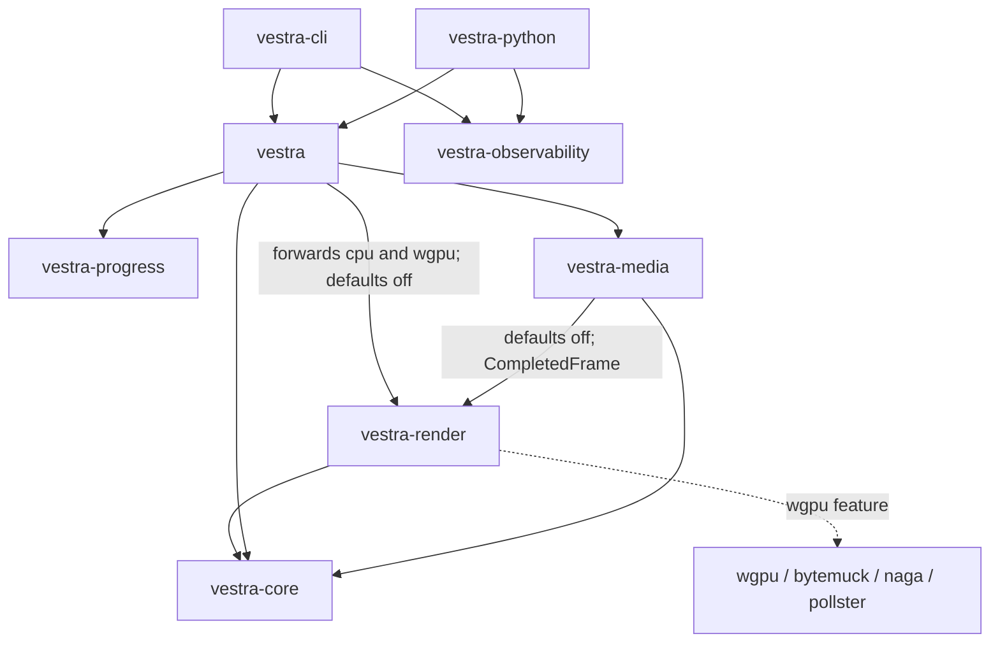
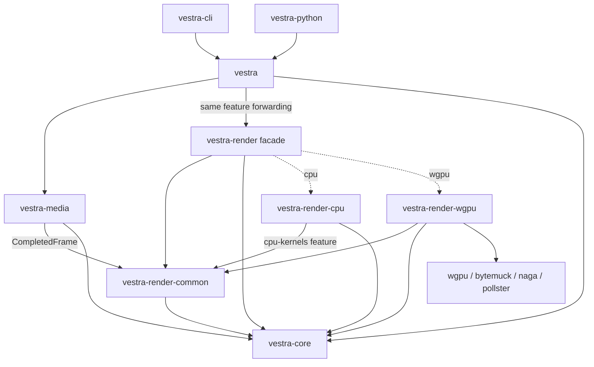

# Renderer extraction review — Phase 2 checkpoint

Status: Phase 2 complete; Phase 3 design ready for user review.
Phase 3 awaits explicit user approval of this report.

Baseline: `origin/develop` at `c26f52f4c41a7d010775c8da61df59bf7caa8cb5`.
Branch: `refactor/render-boundaries`; initial plan commit: `ab7dcc6`.
Recorded local `main`: `b23c985a623efea14511e25aeb1df93b495beecb`.
See the [active execution plan](render-boundaries.md) for progress and the
[plan lifecycle](../../../PLANS.md) for eventual documentation transfer/removal.

Sections A–J distinguish source findings from the proposed extraction. Section K
is reserved for the coordinator's actual commands, results, commits and limitations.
Audit references describe baseline ownership; line numbers shift during cleanup.
The crate layouts and API sketches in A–J remain proposals. Section K records
actual Phase 2 changes and executed commands; no Phase 3 crate exists.

## A. Executive summary

The four-crate renderer split is recommended. The existing `RenderBackend`
interface already supplies the required lifecycle contract. Strongly typed core
plans and effect operations remain the semantic authority; no new renderer
framework or effect registry is needed.

The audit covered shared preparation and numerical helpers, CPU workers and
resources, WGPU pipelines and lifecycle, SDK/media/Python/CLI callers, Cargo
activation, unit/parity tests, CI, generators, benchmarks and distributions.
Existing CPU-only features are useful but do not replace independent ownership,
compilation units or separately selected backend validation.

Three small preparations are completed for Phase 2, inside the existing crate:

1. Replace WGPU's inherent `EffectKernel` shader methods with WGPU-owned free
   functions. Otherwise extracting the type and implementation to different
   crates creates an illegal inherent implementation of a foreign type.
2. Move shared `cpu/shapes.rs` to root `shape_raster.rs`, preserving preparation
   and pixels. Both backends already use it through an unconditional root alias.
3. Remove the CPU feature gate from six WGPU resource tests, retaining the CPU
   gate on the seventh test that actually compares padded-row output with CPU.

Section K records their focused commits, complete final validation and unchanged
lossless frames.
Prepared getters/visibility, CPU timings/counts/surface blending, host CRT,
crate manifests and test extraction remain Phase 3 work.

No serious structural obstacle invalidates the requested split. The principal
risks are cross-crate privacy/test coupling, conditional Gaussian storage,
shared pixel ownership, loss of strict GPU test selection and omitted embedded
assets. These have concrete solutions below. Section K separates source findings
from measured validation; source inspection alone proves no runtime parity.

## B. Ownership audit

In the table, `R` means `crates/vestra-render/src/`; C = common, CPU = CPU
implementation, GPU = WGPU implementation, F = facade. “Public” for a new
implementation bridge means reachable by sibling crates, with private fields
and documented internal purpose; it does not require an additional facade export.
Difficulty: L = mechanical move, M = visibility/test split or coupled move.
Runtime owner describes retained resources, independently of file ownership.

| Baseline module / meaningful types | Responsibility and dependencies | Runtime owner | Proposed owner / difficulty | Visibility, public path and existing coverage |
| --- | --- | --- | --- | --- |
| [lib.rs](../../../crates/vestra-render/src/lib.rs): aliases, `plan`, `project`, `render` | Core compatibility paths and renderer imports | No state | F / L | Preserve `vestra_render::{plan,project,render,animation,domain}`; implementations import C/core directly |
| `lib.rs`: `RenderBackendPreference`, `BackendFallback`, `BackendProbe`, `probe_backend`, `create_backend` | Selection, capability validation, construction/fallback | SDK owns selected boxed backend | F / L | Exact existing public names and diagnostics; SDK editor/selection and facade feature tests |
| `lib.rs`: `trace_milliseconds` | Saturating Duration conversion, std | Stack | C / L | Narrow cross-crate helper; decode/CPU/GPU tracing callers retain saturation |
| [backend.rs](../../../crates/vestra-render/src/backend.rs): `RenderBackendKind`, `AdapterMetadata`, `AdapterPerformanceClass` | Serializable backend facts/classification, serde/core | Snapshot | C / L | F root reexports unchanged; classification tests, SDK DTOs and benchmark records |
| `backend.rs`: `CompletedFrame`, `PollMode`, `RenderBackend` | Owned RGBA completion, submission/poll/flush/abort/cancellation/metrics, core evaluated frame | Backend pending work; completion transfers to SDK/media | C / L | Same trait/default methods/types via F; CPU/GPU lifecycle and SDK staged tests |
| [decoded.rs](../../../crates/vestra-render/src/decoded.rs): `DecodedAssets` | Images, prepared shape/text/glyph pixels, video table/factory, budgets; image/font libraries/core | One immutable Arc bundle per preparation | C / M | Existing build/image/resource/stats/timings paths stay via F; narrow getters for sibling backends; decoded budget tests |
| `decoded.rs`: atlas/shape/text/video/count accessors | Borrow prepared data, clone decoder-factory Arc | Same shared bundle | C / M | Current `pub(crate)` becomes narrow public methods; fields remain private; CPU asset-sharing/GPU bounds/upload tests |
| [video.rs](../../../crates/vestra-render/src/video.rs): `VideoFrame`, `VideoDecoderMetrics`, `VideoDecoderSession`, `VideoDecoderFactory` | Renderer provider protocol, Arc image, Send session/Send+Sync factory, tracing | SDK supplies factory; backend/worker owns mutable sessions | C / L | F root and `video::*` retained; SDK native adapter and CPU/GPU video tests |
| [geometry.rs](../../../crates/vestra-render/src/geometry.rs): `IntrinsicSize`, crop/source regions, affines, `ResolvedRasterGeometry`, motion-tile parameters | Source/logical/anchor bounds and mapping; core values | Copy values and prepared bounds | C / M | Cross-crate used value types/functions public in C; F geometry module retained; origin/crop/anchor tests |
| `R/cpu/shapes.rs`: `PreparedShape`, raster preparation | Shared tiny-skia source raster, alpha conversion; image/core/geometry | Arc pixels retained in decoded bundle | C / L–M | Phase 2 root move; Phase 3 read-only pixels/intrinsic getters; shape tests move unchanged |
| [text.rs](../../../crates/vestra-render/src/text.rs): `PreparedText`, load/prepare | Font loading/shaping/rasterization; cosmic-text/fontdb/image | Font engines temporary; final Arc pixels retained | C / M | Prepared type/getters public in C; preparation private; multiline/limit tests |
| [ascii.rs](../../../crates/vestra-render/src/ascii.rs): `PreparedGlyphAtlas`, coverage/constants | Immutable mip atlas and font preparation | Shared Arc atlas; temporary FontSystem/SwashCache | C / M | Borrow levels/byte count; preserve coverage/math/font bytes; common and CPU ASCII tests |
| [particle_raster.rs](../../../crates/vestra-render/src/particle_raster.rs): `rasterize_instances` | Host evaluated-particle rasterization; image/shared pixel math | Caller surface, including GPU upload staging | C / L | Cross-crate function public; clipping/blending/boundary/rotation/determinism tests |
| [blend.rs](../../../crates/vestra-render/src/blend.rs): pixel transform, `source_over`, `blend_pixel` | Straight-alpha and blend-mode pixel math; core/image | Stateless | C / M | Preserve F blend module; shared particles require these; byte/partial-alpha/additive tests |
| `blend.rs`: `CompositionCaseCounts`, `blend_surface` | CPU instrumentation and full-surface execution | CPU worker profile/compositor | CPU / M | Move together with CPU timings in Phase 3; private, surface reference test follows them |
| [gaussian.rs](../../../crates/vestra-render/src/gaussian.rs): `GaussianKernel`, thread-local cache | Canonical radius, integer weights; CPU-only retained float vector | Per executing thread, maximum 16 entries | C / M | `cpu-kernels` retains existing CPU storage; public numerical access only; normalization/cache tests |
| [halftone.rs](../../../crates/vestra-render/src/halftone.rs): grid/constants | Shared numerical lattice preparation | Stack | C / L | Public only cross-crate helpers; CPU diagonal tests and GPU parity |
| [crt.rs](../../../crates/vestra-render/src/crt.rs): `Sampling` | Host inverse sampling; no WGPU Rust caller | CPU effect call | CPU / L | Private; own boundedness/center and CPU edge-alpha tests; WGSL remains GPU |
| [effects.rs](../../../crates/vestra-render/src/effects.rs) | Typed core pass/identity reexports | No state | F compatibility shim; implementations use core / L | Preserve existing public module, avoid second effect model |
| [kernel.rs](../../../crates/vestra-render/src/kernel.rs): `EffectKernel`, set, operation mapping/capabilities | Stable kernel IDs/indices and plan support validation; core and backend kind | No retained backend resource | C / M | Narrow public internal functions/types; existing exhaustive mapping/conformance tests; shader functions stay GPU |
| [metrics.rs](../../../crates/vestra-render/src/metrics.rs): `PreparationStats`, `PreparationTimings`, `StagedMetrics` | Neutral reporting DTOs with CPU/GPU numeric fields; core/serde/std | Prepared/backend/SDK snapshots | C / L | Same F names, fields, meaning/serialization; aggregation/staged snapshot tests |
| `metrics.rs`: `CpuHotPathTimings` | CPU timing buckets, count aggregation/profile text | CPU workers then backend aggregate | CPU / M | Private with counts/surface executor; preserve report string; aggregate-hot-path test |
| [cache.rs](../../../crates/vestra-render/src/cache.rs): `ByteLruCache`, `CacheStats` | Generic deterministic byte LRU; BTreeMap/serde/tracing | Each cache owner separately | C / L | F root reexports; values/reservations backend-local; budget/eviction/accounting tests |
| [cpu/backend.rs](../../../crates/vestra-render/src/cpu/backend.rs): `CpuBackend` | Workers, channels, admission/scheduling, lifecycle/aggregation | Backend owns worker handles/protocol | CPU / M | F root CpuBackend and existing public cpu module; worker/error/cancel/frame ownership tests |
| [cpu/worker.rs](../../../crates/vestra-render/src/cpu/worker.rs): jobs/commands/completions/worker state | Mutable assets, caches, pools, panic capture | One state per worker | CPU / L | Private; preserve shared Arc clone and failure frame numbers; worker-count parity tests |
| [cpu/assets.rs](../../../crates/vestra-render/src/cpu/assets.rs): `PreparedAssets`, video session/raster source/crop key | CPU views and cursor/crop caching over shared data | Each worker | CPU / M | Private; preserve Arc aliasing/session count; sharing/video/memory tests |
| [cpu/compositor.rs](../../../crates/vestra-render/src/cpu/compositor.rs): context/cached layer/stats | Recursive groups, masks/mattes, cache and blending | Borrowed worker pools/cache | CPU / L | Private; compositor and static-cache suites |
| [cpu/surfaces.rs](../../../crates/vestra-render/src/cpu/surfaces.rs): pools/stats | Image/float scratch, aliases, coverage/feather/depth reuse | Worker retains capacity | CPU / L | Private; lazy allocation/reuse/output transfer tests |
| [cpu/raster.rs](../../../crates/vestra-render/src/cpu/raster.rs), spectrum2d | Source dispatch, transform sampling, spectra | Worker execution | CPU / L | Private; geometry/spectrum sampling tests and parity |
| [cpu/effects.rs](../../../crates/vestra-render/src/cpu/effects.rs), analog/ascii/chromatic/colour_adjust/stylization/vignette/zoom_blur/input_analysis | CPU typed pass execution and pixel loops | Worker scratch/stack | CPU / M | Private; effects/inline tests; BlueNoise table follows CPU |
| [cpu/memory.rs](../../../crates/vestra-render/src/cpu/memory.rs) | Plan-based storage estimates and existing worker policy | Backend admission/reporting | CPU / L | Private; preserve resource-estimate/legacy-worker-selection tests |
| [wgpu/mod.rs](../../../crates/vestra-render/src/wgpu/mod.rs): discovery/probe | Adapter enumeration/readiness | Temporary adapter query | GPU / L | F discovery path retained; probe bridge public in GPU, no raw handles exposed |
| [wgpu/backend.rs](../../../crates/vestra-render/src/wgpu/backend.rs): `WgpuBackend`, pending caches | Prepared resources, slots, decoder sessions, submit/poll/abort | Prepared backend | GPU / M | F root WgpuBackend constructors retained; resource/order/cancellation tests |
| [wgpu/context.rs](../../../crates/vestra-render/src/wgpu/context.rs), diagnostics | Device/queue/adapter/error scopes and root instance policy | Process instances; backend device/queue | GPU / L | Private, preserve declaration/drop order; queue-identity regression |
| [wgpu/support.rs](../../../crates/vestra-render/src/wgpu/support.rs) | Exhaustive GPU plan/blend support | Validation call | GPU / M | One facade-callable internal validation function; no device handles in C |
| [wgpu/frame_plan](../../../crates/vestra-render/src/wgpu/frame_plan/mod.rs), topology | Fixed-slot operation graph, masks/effects/liveness and conservative allocation | Backend plan | GPU / L | Private; planner/negative-validation tests remain GPU unit tests |
| [wgpu/requirements.rs](../../../crates/vestra-render/src/wgpu/requirements.rs) | Device/adapter limits, byte bounds/overflow | Preparation/validation | GPU / M | Private; borrows C resources; limits/prepared-byte tests |
| [wgpu/parameters](../../../crates/vestra-render/src/wgpu/parameters/mod.rs), particles | WGSL ABI, typed packing/alignment/upload arena | Per slot/prepared backend | GPU / L | Private; POD/alignment/arena/upload tests |
| [wgpu/pipeline.rs](../../../crates/vestra-render/src/wgpu/pipeline.rs), shaders | Sources/concatenation, layouts, pipeline creation/lookup | Prepared GPU context | GPU / L | Kernel source/label are GPU free functions; shader bytes preserved; Naga/registration tests |
| [wgpu/resources.rs](../../../crates/vestra-render/src/wgpu/resources.rs), texture_pool, bind_groups | Upload textures, working/static cache resources, bindings | Backend/slot/cache | GPU / M | Private; borrowed C pixels; resource/reservation/abort/reuse tests |
| [wgpu/executor.rs](../../../crates/vestra-render/src/wgpu/executor.rs) | Upload/dispatch/copies/submission, execution metrics | Current slot/backend | GPU / L | Private FrameExecutionMetrics; preserve command and counter scopes |
| [wgpu/readback.rs](../../../crates/vestra-render/src/wgpu/readback.rs), readback_state, polling, runtime_error | Mapping/token/generation lifecycle, tight owned bytes, cancellation/errors | In-flight slot until completion | GPU / L | Private; row repack/state/failure/order tests; common frame returned |
| [wgpu/parity.rs](../../../crates/vestra-render/src/wgpu/parity.rs): `FrameDifference`, `PixelMismatch`, `compare_rgba` | Pure RGBA comparison, serde | Caller value | GPU initially / L | Preserve existing wgpu-gated F exports; pure utility does not need CPU dependency |
| [test_support.rs](../../../crates/vestra-render/src/test_support.rs), CPU/GPU tests | Fixture loading and white/black-box assertions | Test process | Owner-specific units + F parity / M | Same-depth fixture paths survive; private-test traps detailed in G |

The table groups files with one owner; it does not authorize algorithm changes.
CPU-only Rust CRT code remains CPU even though its WGSL counterpart shares math.
Host particle rasterization remains common because GPU's additive path calls it.
A generic LRU belongs common; CPU crop/static values and GPU textures/reservations
do not. These distinctions prevent common becoming a backend implementation dump.

## C. Current and proposed dependency graphs

Arrows below mean Cargo dependency, not runtime ownership. Dotted edges are
optional feature-selected dependencies. Observability/progress edges are shown
only where useful; authoritative inputs are the [workspace](../../../Cargo.toml)
and [crate manifests](../../../crates/vestra-render/Cargo.toml).





Common owns the contracts consumed by backends; neither backend imports facade,
its sibling, media or SDK, including through dev-dependencies. CPU metrics and
surface blending move together, avoiding a common-to-CPU edge. GPU support and
pipeline behavior stay GPU; facade calls a small validation/probe bridge.

Current [media manifest](../../../crates/vestra-media/Cargo.toml) disables render
defaults; only [sink](../../../crates/vestra-media/src/sink.rs) and
[FFmpeg sink](../../../crates/vestra-media/src/ffmpeg.rs) import CompletedFrame.
Move those imports/dependency to C and retain the same type through F reexports.
Media still compiles shared preparation dependencies; a fifth contracts crate is
unnecessary for this assignment.

Current CPU/no-backend render builds still select image default codecs,
cosmic-text, fontdb, tiny-skia, serde and tracing unconditionally. These support
real shared preparation. SDK always selects media/FFmpeg; CLI/Python select SDK
defaults and therefore both backends. Keep these contracts; do not claim tiny
no-backend builds or CPU-only bindings from package `--no-default-features`.

## D. Proposed public and internal APIs

The contract in [backend.rs](../../../crates/vestra-render/src/backend.rs) is
adequate. Move it intact, including default cancellation/idle/metric methods.
This abbreviated sketch describes ownership, not a replacement trait:

```rust
pub struct CompletedFrame { pub frame_number: u64, pub rgba: Vec<u8> }
pub enum PollMode { NonBlocking, WaitForOne, Drain }
pub trait RenderBackend: Send {
    fn submit_frame(&mut self, n: u64, frame: &EvaluatedFrame) -> Result<(), Diagnostic>;
    fn poll_completed(&mut self, mode: PollMode) -> Result<Option<CompletedFrame>, Diagnostic>;
    fn flush(&mut self) -> Result<Vec<CompletedFrame>, Diagnostic>;
    fn abort(&mut self);
    // All existing capacity, cancellation, failure-frame, idle and metrics methods remain.
}
```

One Arc<DecodedAssets> remains shared across workers and GPU preparation. Keep
private storage and existing indexing/validation semantics. Phase 3 adds only
methods/types sibling implementations need; no new runtime allocations:

```rust
impl DecodedAssets {
    pub fn shape(&self, index: usize) -> &PreparedShape;
    pub fn text(&self, index: usize) -> &PreparedText;
    pub fn glyph_atlases(&self) -> &[Arc<PreparedGlyphAtlas>];
    pub fn video_factory(&self) -> Option<Arc<dyn VideoDecoderFactory>>;
    pub fn video_asset(&self, index: usize) -> Option<&VideoAsset>;
    // Existing image/image_resource/stats/timings and required count accessors remain.
}
impl PreparedShape { // PreparedText exposes the same two methods.
    pub fn pixels(&self) -> &Arc<RgbaImage>;
    pub fn intrinsic_size(&self) -> IntrinsicSize;
}
impl PreparedGlyphAtlas {
    pub fn levels(&self) -> &[Arc<RgbaImage>];
    pub fn byte_len(&self) -> u64;
}
```

CPU explicitly Arc::clone's prepared pixels; GPU borrows them for upload. Font
engines/SwashCache remain preparation temporaries. Decoder factories remain
shared providers, while mutable decoder sessions/cache cursors remain backend
or worker-owned. Common never opens native media. Preserve VideoFrame's Arc
payload and all existing String decoder errors and Diagnostic conversion paths.

Core Diagnostic remains the error type, with exact codes/categories/context;
SDK/CLI/Python report adaptation stays above the renderer. Capability IDs,
operation mapping, bitset indices and support facts stay common. WGPU plan
validation remains GPU, and backend selection/fallback remains F. Keep explicit
CPU/WGPU, Auto, unsupported capability, unavailable feature, initialization
failure and fallback stage strings unchanged; no per-effect CPU execution inside
GPU is introduced.

Snapshots remain common despite CPU/GPU-specific numeric fields. Move only
CpuHotPathTimings, CompositionCaseCounts and blend_surface into CPU together;
preserve opt-in report names, cache accounting and snapshot aggregation.
GPU FrameExecutionMetrics already belongs GPU. Generic cache API remains common.

Compatibility uses reexports of original types, never duplicate declarations:

```rust
pub use vestra_render_common::{CompletedFrame, DecodedAssets, PollMode, RenderBackend};
pub use vestra_render_common::{decoded, geometry, metrics, video};
#[cfg(feature = "cpu")]
pub use vestra_render_cpu::CpuBackend;
#[cfg(feature = "cpu")]
pub mod cpu {} // Preserve the existing public namespace; its children were private.
#[cfg(feature = "wgpu")]
pub use vestra_render_wgpu::{WgpuBackend, FrameDifference, PixelMismatch, compare_rgba};
```

Keep all other existing F root/module exports, including blend, effects,
plan/project/core aliases, render compatibility namespace and discovery wrapper.
The current `wgpu` module stays private; current CPU children are not ordinary
public APIs. Internal bridge methods/types in new crates need no additional
facade reexports. Backend crates import C/core directly, avoiding F dependency.
SDK [render imports](../../../crates/vestra/src/render/mod.rs),
[selection](../../../crates/vestra/src/render/engine/selection.rs),
[native video adapter](../../../crates/vestra/src/render/engine/preparation.rs)
and root API remain unchanged. Python constructors/JSON/stubs remain unchanged.

## E. Proposed crate layout

Retain src/cpu and src/wgpu nesting to preserve visibility paths and relative
shader includes. Add three workspace members; retain existing facade member.

```text
crates/
  vestra-render-common/
    Cargo.toml
    assets/DejaVuSans.ttf, DejaVuSans.LICENSE
    src/lib.rs
    src/backend.rs, decoded.rs, video.rs, geometry.rs
    src/text.rs, ascii.rs, shape_raster.rs, particle_raster.rs
    src/blend.rs             # pixel functions only
    src/gaussian.rs, halftone.rs, kernel.rs, cache.rs, metrics.rs
  vestra-render-cpu/
    Cargo.toml
    src/lib.rs               # public CpuBackend, private mod cpu
    src/blue_noise_ranks.in
    src/cpu/mod.rs, backend.rs, backend_tests.rs, worker.rs
    src/cpu/assets.rs, raster.rs, compositor.rs, compositor/tests.rs
    src/cpu/surfaces.rs, memory.rs, spectrum2d.rs
    src/cpu/effects.rs, effects/tests.rs, input_analysis.rs
    src/cpu/analog.rs, ascii.rs, chromatic.rs, colour_adjust.rs
    src/cpu/stylization.rs, vignette.rs, zoom_blur.rs
    src/cpu/crt.rs, metrics.rs, blend.rs
    src/cpu/work_elimination_benchmarks.rs
  vestra-render-wgpu/
    Cargo.toml
    src/lib.rs               # public backend/discovery/probe/support bridge
    src/wgpu/                # current modules, nested parameters/frame_plan
    src/wgpu/tests/          # private, planning and GPU-only tests
    src/shaders/             # all current WGSL sources/snippets unchanged
  vestra-render/
    Cargo.toml
    src/lib.rs               # policy and compatibility reexports
    src/effects.rs           # existing compatibility module if still useful
    tests/parity.rs, tests/support/  # intentional both-backend black-box tests
    examples/wgpu_adapters.rs
```

Files requiring internal splits: blend.rs (pixel/surface), metrics.rs
(snapshot/CPU timing), and mixed GPU tests (public parity/private planning).
Kernel shader functions stay GPU after Phase 2 free-function cleanup.
Pure comparison utility stays GPU initially to minimize churn and preserves its
existing wgpu-gated facade visibility. CRT Rust implementation follows CPU.
Common effects can use direct core imports rather than manufacture new semantics.

[ASCII font inclusion](../../../crates/vestra-render/src/ascii.rs) uses
include_bytes!("../assets/DejaVuSans.ttf"). Move font and adjacent license to C.
[Pipeline includes](../../../crates/vestra-render/src/wgpu/pipeline.rs) and shader
tests keep their existing relative paths with the tree above. Preserve WGSL
bytes/concatenation order and typed layouts. No build.rs currently compiles them.
CPU BlueNoise include follows CPU. Update both output paths in
[generate-blue-noise.py](../../../scripts/generate-blue-noise.py), and only the
shader output in [generate-oklab.py](../../../scripts/generate-oklab.py).
Update moved-font paths in [third-party notices](../../../THIRD_PARTY_NOTICES.md).

## F. Cargo feature design

Keep resolver=2, existing dependency versions/platform defaults, inherited
version, edition=2024, MIT, publish=false and workspace lints for each package.
These are relevant manifest sections, not complete generated manifests.

```toml
# vestra-render-common/Cargo.toml
[features]
default = []
cpu-kernels = []
[dependencies]
vestra-core = { path = "../vestra-core" }
image = { version = "0.25", default-features = true }
cosmic-text = "0.19"
fontdb = "0.23"
tiny-skia = "0.11"
serde = { version = "1", features = ["derive"] }
tracing = "0.1"
[dev-dependencies]
serde_json = "1"

# vestra-render-cpu/Cargo.toml
[dependencies]
vestra-core = { path = "../vestra-core" }
vestra-render-common = { path = "../vestra-render-common", features = ["cpu-kernels"] }
image = { version = "0.25", default-features = false }
tracing = "0.1"
[dev-dependencies]
serde_json = "1"

# vestra-render-wgpu/Cargo.toml
[dependencies]
vestra-core = { path = "../vestra-core" }
vestra-render-common = { path = "../vestra-render-common", default-features = false }
bytemuck = { version = "1", features = ["derive"] }
image = { version = "0.25", default-features = false }
naga = { version = "23", features = ["wgsl-in"] }
pollster = "0.4"
serde = { version = "1", features = ["derive"] }
wgpu = "23.0.1"
tracing = "0.1"
[dev-dependencies]
serde_json = "1"

# vestra-render/Cargo.toml
[features]
default = ["cpu", "wgpu"]
cpu = ["dep:vestra-render-cpu"]
wgpu = ["dep:vestra-render-wgpu"]
[dependencies]
vestra-core = { path = "../vestra-core" }
vestra-render-common = { path = "../vestra-render-common" }
vestra-render-cpu = { path = "../vestra-render-cpu", optional = true }
vestra-render-wgpu = { path = "../vestra-render-wgpu", optional = true }
[dev-dependencies]
image = { version = "0.25", default-features = false }
serde_json = "1"
[[example]]
name = "wgpu_adapters"
required-features = ["wgpu"]
```

Naga's direct use is shader tests; retaining its dependency role minimizes the
mechanical diff. Dev-only placement can be considered separately after proof;
WGPU already brings its own Naga dependency. No backend dev-depends on its sibling.
Facade parity tests use feature-selected normal dependencies, not unconditional
backend dev-dependencies that silently defeat feature isolation.

`cpu-kernels` changes only current Gaussian `cfg(feature="cpu")` retained float
weights to common's new flag; CPU activates it, GPU does not. Keep integer
weights, cache size/key and computation unchanged. Feature unification when both
backends are selected retains float weights as today. Avoid unconditional float
retention in GPU-only builds or a second per-backend coefficient cache.

[SDK features](../../../crates/vestra/Cargo.toml) keep existing forwarding and
renderer defaults=false. Media changes renderer dependency to common. CLI/Python
keep SDK defaults; ordinary installed Python acquires no runtime package dep.

| Selected command/package | Expected renderer implementations |
| --- | --- |
| common or media alone | Neither |
| CPU package or F --no-default-features --features cpu | CPU only |
| GPU package or F --no-default-features --features wgpu | GPU only |
| F --no-default-features | Neither; shared contracts still available |
| F defaults, SDK defaults, CLI, Python, full workspace | Both, intentionally |

Use `cargo tree --locked -p PACKAGE -e features` for each selection, including
normal/dev activation. CPU test graph must contain neither GPU implementation
nor WGPU stack; GPU test graph must contain no CPU implementation. Validate the
actual package compilation with a fresh task-specific CARGO_TARGET_DIR and
`cargo test --locked -p PACKAGE --no-run --message-format=json`; retain artifact
package IDs, full log and wall time. Repeat warm, and run actual package tests.
Optional dependency syntax alone is not isolation evidence. Full workspace
feature unification is expected and is not an isolation test.

## G. Test, CI and distribution migration

| Owner | Suites and coverage retained |
| --- | --- |
| Common | Metadata/frame contracts, cache, decoded budgets, shape/text/ASCII/geometry, particle pixels, kernel mapping/conformance, Gaussian normalization/cache |
| CPU | Backend/workers/memory/channels/errors/cancellation, assets/video/Arc sharing, compositor/masks/mattes, surfaces/scratch, effects/CRT/profile, ignored CPU benchmarks |
| GPU | Shader registration/Naga, frame planning/liveness/limits/negative validation, parameter/POD/arena/upload, requirements/topology, textures/resources/readback/runtime errors, queue identity, six independent resource execution tests |
| Facade | Selection/probe/capability/fallback/unavailable-feature tests; CPU/GPU parity and literal rendered expectations, crop/video/stylization/order/alpha/temporal cases |
| SDK/CLI/Python | Existing lifecycle/encoding/native-video/prepared public API, encoded strict conformance, frozen effects/imports/signatures/JSON/typing/schema compatibility |

Keep all seven [resource tests](../../../crates/vestra-render/src/wgpu/tests/resources_gpu.rs):
six need only GPU; padded-row comparison genuinely needs both backends. Mixed
[crop tests](../../../crates/vestra-render/src/wgpu/tests/crops_gpu.rs) include
one GPU-only unused-video preparation case and five CPU comparisons. Sort during
Phase 3; Phase 2 resource ungating alone does not resolve all mixed tests.

[parity_gpu.rs](../../../crates/vestra-render/src/wgpu/tests/parity_gpu.rs) also
imports private GpuFramePlan, parameter arenas/records and GpuRequirements.
Keep private assertions in GPU units and move public rendering parity to F.
Split combined cases without deleting either assertion. Large stylization tests
use a dual-backend harness and literal references; retain both kinds of evidence.
Do not expose pipelines/handles/parameter records just to compile moved tests.

WgpuBackend::render_frame is cfg(test) in its owner; a dependent facade cannot
call it. Build the facade test helper from existing public submit/poll/flush.
Likewise keep Gaussian cache inspection in common unit tests under cpu-kernels;
CPU effects tests currently call cfg(test) gaussian_kernel_cache_len, unavailable
across a dependency boundary. Move cache assertions to common, retain CPU output
assertions, and avoid a production cache-inspection hook. Two other test-only
helpers need local replacements: CPU raster tests call common's cfg(test)
resolve_raster_geometry (use existing resolve_raster_geometry_with_motion_tile
with None); GPU support tests call EffectKernelSet::contains (use iter().any).
Neither requires promoting a test hook into the common production interface.
Fixture root lookup
CARGO_MANIFEST_DIR/../.. remains correct for sibling crates; audit include_str!
paths separately. Use small existing/local test helpers, not a support framework.

[verify-wgpu.sh](../../../scripts/verify-wgpu.sh) currently runs workspace tests,
then facade `--lib --all-features gpu_`. After extraction explicitly run GPU
private tests and facade integration parity; otherwise moved tests vanish from
the strict filter. Retain VESTRA_REQUIRE_WGPU=1 and hardware requirement for both,
GL single-thread policy, adapter discovery metadata and the strict CLI encoded
regression. Hardware accepts integrated/discrete adapters only; llvmpipe cannot
satisfy hardware evidence. Preserve root instance/queue/concurrency tests.

CI proposal: preserve [existing workflow](../../../.github/workflows/ci.yml),
add one grouped rust-cpu job for common/CPU/F CPU/no-backend tests, keep GPU-only,
F parity and full workspace checks in the existing Rust integration job. Keep
Python/SDK/CLI, style/generator and software-strict coverage; hardware stays an
explicit local maintainer check. Independent package commands remain usable
without running full wrapper/workspace. One extra grouped CPU job costs some
cold dependency duplication; six separate new native jobs would duplicate more.

Use backend-specific Rust cache keys/shared-key suffixes so CPU job does not
restore GPU artifacts. Retain pinned Nix cmd-format/toolchain, compact hosted
Rust dev/test debug=0, existing uv/Nix caches. Update ci-success needs/result
checks for the new job. Preserve documentation-only skip policy: style always,
native jobs skipped only for Markdown/docs/LICENSE changes, unknown paths run
native and manual always runs all. Style still includes core-only generation
compilation even on docs-only changes. Do not advertise zero compilation there.

Packaging remains [maturin](../../../pyproject.toml) with the Python manifest,
vestra._native and no new Python dependency. Inspect a fresh sdist for all new
manifests/sources, WGSL snippets, CPU include table, common font/license and the
existing vendor FFmpeg/scripts/effects/schema.rs/schema inputs. Add explicit
includes only if actual archive discovery omits required inputs. Build/install
from the extracted sdist, then verify installed wheel in a clean environment.
[verify-wheel.py](../../../scripts/verify-wheel.py) covers site-packages import,
version/typing/licenses, bundled-font ASCII and encoded AAC output. Release
matrix/platform policy and FFmpeg source archives stay unchanged; inherited
version/MIT checks already iterate every workspace member.

## H. Performance and memory risks

| Risk | Required preservation/evidence |
| --- | --- |
| Prepared sharing/allocations | Same Arc bundle/pixel aliases; no new image/frame clone or serialization; prepared_raster_sources_share_immutable_pixels and payload counters |
| Workers/scratch/decoder state | Same worker policy/channels/memory admission, one session ownership pattern, same prefetch/cursors/cache budgets; worker-count bytes and session/copy/retained counters |
| Cache lifetimes | Same generic LRU behavior, CPU values local, GPU pending reservations/slot generation/abort accounting; no duplicate asset caches |
| Gaussian feature state | Same conditional float retention and max-16 thread-local cache; compare GPU-only and unified CPU+GPU counters/allocations |
| GPU creation/resources | Same instance/device/queue policy, pipeline creation order/layouts/shader bytes, upload/readback frequency; resource counters and adapter timings |
| Destruction/concurrency | Preserve backend field order (resources before context), context queue before device/adapter, device poll-on-drop and root instances; queue-ID regression remains |
| Synchronization/completion | Same submission index/map callback/token/generation protocol, slot lifetimes, padded-row copy, owned Vec transfer, flush/abort/cancellation/idle; ordered and random requests |
| Metrics/accounting | Same names/semantics; shared decoded payload counted once, independent worker gauges summed; engine estimates distinguished from process/device memory |
| Compile/link | New codegen units can change inlining/binaries/link/incremental work; measure cold/warm and backend-local/common edits rather than promise byte-identical binaries |

Ownership/privacy/feature problems are structurally verifiable. Pixel output,
performance, allocator behavior, process memory and driver concurrency require
execution. Moving code alone does not prove unchanged machine code or timings.

Use [canonical benchmarks](../../../benchmarks/suites.json) and the
[performance method](../../development/performance.md): ten serial scenarios at
1280x720, one warmup and five samples each, covering single video, layered video,
effects, masks/mattes/groups, particles, blends and a 12-second production edit.
The existing runner builds CPU-only release benchmark for CPU and cpu,wgpu for
hardware, records raw RenderResult counters/source fingerprints/executable SHA,
and publishes suite.json only after all scenes and stability checks succeed.
Smoke 128x72/one sample proves execution, not performance.

Compare preparation, frame rendering, encode/publication and GPU upload/encode/
submit/readback scopes separately. Retain raw samples and environment/adapter/
worker/profile/cache state. Repeat alternating A/B if material deltas persist;
five samples do not establish significance. No concurrent builds/benchmarks or
cache deletion. Hardware and software GPU results remain separate.

Existing counters measure named engine storage, not RSS or device residency.
External memory captures must name tool/metric/interval, include owned FFmpeg
children and distinguish simultaneous peaks from summed per-process maxima.
Uncollected memory measurements are unavailable, not zero.

## I. Phase 3 implementation sequence

After approval create `refactor/render-crates` from final Phase 2 HEAD, or updated
develop if Phase 2 was merged. Record the stacking relationship; do not duplicate
Phase 2. Each commit must compile with necessary test/import changes included.
Rollback means inspect/fix the isolated task change or revert its own commit;
never reset/stash/discard unrelated work or rewrite main/develop.

| Commit-sized step | Files/dependencies and compatibility | Focused commands and expected outcome | Isolation if unsuccessful |
| --- | --- | --- | --- |
| 1. `refactor: separate cpu instrumentation from shared helpers` | Move CpuHotPathTimings, CompositionCaseCounts, blend_surface together to CPU metrics/blend; CRT to CPU; move surface test. Pixel helpers remain shared; no manifest change | Current renderer cpu tests for blend/effects/compositor/backend/profile; WGPU-only particle/geometry tests; no-backend test. Same bytes/reports, no shared→CPU import | Keep this logic-free ownership commit separate from crate moves; compare existing reference tests before continuing |
| 2. `refactor: extract shared renderer contracts and preparation` | Add common member/dependency; move contracts/assets/geometry/numerics/kernel/snapshots/cache/font. Add narrow getters and cpu-kernels forwarding from still-monolithic CPU feature. F reexports; media imports C; move common unit/cache-inspection assertions | cargo test -p vestra-render-common; same --features cpu-kernels; current F four-feature matrix; cargo test -p vestra-media; generation check. Same nominal contracts and shared data, no C→backend edge | Validate common/no-backend first; retain recognizable file moves and focused accessor diff; fix failed privacy/path references before CPU extraction |
| 3. `refactor: extract cpu renderer implementation` | Add CPU member, move src/cpu and BlueNoise table; F cpu optional dependency; remove temporary CPU-only module ownership/feature wiring; preserve CpuBackend/cpu public paths | cargo test -p vestra-render-cpu; F cpu/no-backend tests; isolated CPU artifact graph. Same workers/frame ownership and zero GPU implementation compiled | CPU-only package target isolates feature leaks; parity changes needed for compilation accompany this commit |
| 4. `refactor: extract wgpu renderer implementation` | Add GPU member, move src/wgpu/shaders unchanged; F wgpu optional dependency/bridges/reexports; split private unit/public parity tests; update BlueNoise/Oklab outputs and font notices | cargo test -p vestra-render-wgpu; F wgpu/both tests; isolated GPU graph; shader hashes, strict software+hardware, CLI encoded parity. No CPU implementation in GPU package tests | Keep private-test splits reviewable; run GPU units before F parity, inspect any shader/path/lifetime change; no tolerance/reference updates |
| 5. `ci: validate renderer crates independently` | Correct verify-wgpu package/test targets; grouped CPU job, GPU/parity/full integration and CI Success/cache updates; relevant docs/testing/effect paths | just style; independent commands; just wgpu-software/hardware; review docs-only/manual/native workflow paths. All prior test names/coverage accounted for | Retain old full integration commands until replacement targets demonstrably collect every moved suite; do not delete coverage to repair job timing |
| 6. `docs: document renderer crate ownership and validation` | Targeted architecture/effect/testing/GPU docs, packaging inputs if evidence requires; final evidence and plan lifecycle | Full acceptance in J, fresh Python/wheel/sdist, canonical before/after comparison, compile timings/counters. Record all actual counts/skips/limits | Remain on stacked branch and report outstanding evidence; transfer lasting docs/remove completed plans only before eventual authorized merge |

## J. Validation and acceptance criteria

The final report must record exact SHAs/toolchain/environment, commands, test
counts (passed/failed/ignored/filtered), adapter/driver, outputs and limitations.
Counts may increase through split tests; reconcile original named assertions
rather than claiming equal totals alone proves preserved coverage.

```bash
cargo test --locked -p vestra-render-common
cargo test --locked -p vestra-render-common --features cpu-kernels
cargo test --locked -p vestra-render-cpu
cargo test --locked -p vestra-render-wgpu
cargo test --locked -p vestra-render --no-default-features --features cpu
cargo test --locked -p vestra-render --no-default-features --features wgpu
cargo test --locked -p vestra-render --no-default-features --features cpu,wgpu
cargo test --locked -p vestra-render --no-default-features
cargo check --locked -p vestra --no-default-features
cargo check --locked -p vestra --no-default-features --features cpu
cargo check --locked -p vestra --no-default-features --features wgpu
cargo test --locked -p vestra-media
just check
just python-test
just gen-effects-check
just docs-check
just wgpu-software
just wgpu-hardware
just cli-smoke schema-check examples
just wheel-smoke
```

`just check` includes format, generation, core exporter tests, workspace check/
Clippy/test, schema and docs; strict WGPU wrappers additionally run workspace
and selected strict tests. Do not repeat expensive full suites accidentally.
Fresh native Python extension is mandatory; retain
[effect compatibility fixtures](../../../python-tests/fixtures/effects/README.md)
and run frozen compatibility, import/constructors/serialization/loading/
animation/keyframes/validation/typing/examples/CLI tests. Script tests under
`tests/` are separate from pyproject's `python-tests` discovery.

Phase 1 remains core catalog/exporter + structured Python metadata + deterministic
generated declarations/stubs/schema/reference. [gen-effects](../../../scripts/generate-effects.py)
runs core-only effect_metadata with scripts/effects/schema.rs; it needs neither
renderer nor native extension. Preserve this separation and all frozen values.
No Phase 4 registry/parameter-map work is included.

| Area | Completion condition |
| --- | --- |
| API/JSON/Python | Existing facade import paths/type identity and diagnostic/fallback behavior retained; public SDK/CLI/Python/frozen/schema/generator checks pass from final source |
| Pixels | Deterministic CPU and strict software/named hardware frames match baseline lossless output; inspect representative frames/contact sheets plus literal pixels, alpha/hidden RGB, masks/mattes/effect ordering/temporal boundaries |
| Parity/lifecycle | Existing tolerances unchanged; ordered/nonsequential/fresh/prepared cases, owned completed frames, abort/flush/cancel/resource tests pass; no new queue-sharing behavior |
| Performance | Canonical CPU before/after raw samples/stages/counters compared; hardware representative checks when available; investigate material repeatable deltas with controlled A/B before declaring neutral |
| Memory | No added pixel copies/duplicate decoded caches/session counts; worker/GPU reservations and gauges retain meaning; external process peaks documented or explicitly unverified |
| Isolation | Package tests and isolated compiler artifacts prove common has no implementation, CPU has no GPU and GPU has no CPU; F CPU/GPU/both/neither all tested |
| Compilation | Same environment/profile cold isolated and warm commands timed, dependency sets saved; controlled CPU/GPU/common edits show affected rebuilds without promising a speedup |
| CI | Independent backend commands/jobs retain full integration/software strict/generation/Python coverage, correct cache boundaries and doc-only skip/manual behavior |
| Packaging | Fresh wheel installed and tested; sdist inspected and built from extracted source with all manifests/font/license/WGSL/include tables present; no extra Python runtime dependency |
| Repository | Final source clean/committed on task branch, main/develop unchanged; lasting docs updated and plans handled under PLANS lifecycle; no unauthorized push/merge/PR |

Measurement commands use fresh output directories:

```bash
just benchmark target/benchmark-results/before cpu
just benchmark target/benchmark-results/after cpu
just benchmark-compare target/benchmark-results/before/suite.json target/benchmark-results/after/suite.json
just benchmark target/benchmark-results/hardware-after hardware-wgpu
VESTRA_RENDER_BENCH=1 cargo test --release -p vestra --no-default-features --features cpu preparation_matrix -- --nocapture
VESTRA_RENDER_BENCH=1 cargo test --release -p vestra --no-default-features --features cpu effect_scaling_matrix -- --nocapture
VESTRA_RENDER_BENCH=1 cargo test --release -p vestra --no-default-features --features cpu random_access_matrix -- --nocapture
```

The internal matrices use prepared/null-sink scopes and complement end-to-end
suite results; their timings are not interchangeable. Existing ignored CPU
work-elimination/animation tests move to CPU package; optional native decoder
benchmark stays media. Distribution-specific archive/build commands follow the
[release workflow](../../../.github/workflows/release.yml). Any unavailable
required platform/adapter/tool measurement must remain explicitly unverified.

## K. Phase 2 implementation and actual evidence

Status: baseline, cleanup and final verification complete; awaiting design approval.
The final checkpoint message will supply the exact final branch HEAD including
this report. No Phase 3 extraction is authorized or implemented.

### Source, environment and Phase 1

Fetched `origin/develop`: `c26f52f4c41a7d010775c8da61df59bf7caa8cb5`.
Baseline commands below execute identical Rust/Python/build inputs on
`refactor/render-boundaries`; `ab7dcc6` adds only the execution plan. The report
and progress edits do not enter the benchmark source fingerprint. The initial
worktree was clean and this is its sole worktree. CodeGraph exits 139 on
`--help`; the audit used direct source/caller inspection.

Host: Linux x86_64, Ryzen 5 3600 (6 cores/12 threads), 16 GiB RAM;
Rust/Cargo 1.95.0, LLVM 21.1.8; external FFmpeg 8.1.2. Native commands use the
pinned Nix environments and `CARGO_BUILD_JOBS=2`. Existing build/page caches were
retained; these are warm/incremental local measurements, not clean-cache or CI
speed measurements. Desktop/background load was not controlled.

Phase 1 exists in the fetched history: catalog/exporter, structured Python
metadata, generated effects/stubs/schema/reference, compatibility fixtures and
check integration. Freshness reports zero changed artifacts; six exporter and
12 generator tests pass, and both full Python runs include the frozen effect
contracts. No effect registry, Python-generation architecture or expected
fixture value is changed.

Runtime prefixes used below (build jobs set to two outside these commands):

```bash
# Software: pinned loader + Mesa ICD, forced fallback, strict WGPU available.
nix develop .#wgpu-software -c COMMAND
# Hardware: same loader, explicitly choose NVIDIA ICD and remove forced fallback.
nix develop .#wgpu-software -c env -u VESTRA_WGPU_FORCE_FALLBACK \
  VK_ICD_FILENAMES=/run/opengl-driver/share/vulkan/icd.d/nvidia_icd.json \
  VESTRA_WGPU_BACKEND=vulkan COMMAND
```

Vestra discovery, not nvidia-smi alone, proves the selected adapters:

| Mode | Actual adapter/API/classification | Driver |
| --- | --- | --- |
| Software | llvmpipe (LLVM 21.1.8, 256 bits), Vulkan, software/CPU | Mesa 26.1.5 |
| Hardware | NVIDIA GeForce GTX 1650 SUPER, Vulkan, discrete_gpu | NVIDIA 595.71.05 |

The default Nix shell supplies FFmpeg libraries but no Vulkan loader in
LD_LIBRARY_PATH. Its discovery returned no adapters; plain Python initially had
five no-adapter failures (generic text presentation and four later-shapes text
cases), 1,166 passes and 34 skips. Supplying the existing software-shell loader
and an explicit ICD resolves the environment issue: the full suite then passes
on each adapter. The initial failure is retained, not suppressed by test changes.
The first unrestricted workspace build was interrupted after ten simultaneous
linkers caused paging; the two-job retry passes without changing profiles or
removing caches.

### Baseline commands and results

Raw logs, command arrays, elapsed times and dependency trees are under
`target/render-boundaries/baseline/`. `validation.json` preserves the initial
invocations; `validation-verified.json` records corrected Python/hardware/frame
commands. `check.log` records the complete contributor gate.

| Exact command, with prefix above where stated | Baseline result |
| --- | --- |
| `nix develop -c just check` | Pass: format, freshness, exporter/generator, workspace check/Clippy/tests, schema validation/freshness and docs. Rust: 1,138 passed including six explicit exporter tests, 26 ignored, zero failures; generator: 12 passed |
| `nix develop -c cargo test --locked -p vestra-render --no-default-features` | 54 passed, zero ignored/failures; 30.985 s including compilation/tests |
| Same command with `--features cpu` | 238 passed, 9 ignored, zero failures; 22.423 s |
| Same command with `--features wgpu` | 192 passed, 3 ignored, zero failures; 36.999 s |
| Same command with `--features cpu,wgpu` | 442 passed, 20 ignored, zero failures; 38.297 s |
| `nix develop -c just gen-effects-check` | Zero stale artifacts; six Rust exporter and 12 stdlib generator tests pass |
| Software prefix + `just python-test` | Fresh native package: 1,205 passed, zero failures/skips; compileall passes |
| Hardware prefix + `just python-test` | 1,205 passed, zero failures/skips; compileall passes |
| Software prefix + `just wgpu-software` | Workspace passes; targeted strict renderer: 92 passed, 11 ignored, 359 filtered; actual llvmpipe execution. Wrapper 244.362 s including builds/workspace/targeted tests |
| Hardware prefix + `just wgpu-hardware` | Workspace passes; strict renderer: 92 passed, 11 ignored, 359 filtered; strict canonical CLI encoded regression: 1 passed, 1 filtered. Wrapper 277.180 s including builds; actual NVIDIA execution |

Ignored tests are the repository's opt-in performance, exhaustive RGB, larger
1080p/4K effect/resource and extended concurrency checks; their names/reasons
remain in the full logs. None were disabled or given wider tolerances. The
standard suites do not establish every ignored stress/platform configuration.
The plain feature-matrix runs can skip adapter-unavailable bodies; the separate
strict software/hardware executions supply runtime evidence.

Activated normal/build package sets, measured with `cargo tree --locked -p
vestra-render --no-default-features [--features ...] --edges normal,build
--prefix none --format '{p}' --no-dedupe`, have 142 unique packages for neither
or CPU and 182 for WGPU or both. Neither/CPU select no WGPU or Naga package;
WGPU selects wgpu 23.0.1/core/hal/types and Naga 23.1.0. Full `-e features` trees
are retained. These prove current feature activation, not future four-crate
compilation isolation. Existing preparation libraries remain selected in all
four configurations, as designed.

### Rendering and measurements

Captured 12 canonical raw RGBA frames per backend at numbers
`0,14,24,28,36,42,48,59,68,84,96,143`, followed by reversed/repeated requests
(27 requests per backend). Repeated frame hashes match in every backend.
CPU/software/hardware PNGs, raw bytes, hashes and adapter metadata are retained
under `baseline/frames/`; a contact sheet was visually inspected. The existing
strict suites supply additional literal, mask/matte, effect, alpha, temporal,
resource, ownership and encoded-frame parity assertions with unchanged limits.
Three frames each of geometric masks and ASCII were also captured per backend,
including reversed/repeated requests: 18 unique frames per backend, 54 total.
The shape/mask and glyph contact sheets were visually inspected before and after
cleanup. Final exact comparisons match all 54 unique raw RGBA frames.
All 36 WGSL files and both embedded font/license files have baseline SHA-256
manifests; no shader/algorithm change is planned.

The first CPU smoke attempt inherited VESTRA_REQUIRE_WGPU=1 from the software
shell and correctly stopped on the benchmark's strict-WGPU assertion; it did
not publish a suite. Correct CPU commands explicitly unset both strict WGPU
requirement flags. Retain that diagnostic; do not treat its timing as a sample.
The corrected smoke and both canonical suites passed, each publishing suite.json.
They ran serially without competing builds/tests or source edits. Canonical uses
1280x720, one warmup, five samples, libx264 ultrafast/crf=30/yuv420p; CPU used
eight workers and hardware WGPU used three in-flight slots. These are local
baseline medians, not refactor improvements or universal backend rankings.

| Canonical workload | CPU wall median (ms) | NVIDIA WGPU wall median (ms) |
| --- | --- | --- |
| single_video | 1,319 | 702 |
| mixed_dynamic | 1,988 | 853 |
| video_heavy | 5,303 | 8,951 |
| combined | 5,536 | 945 |
| masks | 291 | 401 |
| mattes | 255 | 487 |
| nested_groups | 2,050 | 596 |
| particles | 257 | 408 |
| blend_modes | 635 | 632 |
| production_edit | 10,570 | 3,035 |

Raw suites and all stage/resource counters are retained at
`target/benchmark-results/render-boundaries-{cpu,hardware}-baseline-20261027/`.
CPU canonical wrapper: 172.932 s; hardware wrapper: 295.438 s including its
3m08s optimized build. The initial CPU optimized build took 2m10s, and its later
cached build took 0.13s. These different cache/feature states are not an A/B
build-speed comparison. Parallel CPU frame timings sum worker work and can
exceed wall time (production median frame work 81,095 ms versus wall 10,570 ms).

The existing benchmark measure_process helper with psutil 7.2.2 sampled
simultaneous process-tree RSS every 20 ms for a separate unwarmed production-edit
sample, including fixture generation and owned FFmpeg children. Peak sampled
RSS was 777,908,224 bytes (about 742 MiB), a sampled lower bound rather than total
allocation volume or GPU residency. This instrumented sample is separate from
the canonical timing distributions. CPU production counters include 782,328
shared decoded-source bytes, 16 decoder sessions, 58,982,400 retained scratch
bytes and zero reported full-frame effect-copy bytes; those are named engine
counters, not complete process accounting.

Independent `cargo check --locked -p vestra-media` and `cargo check --locked -p
vestra --no-default-features` passed. The former emitted 45 existing renderer
unused/dead-code warnings because no concrete backend consumes internal helpers;
they were not hidden with broader visibility or unrelated lint changes.

### Cleanup and final validation

| Commit | Completed change and focused evidence |
| --- | --- |
| `ab7dcc6` | Record execution plan and explicit Phase 2 approval gate |
| `88fa011` | Shared shape file relocation, unchanged logical module and pixel body; 4 no-backend shape + 4 WGPU shape + 1 CPU Arc-sharing tests pass |
| `263c019` | WGPU-owned kernel_label/kernel_source functions; all 19 mappings, label/include literals and order preserved; 2 pipeline/conformance + 1 combined-WGSL Naga tests pass |
| `d27ecb4` | Six resource tests execute in a strict NVIDIA WGPU-only build; CPU gate retained on padded-row parity, which also passes separately |

Code HEAD: `d27ecb48a94072a69889ab3a8d8246f483e95981`. Six existing source files
are affected including the shape rename; no manifest, core effect contract,
shader, algorithm, scheduler, cache limit, Python or generated artifact changes.
Only the existing shader match blocks change indentation when removed from
their inherent impl. Public imports and resource access are unchanged.

Final validation against that code HEAD uses the hardware prefix above, with
both strict requirement variables unset for general contributor/workspace
commands. GPU-only/combined renderer and Python commands explicitly set
VESTRA_REQUIRE_WGPU=1 and VESTRA_REQUIRE_HARDWARE_WGPU=1. The GPU wrapper itself
scopes requirements to its targeted checks, preserving the repository policy.

| Final command | Result |
| --- | --- |
| General prefix + `just check` | Pass: 1,138 Rust tests including exporter, 26 ignored; 12 generator tests; format/workspace check/Clippy/schema/docs pass |
| `cargo test --locked -p vestra-render --no-default-features` | 54 passed, zero ignored/failures |
| Same with `--features cpu` | 238 passed, 9 ignored, zero failures |
| Strict hardware prefix, same with `--features wgpu` | 198 passed, 3 ignored, zero failures; six more than baseline because resource tests now collect without CPU |
| Strict hardware prefix, same with `--features cpu,wgpu` | 442 passed, 20 ignored, zero failures; existing combined coverage preserved |
| `cargo check --locked -p vestra-media` and `cargo check --locked -p vestra --no-default-features` | Both pass |
| `uv sync --locked --extra dev --reinstall-package vestra` | Native package rebuilt from final code, 123.242 s; no reliance on the previously installed extension |
| Strict hardware prefix + `just python-test` | 1,205 passed, zero failures/skips; compileall passes |
| `just gen-effects-check` | Zero stale artifacts; six exporter and 12 generator tests pass |
| `just docs-check` | 432 relative links in 105 Markdown files checked; zero missing at this run |
| Hardware prefix + `just wgpu-hardware` | Pass: strict target 92 passed/11 ignored/359 filtered, strict CLI 1 passed/1 filtered; actual NVIDIA Vulkan |
| Software prefix + `just wgpu-software` | Pass: workspace plus strict target 92 passed/11 ignored/359 filtered; actual llvmpipe Vulkan |
| Software prefix + `just python-test` | Rebuilt native package: 1,205 passed, zero failures/skips; compileall passes |
| Final lossless frame comparison | All 54 raw RGBA frames identical to baseline, 12,441,600 bytes compared; repeated/backward requests stable |

Software emitted seven `software-adapter` hardware-conformance skip markers;
the strict NVIDIA run emitted no runtime skip markers. Hardware-only conformance
is therefore evidenced by NVIDIA, not inferred from the software pass count.
Standard ignored test names/reasons are retained in `final/ignored-tests.txt`;
37 ignored occurrences in each GPU wrapper comprise 26 workspace and 11 strict
target occurrences, with overlap. No ignored test was newly introduced.

`final/frame-comparison.json` records each direct byte comparison and SHA-256.
Representative official visual-comparison CLI runs for shared masks and ASCII
also pass with zero tolerance: MAE=0, maximum channel error=0, mismatched pixels=0.
Their difference images and the final CPU/software/hardware contact sheet were
inspected. This compares raw alpha/hidden RGB as well as visible color; no golden
reference was updated. Final dependency trees are byte-identical to baseline in
all four feature selections (142 or 182 activated normal/build packages).

The first final general check incorrectly inherited VESTRA_REQUIRE_WGPU=1 with
the NVIDIA-only ICD. Two CLI tests intentionally set FORCE_FALLBACK=1; no software
adapter exists under that ICD, so their global-strict branches fail. This was
an invocation conflict, not changed fallback code. Retained the failed log and
initial JSON; the focused three-test CLI suite and full check both pass with
strict requirements unset for general tests. No assertion, tolerance, fixture,
or renderer code was modified in response. Exact command arrays/results are in
`final/validation.json`; failed attempt is `final/validation-initial.json`.

A fresh independent read-only review found no blocking source/design issue.
It confirmed unchanged shape bodies, shader labels/includes/order and resource
test assertions. Its two additional cfg(test) migration notes were verified and
added to G; no production test hooks were introduced. Runtime results remain
separate evidence, not inferred from that review.

All 38 embedded asset hashes match baseline, and the entire shape source body
after its module comment is byte-identical to baseline. Cargo manifests and
lockfile are unchanged; no new renderer crate exists. Remaining extraction work
is explicitly designed: expose borrowed preparation contracts, move CPU
timings/counts/surface execution together, forward Gaussian retention, split
private/parity tests, migrate script/CI/package inputs, then prove isolation and
runtime/performance behavior. No unresolved structural decision blocks the
recommended four-crate proposal.

The standard ignored stress/4K/exhaustive checks, other graphics APIs/platforms,
new-crate build isolation, wheel/sdist extraction builds, post-extraction
performance and sustained/device memory remain unverified. Those future Phase 3
claims cannot be made before its implementation. This phase records controlled
workload baselines; it does not claim a runtime speedup or performance proof for
crates that do not yet exist.

All validation processes are terminal; no CI poll, merge, push or PR was started.
Local `develop` remains `c26f52f4c41a7d010775c8da61df59bf7caa8cb5` and local
`main` remains `b23c985a623efea14511e25aeb1df93b495beecb`, matching initial values.
The final handoff supplies the documentation commit SHA and freshly verifies the
clean Git working tree; code HEAD above identifies the three cleanup commits.
Keep this report and the active plan through review, then follow PLANS.md before
an eventual separately authorized merge.

After that evidence is complete, request approval or amendments to the ownership,
prepared access, cpu-kernels feature, test placement and grouped CI strategy.
Stop before creating `refactor/render-crates` or any extraction crate.
