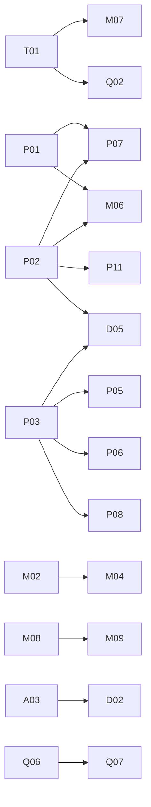

# Vestra next development stages

Draft master issue. Publication awaits approval of the linked ticket breakdown.
This draft uses local IDs; publication substitutes actual issue links and native
hierarchy/blocking relationships.

## Objective and established direction

Make long-form timelines correct first, then improve measured performance,
media scalability, maintainability, quality and developer tooling. Preserve the
working architecture and public contracts; investigate alternatives before
selecting algorithms, new timing modes, formats or platform-specific paths.

## Specs and scope

| Spec | Tickets | P0 | P1 | P2 | P3 |
| --- | --- | --- | --- | --- | --- |
| [Timeline and long-form correctness](spec-timeline.md) | T01–T10 | 10 | 0 | 0 | 0 |
| [Performance measurement and optimization](spec-performance.md) | P01–P11 | 0 | 4 | 5 | 2 |
| [Media pipeline and encoding](spec-media.md) | M01–M10 | 0 | 4 | 3 | 3 |
| [Architecture and maintainability](spec-architecture.md) | A01–A06 | 0 | 3 | 3 | 0 |
| [Correctness and quality](spec-quality.md) | Q01–Q08 | 0 | 5 | 2 | 1 |
| [Python API, tooling and DX](spec-developer-experience.md) | D01–D05 | 0 | 3 | 2 | 0 |
| Total | 50 | 10 | 19 | 15 | 6 |

The six specs plus master add seven coordination/spec issues to the 50 child
tickets: 57 issues in the proposed publication. Eighteen child tickets deliver
implementation/verification and 32 deliver bounded investigation, prototype or
measurement results. A research result is not permission to adopt its approach.

## Startable frontier

Start with T02 (reproduced global-effect timing), T03 (reproduced effective-output
budget mismatch) and T01 (remove default caps while retaining safety). T09 fixes
source-confirmed nested media pointers; T10 extends long-range boundary tests.

P01 captures measurement evidence in parallel. P02/P03 add missing measurement
capabilities. A01/A05, Q01/Q03/Q04/Q05 and D01/D04 can start without waiting for
an umbrella refactor. Coordinate edits to shared validation/backend surfaces.

An unblocked investigation can also start immediately. Priorities order work;
they are not blocking edges. Specs and the master are containers, not gates.

## Genuine dependency graph

All omitted tickets are roots. Edges point from prerequisite to dependent:

M07/Q02 depend on cap removal for real long-run stress. P07/M06 need comparable
baseline/memory evidence. P05/P06/P08 use P03 attribution; P11 uses measured
memory. M04 needs a demonstrated hardware encoder; M09 needs reviewed range
semantics. D02 uses resource ownership decisions; Q07 uses colour requirements;
D05 reports the new memory/profile data. No unrelated feature shares that chain.

## Open decisions and deferred implementation

- T04–T08: transition precision, nested inference, fill-to-end, minimum mode,
  source-end versus effective clipping. Proposals do not silently replace
  existing inherited duration, half-open boundaries or EOF policies.
- M01/M08: exact encoder-control and range APIs. M02–M04: supported hardware
  codec/device/transfer paths. M09/M10: resume identity/reassembly and first
  additional output formats.
- P04–P11: caching, reuse, allocations, scheduling, fusion, ROI, SIMD and
  aggregate resource-policy proposals require evidence before integration.
- A02–A04/A06: only concrete duplication, ownership or IR needs justify a
  refactor. No broad architecture replacement is agreed.
- Q06–Q08: colour, precision/HDR and quality/resampling migration remain open.
- D02/D03: public budget configuration and a minimal editing helper contract.

Every deferred implementation has an owning research ticket. An accepted result
must name the next reviewed slice; a deferred/rejected result records why and
the condition for revisiting it. No speculative production ticket is advertised
as implementation-ready.

## Verification and evidence

The [audit](audit.md) records source inspection, two executed validation defect
reproductions plus cap-policy cases, and 328 passing core tests with one ignored.
No hardware speed or multi-hour correctness claim comes from this planning run.
Each [ticket contract](tickets.md) supplies its own acceptance and verification.

Use existing public validation/inspection/prepared-render, benchmark/report,
rendered-media/ffprobe, descriptor/schema and CPU/WGPU sequence seams. Hardware
claims require actual named hardware; unavailable checks remain unverified.
