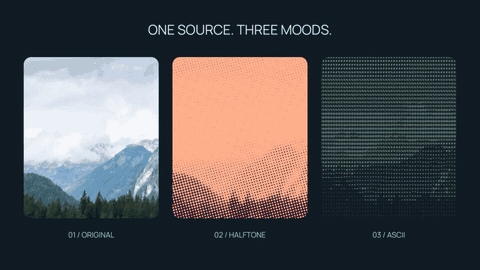
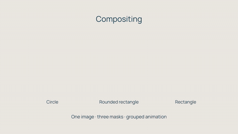

# Showcases

Six complete CPU-rendered compositions, with their Python source, rendered MP4s,
posters, silent animated previews and assets. Each project page displays a
GIF preview directly on GitHub; the MP4 link opens the full video file for download.

<table>
  <tr>
    <td width="50%" align="center" valign="top">
      <strong>Video editing</strong><br><br>
      <a href="real-media-edit/render.mp4"></a>
      <p>Three video clips with animated framing and dissolves.<br><a href="real-media-edit/main.py">Python source</a></p>
    </td>
    <td width="50%" align="center" valign="top">
      <strong>Visual effects</strong><br><br>
      <a href="lookbook/render.mp4"></a>
      <p>A photograph with halftone and ASCII effects.<br><a href="lookbook/main.py">Python source</a></p>
    </td>
  </tr>
  <tr>
    <td width="50%" align="center" valign="top">
      <strong>Audio reactivity</strong><br><br>
      <a href="audio-visualizer/render.mp4"></a>
      <p>Audio signals control a spectrum, ring and particles.<br><a href="audio-visualizer/main.py">Python source</a> · <a href="audio-visualizer/render.mp4">Video with sound</a></p>
    </td>
    <td width="50%" align="center" valign="top">
      <strong>Compositing</strong><br><br>
      <a href="compositing/render.mp4"></a>
      <p>Masks and nested compositions with grouped animation.<br><a href="compositing/main.py">Python source</a></p>
    </td>
  </tr>
</table>

| Project | Render | Source / notes |
| --- | --- | --- |
| README demo | [Watch](readme-demo/render.mp4) | [10 seconds: keyframes, masked footage and audio-driven motion](readme-demo/README.md) |
| README quickstart | [Watch](quickstart/render.mp4) | [3 seconds: an asset-free animated rectangle](quickstart/README.md) |
| Effects lookbook | [Watch](lookbook/render.mp4) | [6 seconds: one photo, halftone and ASCII](lookbook/README.md) |
| Video editing | [Watch](real-media-edit/render.mp4) | [14 seconds: a silent day-to-night Shanghai edit](real-media-edit/README.md) |
| Audio + spectrum | [Watch](audio-visualizer/render.mp4) | [12 seconds: spectrum, audio signals and particles](audio-visualizer/README.md) |
| Masks + groups | [Watch](compositing/render.mp4) | [8 seconds: photo cutouts, masks and grouped animation](compositing/README.md) |

The hero, lookbook and original three showcases are 1280×720 at 30 fps; the quickstart is
640×360 at 30 fps. All are rendered by Vestra itself. Only Audio + spectrum has an audio stream. Each example README records its input sources, licenses and modifications.
Third-party inputs retain their own terms; the software license does not replace them.

From a checkout with FFmpeg/ffprobe and the native package installed:

```bash
uv sync --locked --extra dev
just showcase-smoke                 # full timelines, offline test footage; small quickstart unchanged
just showcase                       # full renders from the bundled real inputs
just showcase-refresh               # regenerate committed MP4s, posters and GIFs
```

Full output goes to the ignored `examples/output/` directory. Smoke output goes
to `target/showcase-smoke/`. The smoke command deliberately substitutes generated
video fixtures in a temporary directory; it never overwrites the licensed inputs
or committed previews. Full rendering uses the real bundled footage.

`just showcase-assets` reproduces the source selections and synthesized audio.
It downloads a checksum-verified original into an ignored cache. A network
connection is only needed to reproduce the original footage, not to render the
checkout. The larger scenes accept `--smoke` and `--output PATH`; the small
quickstart uses fixed settings and writes to the current directory.

Inspect full videos before refreshing committed results. The renderer/probe
checks verify dimensions, frame counts, durations and audio streams; visual
quality and attribution still need human review. Codec bytes can vary with the
FFmpeg version even when the project and source inputs are unchanged.

The documentation quickstart is also checked against the code in the tutorial, so the
copy-paste example and its committed result share the same scene.

Full showcase MP4s use 1280×720 / 30 fps and the high quality tier (libx264
CRF 18 / medium); the small Python quickstart retains its 640×360 / 30 fps
balanced output. GIFs use 20 fps, 128 colours and a 480 px width (800 px for the
hero’s standalone project page). The media-edit GIF uses 400 px and 96 colours
to keep the moving footage reasonably small. It shows seconds 3.5–7.5, with
short fades at its ends; the linked MP4 is the complete
fourteen-second edit. GIF previews intentionally omit audio.

## Shared font

All five larger scenes use `assets/Manrope.ttf`, Copyright 2018 The Manrope
Project Authors (https://github.com/googlefonts/manrope). The unmodified variable
font was renamed on disk. Its complete [SIL OFL 1.1](assets/Manrope-OFL.txt)
accompanies the bundled file; retain that copyright notice and license when
redistributing the font. Videos and posters display rendered text and do not
redistribute the font file.

The font comes from [Google Fonts revision b31870a](https://github.com/google/fonts/tree/b31870aff700ab7a1d74fa0c6887d95beb9e0037/ofl/manrope).
To reproduce it from the repository root:

```bash
curl -fL https://raw.githubusercontent.com/google/fonts/b31870aff700ab7a1d74fa0c6887d95beb9e0037/ofl/manrope/Manrope%5Bwght%5D.ttf -o target/Manrope.ttf
echo '3ae11c49db0455a3cc33e37d380f20fdb8c7f8b41dc07625c177e3d87a9d6ae6  target/Manrope.ttf' | sha256sum --check
```

The checked-in file has that same checksum. Keep the accompanying OFL copy
with it rather than substituting an external link.

## Prepare shared inputs

The bundled inputs are sufficient to render offline. To regenerate footage and
synthesized audio, run `just showcase-assets` from the repository root. It verifies
the downloaded original by checksum, keeps the larger source under
`target/showcase-sources/`, and replaces the three footage selections and audio
under `assets/`. To regenerate only the synth, use
`uv run python examples/showcase/prepare-assets.py --audio-only`.

The [video edit](real-media-edit/README.md#footage-source) records footage terms,
selection times and the original checksum. The [photo cutouts](compositing/README.md#photo-source)
record the photograph and its preparation; the [audio visualizer](audio-visualizer/README.md#credits)
records the original synth dedication. The preparation script fails on a missing
or changed source, a checksum mismatch or an FFmpeg error. Encoding bytes can vary
with FFmpeg versions.
