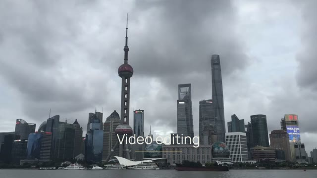
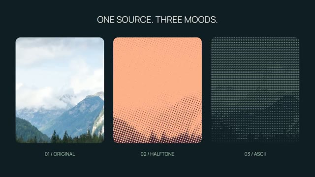
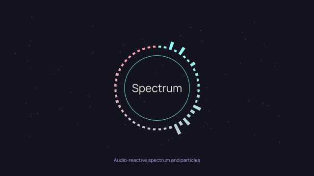
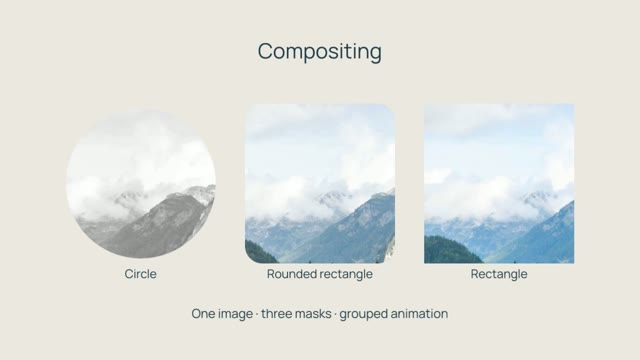
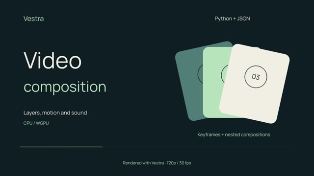

# Showcases

Open a preview for the animated version, run command and credits.

<table>
  <tr>
    <td width="50%" valign="top">
      <a href="real-media-edit/README.md"></a><br>
      <strong>Video editing</strong><br>
      Three shots with animated framing and dissolves.<br>
      <a href="real-media-edit/main.py">Python</a> · <a href="real-media-edit/render.mp4">MP4</a>
    </td>
    <td width="50%" valign="top">
      <a href="lookbook/README.md"></a><br>
      <strong>Visual effects</strong><br>
      One photo with halftone and ASCII treatments.<br>
      <a href="lookbook/main.py">Python</a> · <a href="lookbook/render.mp4">MP4</a>
    </td>
  </tr>
  <tr>
    <td width="50%" valign="top">
      <a href="audio-visualizer/README.md"></a><br>
      <strong>Audio reactivity</strong><br>
      A synth track drives a spectrum, halo and particles.<br>
      <a href="audio-visualizer/main.py">Python</a> · <a href="audio-visualizer/render.mp4">MP4 with sound</a>
    </td>
    <td width="50%" valign="top">
      <a href="compositing/README.md"></a><br>
      <strong>Compositing</strong><br>
      Photo cutouts with masks and grouped animation.<br>
      <a href="compositing/main.py">Python</a> · <a href="compositing/render.mp4">MP4</a>
    </td>
  </tr>
  <tr>
    <td width="50%" valign="top">
      <a href="readme-demo/README.md"></a><br>
      <strong>Motion design</strong><br>
      Nested cards, masked footage and audio-driven motion.<br>
      <a href="readme-demo/main.py">Python</a> · <a href="readme-demo/render.mp4">MP4</a>
    </td>
    <td width="50%" valign="top">
      <a href="quickstart/README.md"></a><br>
      <strong>First animation</strong><br>
      An asset-free shape with eased keyframes.<br>
      <a href="quickstart/main.py">Python</a> · <a href="quickstart/render.mp4">MP4</a>
    </td>
  </tr>
</table>

See also the [README reel](readme-hero/README.md) and [stylized effects recipes](stylized-effects/README.md).

## Render from source

Run from the repository root with `ffmpeg` and `ffprobe` on your PATH. [Checkout setup](../../CONTRIBUTING.md#2-set-up-a-checkout)

```bash
just showcase
```

Renders go to `examples/output/`. Use `just showcase-smoke` for quick renders
with test footage in `target/showcase-smoke/`. To replace the committed MP4s,
posters and GIFs, run `just showcase-refresh` and inspect the results.

## Shared font

Manrope © 2018 The Manrope Project Authors. The unmodified variable font was
renamed to `Manrope.ttf`. Keep the accompanying [SIL OFL 1.1 and copyright notice](../../assets/fonts/Manrope-OFL.txt)
when redistributing the font. [Font source at Google Fonts revision b31870a](https://github.com/google/fonts/tree/b31870aff700ab7a1d74fa0c6887d95beb9e0037/ofl/manrope)

<details>
<summary>Download and verify Manrope</summary>

```bash
mkdir -p target
curl -fL https://raw.githubusercontent.com/google/fonts/b31870aff700ab7a1d74fa0c6887d95beb9e0037/ofl/manrope/Manrope%5Bwght%5D.ttf -o target/Manrope.ttf
echo '3ae11c49db0455a3cc33e37d380f20fdb8c7f8b41dc07625c177e3d87a9d6ae6  target/Manrope.ttf' | sha256sum --check
```

</details>

## Prepare shared inputs

The footage and synth are bundled. Run `just showcase-assets` to check the
footage and regenerate the synth. [Footage sources](../../assets/footage/README.md) · [Synth credits](audio-visualizer/README.md#credits)
