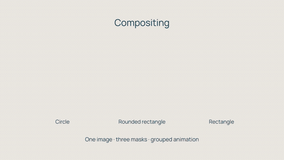

# Photo cutouts with masks and groups

[Watch / download the rendered video](render.mp4)



An eight-second example of one photograph composited through three geometric
masks: a circle, a rounded rectangle and a rectangle. Each nested group moves
as a unit while its image zooms independently; different saturation settings
make the treatments easy to compare. The output is silent.

From the checkout after `uv sync --locked --extra dev`:

```bash
uv run python examples/showcase/compositing/main.py
```

Output: `examples/output/compositing.mp4`, 1280×720, 30 fps, 8 seconds, CPU.
Pass `--smoke` for the full timeline at 320×180 and 6 fps, or `--output PATH`.
The OFL font and CC0 photograph are bundled; no downloads are needed.
See the sources below and the [shared Manrope notice](../README.md#shared-font).

## Photo source

`assets/landscape.jpg` is a derivative of “Landscape in Salzburger Land” by
Dimitry Anikin, from [Wikimedia Commons](https://commons.wikimedia.org/wiki/File:Landscape_in_Salzburger_Land.jpg),
dedicated to [CC0 1.0](https://creativecommons.org/publicdomain/zero/1.0/).
The Commons license statement was checked on 2026-11-06. Credit is useful
provenance; CC0 does not require attribution. The image was resized to 1600 px
wide, JPEG re-encoded and stripped of metadata. This scene crops, zooms, masks
and adjusts saturation; the [lookbook](../lookbook/README.md) also applies effects.

Download the [original photograph](https://upload.wikimedia.org/wikipedia/commons/e/e5/Landscape_in_Salzburger_Land.jpg)
as `target/landscape-original.jpg`. Its SHA-256 is
`6936f552123608df0552d3b3ddaaeabdff3ed233e669b04676ac8078d6c0aad6`.
After checking it, reproduce the bundled derivative from the repository root:

```bash
ffmpeg -i target/landscape-original.jpg -vf scale=1600:-1 -map_metadata -1 -q:v 3 target/landscape.jpg
```

Encoding bytes may vary with FFmpeg versions. Graphics and example code are MIT
licensed. The [Manrope license copy](../assets/Manrope-OFL.txt) stays with the font;
rendered text in the video does not redistribute that font file.
