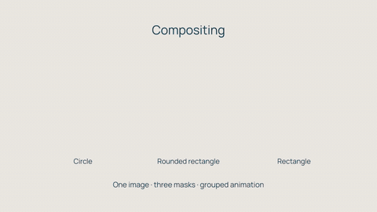

# Photo cutouts with masks and groups

[Full video](render.mp4) · [Python source](main.py)



One photo appears through three masks. Each group moves as a unit while its
photo zooms independently.

## Render

Run this from a [development checkout](../../../CONTRIBUTING.md#2-set-up-a-checkout).

```bash
uv run python examples/showcase/compositing/main.py
```

Writes `examples/output/compositing.mp4` (8 seconds, silent). Add `--smoke` for a
quick preview or `--output PATH` to choose the destination.

## Photo source

The scene crops, zooms, masks and adjusts saturation on Dimitry Anikin's
“Landscape in Salzburger Land” (CC0). The bundled photo record gives the
original source, checksum and prep command. [Photo credits](../../../assets/images/README.md) · [Manrope font credits](../README.md#shared-font)
