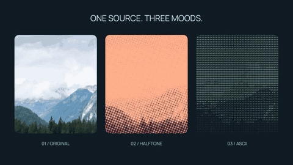

# Photo, halftone and ASCII

[Watch the MP4](render.mp4) · [Python source](main.py)



One bundled CC0 landscape becomes three coordinated panels: the original
photograph, warm halftone and mint ASCII. Each panel uses the same eased zoom;
a rounded group mask keeps the crop consistent. All effects, masks, animation
and text are rendered by Vestra, with no postproduction compositing.

From the repository root after `uv sync --locked --extra dev`, with FFmpeg and
ffprobe on `PATH`:

```bash
uv run python examples/showcase/lookbook/main.py
```

Output: `examples/output/lookbook.mp4`, 1280×720, 30 fps, six seconds, CPU, silent.
Use `--smoke` for 320×180 at 6 fps or `--output PATH` for another destination.
`just showcase-refresh` regenerates the committed MP4, poster and GIF.

The photo is by Dimitry Anikin (CC0); headings use Manrope (OFL). ASCII uses
Vestra's bundled DejaVu face. See the credits below and [software notices](../../../THIRD_PARTY_NOTICES.md). Source code and original
layout are MIT licensed.

## Credits

The [photo cutout example](../compositing/README.md#photo-source) records the
Commons source, CC0 dedication, original checksum and resizing command for
Dimitry Anikin's “Landscape in Salzburger Land”. This scene crops and animates
that derivative and applies halftone and ASCII effects. Credit is provenance;
CC0 does not require attribution.

Manrope's [copyright and complete SIL OFL 1.1 copy](../README.md#shared-font)
accompany the bundled font. ASCII uses the embedded DejaVu-derived VestraTest
face; its complete [Bitstream Vera/DejaVu notice](../../../crates/vestra-render-common/assets/DejaVuSans.LICENSE)
and [distribution copy](../../../licenses/DejaVuSans.txt) remain in place.
Preserve the applicable notices when distributing font files. Rendered glyphs
in the preview do not redistribute those files.
