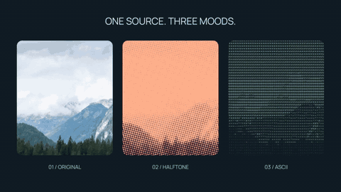

# Photo, halftone and ASCII

[Full video](render.mp4) · [Python source](main.py)



Three panels share the same zoom and rounded crop, so you can see what each
effect does to the same photo.

## Render

Run this from a [development checkout](../../../CONTRIBUTING.md#2-set-up-a-checkout).

```bash
uv run python examples/showcase/lookbook/main.py
```

Writes `examples/output/lookbook.mp4` (6 seconds, silent). Add `--smoke` for a
quick preview or `--output PATH` to choose the destination.

## Credits

The scene crops and animates Dimitry Anikin's landscape (CC0) and applies
halftone and ASCII. Headings use Manrope (SIL OFL 1.1). ASCII uses the bundled
DejaVu-derived face. [Photo credits](../compositing/README.md#photo-source) · [Manrope font credits](../README.md#shared-font) · [DejaVu notice](../../../crates/vestra-render-common/assets/DejaVuSans.LICENSE)
