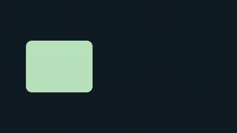

# First animation

[Full video](render.mp4) · [Python source](main.py) · [Tutorial](../../../docs/getting-started/first-animation.md)



An asset-free, three-second loop. Position keyframes slide a rounded rectangle
across the screen and bring it back to its starting point.

## Render

Run from the repository root with Vestra and FFmpeg installed.

```bash
uv run python examples/showcase/quickstart/main.py
```

Writes `quickstart.mp4` to the current directory and replaces it on rerun.
The graphics and code are original MIT-licensed work.
