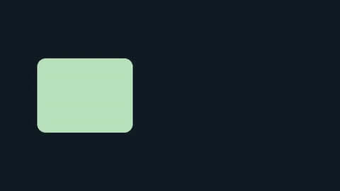

# README quickstart

[Python source](main.py) · [Rendered MP4](render.mp4) · [Tutorial](../../../docs/getting-started/python-quickstart.md)



This is the README's complete scene: three rounded rectangles, one background
and rotation keyframes. No media, font, GPU or download is needed.

From the repository root, with Vestra and FFmpeg installed:

```bash
uv run python examples/showcase/quickstart/main.py
```

Writes `quickstart.mp4` to the current directory (and replaces it on a rerun).
The output is 640×360, 30 fps, three seconds and silent. The MP4 is the actual
CPU render; the GIF is a reduced-frame-rate preview of it. The authored angles
return to their initial values at three seconds for a looping preview.

`just showcase-refresh` renders this scene and refreshes its committed MP4,
poster and GIF along with the other showcases. `just showcase-smoke` also
renders and probes this small scene at its original resolution and frame rate.
All graphics are original MIT-licensed project work.
