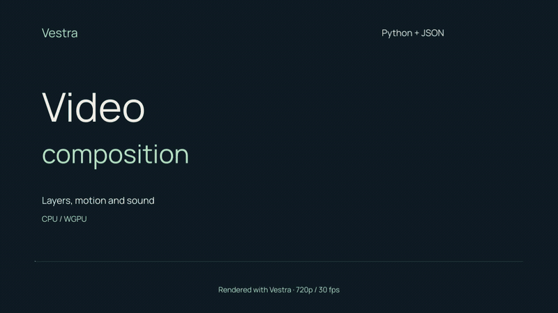

# Video composition showcase

[Full video](render.mp4) · [Python source](main.py)



Nested cards move together, valley footage rotates through a mask and turns
into a dithered image, and a radial spectrum responds to the synth loop.

## Render

Run this from a [development checkout](../../../CONTRIBUTING.md#2-set-up-a-checkout).

```bash
uv run python examples/showcase/readme-demo/main.py
```

Writes `examples/output/readme-demo.mp4` (10 seconds, silent). The synth stays
in the analysis mix with `output_audio=False`. Add `--smoke` for a quick
preview or `--output PATH` to choose the destination.

## Credits

The scene scales, masks, rotates and dithers the bundled valley clip. The CC0
synth loop drives the spectrum, and the labels use Manrope.
[Footage credits](../../../assets/footage/README.md) · [Synth credits](../audio-visualizer/README.md#credits) · [Manrope font credits](../README.md#shared-font) · [Earlier CC BY footage credits](../real-media-edit/README.md#earlier-footage-copies)

See the [gallery page](../../../docs/gallery/motion-design.md#preview-details) for
the source render checksum and delivery preview instructions.
