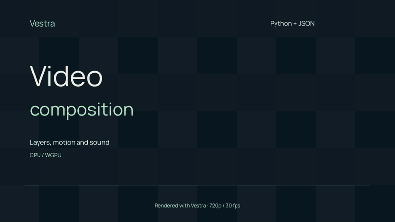

# Video composition showcase

[Watch / download the silent video](render.mp4) · [Python source](main.py)



The README's ten-second hero is itself a Vestra composition, including all text:

- Rounded cards and their inset labels move together in nested compositions.
- Blue-hour Shanghai footage plays through a rotating mask, then becomes a
  four-colour Bayer-dithered image.
- A radial spectrum and RMS-driven ring respond to the bundled synth recording.

Python and JSON share the top label; scene captions explain the changing visual.
The synth remains in the analysis mix, with `output_audio=False` suppressing the
exported audio track. No audio is added or stripped in a separate encoding step.
All inputs are bundled; no download is needed. Sources, licenses and preparation are linked under [Credits](#credits).

```bash
uv sync --locked --extra dev
uv run python examples/showcase/readme-demo/main.py
```

Output: `examples/output/readme-demo.mp4`, 1280×720, 30 fps, 10 seconds, CPU, no audio.
Use `--smoke` for the same timeline at 320×180 and 6 fps, or `--output PATH`.
`just showcase-refresh` regenerates committed videos, posters and animated previews.

The root README displays `preview.gif` and links to the complete repository MP4.
When the scene changes, refresh the render, poster and GIF together, inspect the
result and update the render checksum below. The source layout and comments can
be cleaned up without regenerating an unchanged scene.

<details>
<summary>Published hero checksums (SHA-256)</summary>

```text
38b6d16c31f5580578029ff5f4613a20e10a7883965bcadec9231892bf9e752e  render.mp4
```

</details>

## Credits

The [video edit's footage record](../real-media-edit/README.md#footage-source)
identifies Yigang Yu's CC0 Shanghai timelapse, original links, checksum and
five-second selections. This scene uses `city-2.mp4`, then scales, masks,
rotates and dithers it. The original audio is removed.

The [audio visualizer](../audio-visualizer/README.md#credits) records the original
CC0 synth loop, generated by Vestra contributors. Here it drives analysis only;
the exported MP4 is silent. The [shared Manrope notice](../README.md#shared-font)
records the font's copyright, source and complete OFL copy. The video displays
rendered text rather than redistributing a font file. Original composition and
code are MIT licensed. [Earlier CC BY footage copies](../real-media-edit/README.md#earlier-footage-copies)
retain their attribution requirements.
